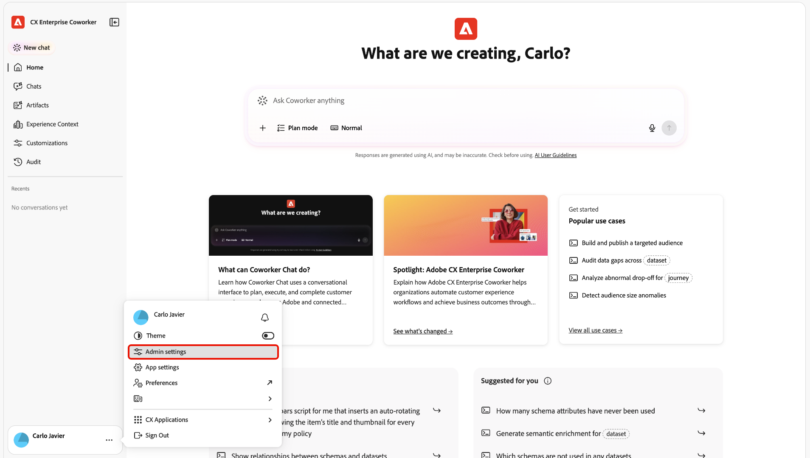
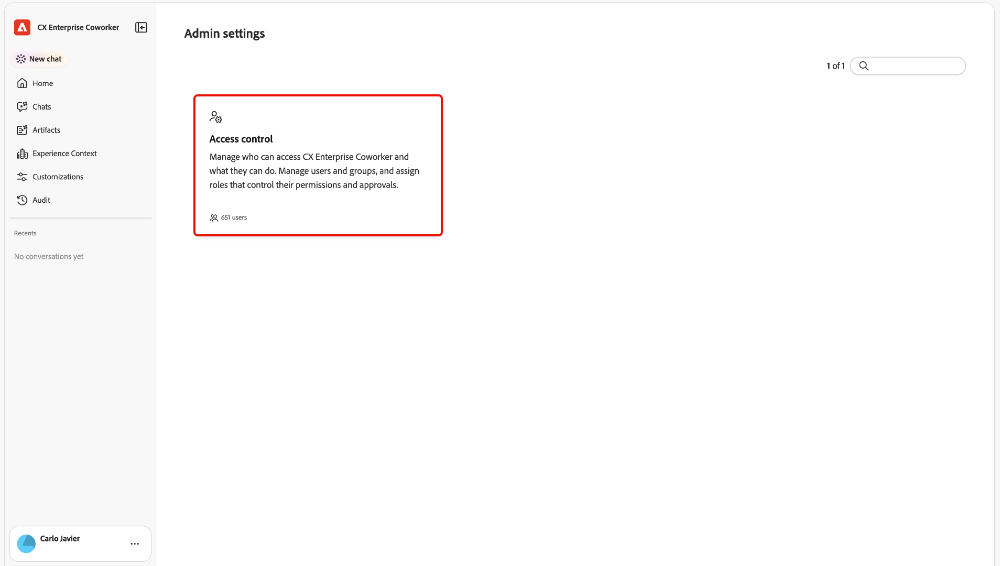

# Access control for Coworker {#access-control}

Use Adobe CX Enterprise Coworker access control to manage who can use Coworker and which capabilities they can use.

>[!NOTE]
>
>Your organization must be enabled for Coworker to use this feature. For more information, see the [Coworker Chat overview](https://experienceleague.adobe.com/en/docs/coworker/content/chat/overview).

## How access is determined {#how-access-is-determined}

Coworker access is controlled by an organization-wide setting and optional user or group overrides. The organization-wide setting enables or disables Coworker access for users in your organization. Access is enabled for everyone by default.

| Setting | How it affects access |
| --- | --- |
| Organization-wide setting | Enable Coworker access for everyone or disable it for your organization. |
| User or user group override | Overrides give administrators control over Coworker access for specific users or user groups. |
| Compatible application permissions | Coworker access controls determine whether you can access any generally available Coworker capabilities. Coworker inherits your user permissions from Coworker-compatible CX Enterprise applications and respects the permissions each application already enforces. |

## Add Coworker administrators {#add-coworker-admins}

A Coworker administrator is a user assigned the **[!UICONTROL Product Admin]** role for [!DNL Adobe Experience Platform] in [!DNL Adobe Admin Console].

Use this video to learn how to add Coworker admins.

>[!VIDEO](https://video.tv.adobe.com/v/3507041?learn=on){transcript=true}

## Manage user access {#manage-user-access}

1. Open the Coworker experience. For instructions, see [Sign in to Coworker](/help/chat/ui-guide.md#sign-in).
2. Open the profile menu and select **[!UICONTROL Admin settings]**.

   

   

3. Select **[!UICONTROL Access control]**.

   

   Use this video to learn how to manage Coworker users.

   >[!VIDEO](https://video.tv.adobe.com/v/3507151?learn=on){transcript=true}

4. In Coworker, use **[!UICONTROL Users]** to manage access for individuals, or **[!UICONTROL User groups]** to manage Coworker access for groups of users. A user group setting applies to its members.

   Coworker user groups are separate from [!DNL Adobe Admin Console] groups. Syncing user groups from [!DNL Adobe Admin Console] to Coworker is coming soon.

   The Users list includes users in your organization. Coworker access is enabled for these users by default.

   * **Enabled:** The user or user group is active.
   * **Disabled:** The user or user group is inactive.

   When access for everyone is disabled, turn on **[!UICONTROL Allow overrides]** and select **[!UICONTROL Add override]** to add users or groups who should still have access.

## Permissions in compatible applications {#permissions-in-compatible-applications}

Coworker-compatible CX Enterprise applications continue to enforce their own permissions.

Coworker respects permissions in compatible applications. For example, if you cannot access a dataset in [!DNL Adobe Experience Platform], Coworker cannot retrieve or act on that dataset for you.

## Get help with access {#get-help-with-access}

If you do not see [!UICONTROL Access control], contact your Adobe administrator or Adobe representative. They can confirm whether the feature is enabled for your organization and whether you have access to its settings.

If you are denied access, ask your administrator to review the organization-wide default and any user or group settings. For a Coworker-compatible CX Enterprise application, ask them to check the permissions managed separately for that application.

## More help on this topic {#more-help}

Use these resources for more information about Coworker and administration.

* [Coworker Chat overview](/help/chat/overview.md)
* [Get started with Coworker Chat](/help/chat/ui-guide.md)
* [Manage plugins and marketplaces](/help/customizations/plugins/manage-plugins-for-your-org.md)
