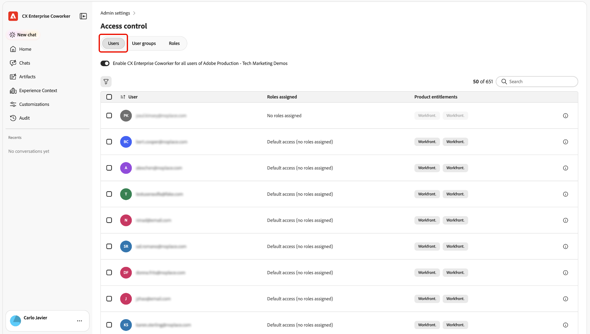
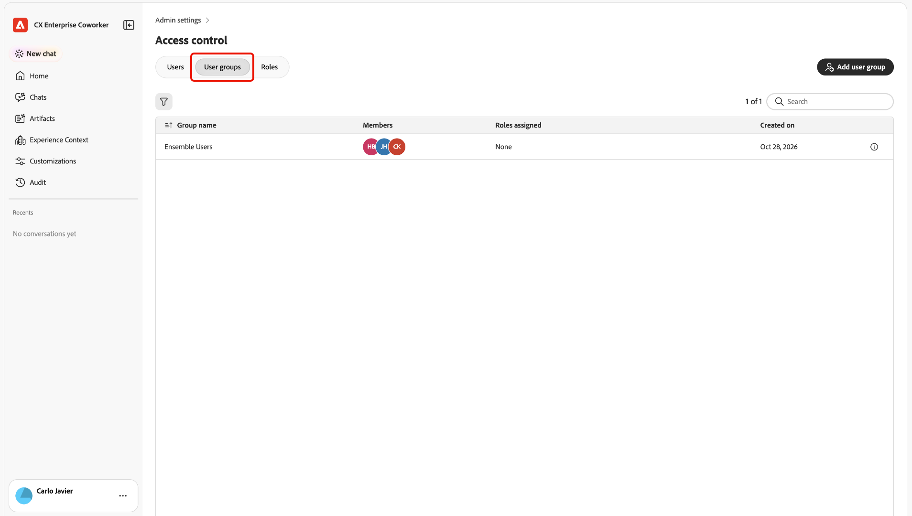
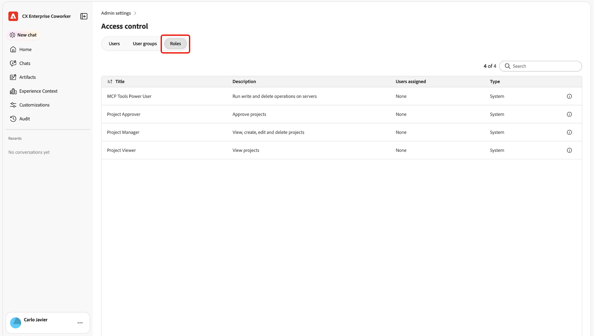
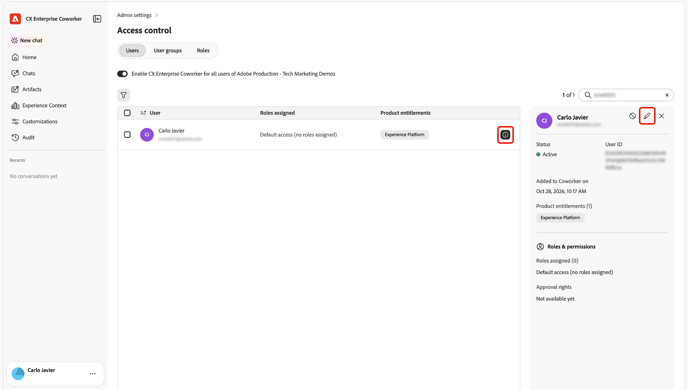
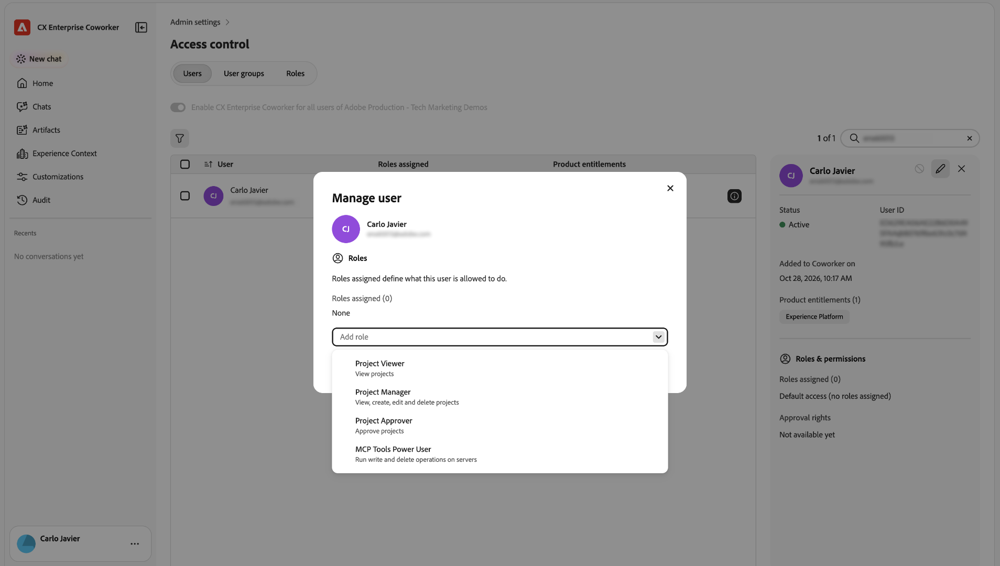

# Access control for Coworker {#access-control}

Use Adobe CX Enterprise Coworker access control to manage who can use Coworker and which capabilities they can use. Available settings and roles may vary by organization.

## How access is determined {#how-access-is-determined}

Coworker access works alongside permissions in the Adobe products you connect to. Administrators manage Coworker access for users and groups and assign available roles.

| Access type | What it determines |
| --- | --- |
| Coworker access | Whether a user or group can use Coworker. |
| Coworker roles | Which Coworker capabilities or tools a user can use. |
| Connected application permissions | Which data and actions a user can access in connected Adobe products. Coworker does not grant additional product permissions. |
| Coworker Projects access | Whether a user can access Coworker Projects. Access to Coworker Chat does not automatically grant Projects access. |

A user who can open Coworker might still need additional permissions for a connected application or a specific Coworker capability.

## Manage access {#manage-access}

If access control settings are available to you in your organization, use them to review and manage Coworker access.

1. Open the standalone Coworker experience. For instructions, see [Sign in to Coworker](/help/chat/ui-guide.md#sign-in).
1. Open the profile menu and select **[!UICONTROL Admin settings]**.

   

   

1. Select **[!UICONTROL Access control]**.

   

1. Use **[!UICONTROL Users]** and **[!UICONTROL User groups]** to review access and make changes.

   

   

1. Select **[!UICONTROL Roles]** to review available roles and their descriptions.

   

1. In **[!UICONTROL Users]**, open a user's details, then edit their role assignments.

   

1. In **[!UICONTROL Manage user]**, select **[!UICONTROL Add role]** and choose an available role.

   

1. Enable or disable access as needed.

Use the role descriptions displayed in your Coworker environment to choose the appropriate access. Grant only the access users need.

## Connected application permissions {#connected-application-permissions}

Connected Adobe products continue to enforce their own permissions. These products include Adobe Experience Platform, Adobe Journey Optimizer, [!DNL Adobe Workfront], and [!DNL Adobe Experience Manager].

If you cannot perform an action in a connected product, using Coworker does not grant you that permission.

In [!DNL Workfront], access levels, object permissions, and system preferences may also affect the Coworker panel and available actions. For details, see [Use CX Enterprise Coworker in Workfront](https://experienceleague.adobe.com/en/docs/workfront/using/basics/coworker-in-workfront/use-coworker-in-workfront){target="_blank"}.

## Get help with access {#get-help-with-access}

If you do not see [!UICONTROL Access control], contact your Adobe administrator or Adobe representative. They can confirm whether the feature is enabled for your organization and whether you have access to its settings.

If you are denied access, ask your administrator to review your Coworker access and assigned roles. For a connected application or Coworker Projects, ask them to check the permissions managed separately for that application or experience.

## More help on this topic {#more-help}

Use these resources for more information about Coworker and administration.

* [Coworker Chat overview](/help/chat/overview.md)
* [Get started with Coworker Chat](/help/chat/ui-guide.md)
* [Manage plugins and marketplaces](/help/customizations/plugins/manage-plugins-for-your-org.md)
