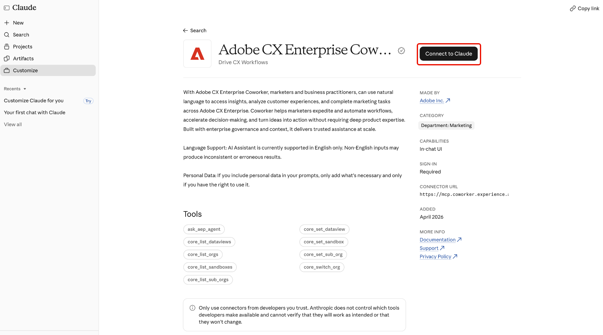

# Adobe CX Enterprise Coworker for AI Platforms

Use Adobe CX Enterprise Coworker for AI Platforms to get marketing insights in the AI tools you already use. Ask questions in natural language without switching tools. Find the product listed as Adobe CX Enterprise Coworker in each platform.

Find available platforms and their setup instructions in [Set up Coworker](#set-up-coworker).

There's no additional cost to use Coworker in AI platforms. It's included in your CX Enterprise Coworker license, and usage draws from the same AI credits as other Coworker features. For more information, see [Adobe Experience Platform agent jobs and AI credits consumption](https://experienceleague.adobe.com/en/docs/cx-enterprise-ai/experience-cloud-ai/overview/ai-credit-consumption){target="_blank"}.

<!-- TODO: architecture diagram pending from engineering. KT page notes "to be provided on 8/28"; still outstanding as of 8/31. Insert here once received. -->

## Prerequisites {#prerequisites}

Before you can use Coworker in an AI platform, confirm you have the following.

* Adobe CX Enterprise Coworker provisioned for your organization, and your own access to it in Adobe.
* Adobe Experience Platform and at least one of Adobe Real-Time CDP, Adobe Journey Optimizer, or Adobe Customer Journey Analytics.
* Access to an AI platform listed in [Set up Coworker](#set-up-coworker).

## Data access and permissions {#data-access-and-permissions}

Coworker in AI platforms reflects the same data and access level tied to your Adobe identity. What you can query and see matches what you're already entitled to in Experience Platform and its associated solutions. Coworker inherits those permissions, so no separate permissions setup is required for the AI platform integration. Coworker returns read-only insights and does not modify your customer data. Review any generated summaries and analyses before you use them to make business decisions.

<!-- Confirmed by PM (Siddhartha Srivastava) on 2026-09-02 for Microsoft 365 Copilot, Claude, and ChatGPT. Validate this permissions model for each additional platform before adding its setup tab. -->

## Key use cases {#key-use-cases}

Use Coworker in AI platforms to speed up common marketing workflows without leaving your everyday tools.

| Use case | Description |
| --- | --- |
| Plan and review campaigns | Plan campaigns, including partner campaign reviews and audience forecasting. Compare campaign performance over time and identify which touchpoints drive conversions. |
| Monitor journeys and campaign readiness | Review and monitor active campaigns, analyze customer journeys, and assess campaign readiness. Track journey performance and drop-offs to pinpoint opportunities for optimization. |
| Retrieve operational insights | Identify which audiences are largest or most engaged so you can prioritize where to focus your efforts, and track how your segments grow or shrink over time. |
| Optimize workflows and content | Optimize workflows and identify asset and content needs for CX campaigns. Generate visual reports on campaign performance without manually building queries or dashboards. |
| Collaborate and decide faster | Use suggested prompts to explore audiences, campaigns, and web traffic. Share insights with your team during planning meetings, and answer ad hoc questions in real time while reviewing plans or decks. |

<!-- Use cases approved by PM Siddhartha Srivastava on 2026-08-31 and confirmed for Microsoft 365 Copilot, Claude, and ChatGPT on 2026-09-02. Validate applicability for each additional platform before adding its setup tab. -->

## Set up Coworker {#set-up-coworker}

Select an available platform for setup instructions. After setup, try the [example prompts](#example-prompts).

>[!BEGINTABS]

>[!TAB Microsoft 365 Copilot]

Use [!DNL Adobe CX Enterprise Coworker for Copilot] to get marketing insights in [!DNL Microsoft 365 Copilot].

Before you begin, confirm you have access to [!DNL Microsoft 365 Copilot].

**Set up Coworker for your organization**

An administrator must complete these steps before end users can access Coworker in [!DNL Microsoft 365 Copilot].

1. In the [!DNL Microsoft 365 admin center], confirm that your tenant settings allow apps and agents built by external publishers.
1. Approve **[!UICONTROL Adobe CX Enterprise Coworker]** in both the [!DNL Microsoft 365 admin center] and the [!DNL Teams admin center]. You can typically find the agent through the [!DNL Microsoft Commercial Marketplace] or your organization's **[!UICONTROL Integrated Apps]** list.
1. Deploy the agent to end users. You can deploy it to specific users or groups, or to your entire organization. The number of users you enable does not affect setup or cost.

>[!NOTE]
>
>If [!DNL Microsoft] releases an update to Coworker that requires new permissions, your administrator must approve the update in the [!DNL Agent Registry] before it rolls out to your users.

**Access Coworker in [!DNL Copilot]**

Once your administrator enables Coworker, you can access it across [!DNL Microsoft 365 Copilot] surfaces, including [!DNL Teams], [!DNL Word], [!DNL Excel], [!DNL PowerPoint], and web chat.

In [!DNL Microsoft 365 Copilot], select **[!UICONTROL Agents]**, then select **[!UICONTROL More agents]**.

Next, select **[!UICONTROL Adobe CX Enterprise Coworker]** in the agent catalog.

Finally, select **[!UICONTROL Add]** to add Coworker to your agents.

>[!TAB ChatGPT]

Use [!DNL Adobe CX Enterprise Coworker for ChatGPT] to get marketing insights in [!DNL ChatGPT].

Before you begin, confirm you have access to [!DNL ChatGPT].

**Set up Coworker for your organization**

* Ask your [!DNL ChatGPT] administrator to approve **[!UICONTROL Adobe CX Enterprise Coworker]** for selected users or your entire organization.

**Access Coworker in [!DNL ChatGPT]**

In [!DNL ChatGPT], select **[!UICONTROL Plugins]**.

Next, find and select **[!UICONTROL Adobe CX Enterprise Coworker]** in the plugin catalog.

Finally, select **[!UICONTROL Install plugin]** to add Coworker to [!DNL ChatGPT].

>[!TAB Claude]

Use Coworker to get marketing insights in [!DNL Claude].

Before you begin, confirm you have access to [!DNL Claude].

**Set up Coworker for your organization**

* Ask your [!DNL Claude] administrator to approve **[!UICONTROL Adobe CX Enterprise Coworker]** for selected users or your entire organization.

**Access Coworker in [!DNL Claude]**

1. In [!DNL Claude], select **[!UICONTROL Customize]**.

   

1. Select **[!UICONTROL Connectors]**, then **[!UICONTROL Discover]**, and use **[!UICONTROL Search]** to find Adobe CX Enterprise Coworker.

   

1. Select **[!UICONTROL Adobe CX Enterprise Coworker]**, then select **[!UICONTROL Connect to Claude]**.

   

1. Sign in with your Adobe credentials to connect Coworker to [!DNL Claude].

>[!ENDTABS]

<!-- Setup steps above reflect the real customer-facing flow confirmed by PM (Siddhartha Srivastava) on 2026-09-02: an org admin approves the connector or plugin, then end users find and add it in their platform's catalog and sign in. The previous version of this file described a manual MCP-connector setup for ChatGPT (Settings > Connectors > paste server URL) -- PM clarified that flow is for internal testing only, not the customer path, so it was removed here. -->

## Example prompts {#example-prompts}

After you set up Coworker in a supported platform, try these prompts, or write your own in natural language.

* Show your top five audiences.
* Show a metric for the last month.
* Show your active Workfront projects.
* Show journeys with loyalty audiences.

## Known limitations {#known-limitations}

Coworker in AI platforms does not support every integration pattern.

* You cannot connect Coworker to your own agentic harness using MCP.

## Troubleshoot Coworker in AI platforms {#troubleshoot}

Try these steps if you run into issues using Coworker in an AI platform.

* If you see an error, sign out and sign in again with your Adobe credentials. Re-authenticating resolves most issues.
* If you cannot access Coworker or specific data, contact your Adobe administrator to confirm your product access and permissions.

<!--
Editorial maintenance, 2026-10-27:
Only approved platforms with validated setup guidance belong in the rendered tab set.
Remaining platforms to add: Gemini, Amazon Quick, IBM, and Databricks.

To add an approved platform:
* Confirm approval and obtain access to the customer flow.
* Validate prerequisites, organization approval, catalog discovery, listing name, installation, and Adobe sign-in.
* Confirm the shared licensing, permissions, use cases, prompts, limitations, and troubleshooting guidance applies.
* Add one tab before ENDTABS, following the existing order: introduction, platform prerequisites, organization setup, and user access.
* Document any platform-specific requirements or exceptions within that tab.
* Preview the tab and verify its links and image references.
Keep the introduction, metadata, and shared prerequisites free of platform lists so adding a tab does not require duplicate updates.

Gemini draft scope:
No setup steps are confirmed. Validate the complete customer flow and all shared guidance before adding the tab.
Do not infer the flow from another platform.
-->
