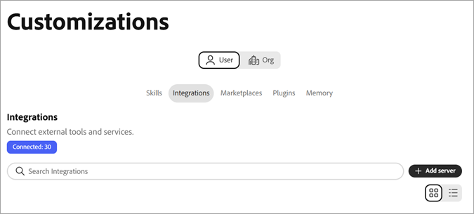

# Get started with Coworker Chat {#ui-guide}

Coworker Chat lets you work with your Adobe CX Enterprise data and tools by asking for what you need in plain language. Use this page to open Coworker Chat, send your first message, and set it up the way you work.

>[!VIDEO](https://video.tv.adobe.com/v/3498558?learn=on)

## Availability

Coworker Chat is available as an immersive experience, a full-page workspace, and as an in-product experience in some CX Enterprise applications. To open the in-product experience, click the Coworker icon  at the top right of the application.

The following table shows where each experience is available.

| CX Enterprise application | Immersive experience | In-product experience |
|---|---|---|
| Real-Time CDP | Available now | Coming soon |
| Adobe Journey Optimizer | Available now | Coming soon |
| Customer Journey Analytics | Available now | Coming soon |
| Workfront | Available now | Coming soon:  * Early September 2026 in Preview instance for select eligible Workfront system administrators  * Mid September 2026 in Production instance for eligible fast release Workfront customers  * Mid October 2026 in Production instance for eligible quarterly release Workfront customers |
| Target | Available now | Available now |
| AEM | Available now | Available now |
| Marketo Engage | Available now | Coming soon |

## Open Coworker Chat {#immersive}

To use the immersive experience, sign in with your Adobe credentials. You can open it from a direct link or from within CX Enterprise.

1. Go to [https://experience.adobe.com/#/coworker](https://experience.adobe.com/#/coworker).
1. Sign in with your Adobe ID.

Alternatively, click **[!UICONTROL Coworker]** in the application selector in the CX Enterprise header.

## Choose your organization

Your [organization](https://experienceleague.adobe.com/en/docs/core-services/interface/administration/organizations) and sandbox determine which data, skills, and connected tools a conversation can reach. Check them before you start. Your current context appears at the bottom of the left navigation rail, under your name.

To change your context:

1. Click your name at the bottom of the navigation rail to open the account menu.
1. Click **[!UICONTROL Organization]** and choose the IMS organization you want to work in.

   

1. Clidk **[!UICONTROL Sandbox]** and choose the AEP sandbox you want to work in.

   

The account menu also includes the following options:

| Option | Use it to |
| --- | --- |
| **[!UICONTROL Theme]** | Switch between the Light and Dark themes. |
| **[!UICONTROL Settings]** | View account details and workspace settings. |
| **[!UICONTROL CX Applications]** | Go to another CX Enterprise application connected to your account. |
| **[!UICONTROL Sign Out]** | Sign out of your Adobe account. |

## Find your way around

The workspace has two areas: the navigation rail on the left and the conversation canvas that fills the rest of the window.

Use the navigation rail to move between the parts of the product and return to recent work.

| Option | Use it to |
| --- | --- |
| **[!UICONTROL New chat]** | Start a conversation. Coworker Chat saves your current chat to your history. |
| **[!UICONTROL Home]** | Return to the greeting, the input box, and suggested prompts. |
| **[!UICONTROL Chats]** | Search, pin, archive, or delete past conversations. |
| **[!UICONTROL Configurations]** | Manage skills, MCP servers, marketplaces, plugins, and memory. |
| **[!UICONTROL Pinned]** | Open conversations you starred. Click **[!UICONTROL View all]** to see them on the Chats page. |
| **[!UICONTROL Recents]** | Open your latest conversations. Click **[!UICONTROL View all]** to open the Chats page. |

## Send your first message

The Home screen shows a greeting, the input ([!UICONTROL Chat]) box, and suggested prompts based on what Coworker Chat can do in your sandbox. You can start with a suggestion or write your own message.

To send a message:

1. Click **[!UICONTROL Home]** in the navigation rail.
1. Do one of the following:

   * Select a prompt under **[!UICONTROL Suggested for you]**. Coworker Chat adds it to the input box, where you can edit it.
   * Enter your own request in the **[!UICONTROL Ask Coworker anything]** box.

1. (Optional) Add context, choose how Coworker Chat responds, or dictate your message. See [Add context and choose a response style](#input-options).
1. Click **[!UICONTROL Send]**.

>[!TIP]
>
>Suggested prompts show the kinds of tasks Coworker Chat supports, such as moving schemas between sandboxes, finding anomalies in a journey, and validating a dataset.

To point Coworker Chat at a specific object in your sandbox, type **+** in the input box and Click a schema, journey, dataset, or other object. This is called an entity mention. It tells Coworker Chat exactly which object you mean.

## Add context and choose a response style {#input-options}

The toolbar below the input box controls what you attach, how Coworker Chat approaches the task, and how much of its work you see.

| Control | Use it to |
| --- | --- |
| **[!UICONTROL +]** (Attach) | Add a file or a sandbox object to your message. |
| **[!UICONTROL Plan mode]** | Review a step-by-step plan before Coworker Chat acts. |
| **[!UICONTROL Transcript view]** | Choose how much of Coworker Chat's activity you see. |
| **[!UICONTROL Microphone]** | Dictate your message. Click it again to stop recording. |
| **[!UICONTROL Send]** | Send your message. While Coworker Chat responds, this control becomes **[!UICONTROL Stop]**, which interrupts the response. |

### Attach a file or object

Attach a file or object when Coworker Chat needs more information to do the work. 

1. Click **[!UICONTROL +]** in the input box.
1. Click one of the following:

   * **[!UICONTROL Attach file]**: Upload a file for Coworker Chat to read and reference.
   * **[!UICONTROL Add data or object]**: Reference an object in your sandbox, such as a dataset or schema, so Coworker Chat works against your live data.

### Review a plan before Coworker Chat acts {#plan-mode}

Use Plan mode for complex tasks or tasks that change data. When Plan mode is on, Coworker Chat proposes a plan and waits for your approval before it carries it out. When Plan mode is off, Coworker Chat starts the work right away.

1. Click **[!UICONTROL Plan mode]** in the input toolbar to turn it on.
1. Send your message.
1. Review the plan and approve it to continue.

### Choose a transcript view

The transcript view controls how much of Coworker Chat's reasoning and tool activity appears in the conversation.

1. Click **[!UICONTROL Transcript view]** in the input toolbar.
1. Click a view:

   | View | What you see |
   | --- | --- |
   | **[!UICONTROL Normal]** | A summary of key thinking steps and tool activity. |
   | **[!UICONTROL Focus]** | Mostly the answer. Coworker Chat hides most intermediate steps. |
   | **[!UICONTROL Verbose]** | Every thinking step, skill load, file read, and query. |

## Review a response

Coworker Chat shows its work as it goes, then returns an answer. A response can include its reasoning, a record of the tools it used, artifacts, and a summary.

### Follow the activity

While Coworker Chat works, you can follow and verify what it does. Expand any entry to see more detail.

* **Thought for**: A collapsible block with Coworker Chat's reasoning and how long it took.
* **Loaded skill**: The specialized capability Coworker Chat used for the task.
* **Read file** and **Ran 1 query**: The files Coworker Chat read and the queries it ran, with the time each took.

>[!TIP]
>
>Set **[!UICONTROL Transcript view]** to **[!UICONTROL Verbose]** to see every step, or to **[!UICONTROL Focus]** to hide them.

### Work with artifacts

Coworker Chat shows results, such as a table of audiences, as artifact cards in the response. You can download a table artifact as a CSV file from its card. When a response includes more than one artifact, use **[!UICONTROL Previous]** and **[!UICONTROL Next]** to move between them.

### Use the summary

Below the artifacts, Coworker Chat explains what the results mean, highlights notable findings, and suggests follow-up actions. Use these suggestions to continue the conversation.

### Rate and copy a response

Each response includes controls that you can use to give feedback or reuse the content.

* Click **[!UICONTROL Thumbs up]** or **[!UICONTROL Thumbs down]** to rate the response. Your rating helps improve future answers.
* Click **[!UICONTROL Copy]**, then choose **[!UICONTROL Copy as Markdown]** to keep formatting or **[!UICONTROL Copy as Plain Text]** to remove it.

## Manage your chats

Your chat history keeps past conversations so you can return to them. Click **[!UICONTROL Chats]** in the navigation rail to open it. Conversations are grouped by date, and each row shows the title and the number of turns.

On the Chats page, you can:

* Enter a name in **[!UICONTROL Search by title]** to find a conversation.
* Click **[!UICONTROL Show pinned]** to see only the conversations you starred.
* Click **[!UICONTROL Show archived]** to see archived conversations.
* Click **[!UICONTROL New chat]** to start a conversation.

To pin, rename, archive, or delete a conversation, click the row menu (**[!UICONTROL …]**) on its row and choose an option.

## Customize Coworker Chat

Configurations is where you control what Coworker Chat can do. Click **[!UICONTROL Configurations]** in the navigation rail, then choose a tab: **[!UICONTROL Skills]**, **[!UICONTROL MCP servers]**, **[!UICONTROL Marketplaces]**, **[!UICONTROL Plugins]**, or **[!UICONTROL Memory]**.

### Add and view skills

Skills are specialized capabilities that Coworker Chat uses automatically when they apply. You can also start a skill yourself by typing **/** in the chat. The **[!UICONTROL Skills]** tab lists every installed skill.

1. On the **[!UICONTROL Skills]** tab, click **[!UICONTROL Add Source]** to install skills from a new source.
1. Enter a name in **[!UICONTROL Search]** to find a skill. Use the view toggle to switch between grid and list layouts.
1. Select a skill to see the plugin it belongs to, when Coworker Chat uses it, and the files it includes.

   

1. (Optional) Click **[!UICONTROL View SKILL.md]** to read the full skill definition, or click **[!UICONTROL Remove Source]** to uninstall the skill.

   

### Connect MCP servers

Model Context Protocol (MCP) servers connect Coworker Chat to external tools and services, such as Adobe Journey Optimizer, Real-Time CDP, Target, and Workfront. The **[!UICONTROL MCP servers]** tab lists your connected servers and the number of active connections. Each card shows the server name, its endpoint, and tags that describe what it provides.

To connect a server, click **[!UICONTROL Add server]** and follow the prompts.

### Add a marketplace

A marketplace is a registry of plugins that you can browse and install from. On the **[!UICONTROL Marketplaces]** tab, click **[!UICONTROL Add Marketplace]** to register a new one. Use **[!UICONTROL Search]** or filter by group to narrow the list. A marketplace with a **Ready** status is available to install from.

### Manage plugins

A plugin bundles skills and MCP servers so that you can install and manage them together. The **[!UICONTROL Plugins]** tab shows your installed plugins.

* Click **[!UICONTROL Browse Marketplaces]** to find new plugins.
* Filter by marketplace to see where each plugin came from.
* Click **[!UICONTROL Uninstall]** to remove a plugin and everything it bundles.

### Manage memory

Memory lets Coworker Chat remember your preferences across conversations, so responses stay relevant over time. Use the **[!UICONTROL Memory]** tab to control what it keeps.

1. Click **[!UICONTROL Memory]** on the Configurations page.
1. Turn on **[!UICONTROL Enable memory]**. Turn it off to stop Coworker Chat from remembering across sessions.
1. Under **[!UICONTROL Stored preferences]**, review what Coworker Chat saved. You can edit, delete, or inspect each entry, and filter entries by category.
1. Use **[!UICONTROL Saved memories history]** to see a timeline of changes to your memories.

