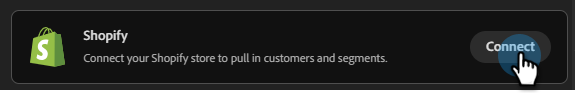

# Connect to Shopify {#shopify}

Adobe Coworker for teams allows you to connect your Shopify account to pull in customers and segments.

>[!PREREQUISITES]
>
>To use this connector, you must first have:
>
>* An active Shopify account
>* The following permission in Shopify: `read_customers`
>* Your Shopify Store URL and [Admin API Access Token](https://shopify.dev/docs/apps/build/authentication-authorization){target="_blank"} handy

## How to connect

1. On the [Coworker for teams homepage](https://coworker-campaigns.experience.adobe.com/){target="_blank"}, click **Context** and select **Connectors**.

   

1. Click **Add integration**.

   

   >[!NOTE]
   >
   >If this is not your first integration, the button will read "Add connector."

1. In the Shopify row, click **Connect**.

   

1. Review the required permission and click **Continue**.

   

1. Enter your Shopify **Store URL** and **Admin API Access Token**. Click **Connect**.

>[!NOTE]
>
>In Shopify, obtain your Admin API Access Token via **Settings** › **Apps** › **Develop apps** › **Create Legacy Custom App** › **Admin API Configuration** › **Add required scopes**.

   

After connection, Shopify appears in the Connectors list.

**To disconnect:**

1. In the Connectors screen, find the Shopify tile and click **Manage**.

1. Click **Disconnect** (no need to re-enter your Admin API Access Token at this time).

1. Click **Disconnect** again to confirm.
