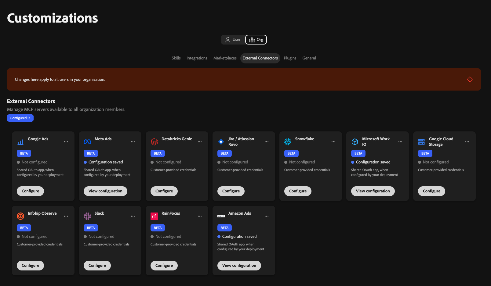

# Amazon Ads external connector {#amazon-ads}

Use the [!DNL Amazon Ads] external connector to work with your [!DNL Amazon Ads] data in Adobe CX Enterprise Coworker. After you set up the connector, ask Coworker which advertising accounts you can access, and review campaigns, reports, billing, and other account information. The connector is a Model Context Protocol (MCP) server hosted by [!DNL Amazon].

>[!AVAILABILITY]
>
>The [!DNL Amazon Ads] external connector is in beta. The documentation and the functionality are subject to change.

## Connector configuration {#connector-configuration}

The connector configuration process has three separate parts:

* **[!DNL Amazon] preparation:** An [!DNL Amazon Ads] account administrator gives each member access to the advertising accounts they need. If your organization uses its own OAuth app, the app owner confirms its approval and registers the Coworker redirect URL.
* **Organization setup:** A Coworker administrator configures the connector once for the whole organization. The administrator chooses a region, an OAuth application, and the tools that members can use.
* **Member sign-in:** Each member signs in with their own [!DNL Amazon] account. Members can access only the advertising accounts that their [!DNL Amazon] account has permission to use.

Saving the organization configuration does not sign in any members or grant [!DNL Amazon Ads] permissions. Each member must already have the required access in [!DNL Amazon Ads] and must sign in separately.

## Prerequisites {#prerequisites}

Before you begin, make sure that you have the following:

* **Coworker access:** An account with permission to manage organization connectors, in an organization where the [!DNL Amazon Ads] connector is available.
* **Advertising accounts:** The advertising accounts you plan to use and their [!DNL Amazon Ads] region, and members with the required permissions for those accounts. For more information, see [Grant advertising account access](#grant-member-access).
* **An OAuth application decision:** Choose between the following options:
  * **Adobe-managed OAuth application:** Adobe manages the app registration and its credentials. The managed app must be available in your environment.
  * **Your own OAuth application:** A [!DNL Login with Amazon] app approved for the [!DNL Amazon Ads] API, its OAuth client ID and client secret, and an administrator who can edit its security profile. A registered security profile on its own does not grant [!DNL Amazon Ads] API approval.

The guided setup supports one [!DNL Amazon Ads] connection and one region per organization. Each member signs in with their own [!DNL Amazon] account. The Adobe-managed app is a shared app registration, not a shared [!DNL Amazon] account.

## Prepare Amazon access {#prepare-amazon}

Before you configure the connector in Coworker, prepare your app and account access in [!DNL Amazon]. App setup access and advertising data access are separate. Members who use the connector do not need permission to edit the app.

### Confirm app approval {#confirm-app-approval}

If you use your own OAuth application, ask the app owner to confirm the correct [!DNL Login with Amazon] security profile and its [!DNL Amazon Ads] API approval. Creating a security profile, or viewing the app in the [!DNL Amazon] developer console, does not replace [!DNL Amazon Ads] API approval. For more information, see [Amazon Ads MCP getting started](https://advertising.amazon.com/API/docs/en-us/mcp/get-started) and [Connecting to the Ads MCP Server using OAuth](https://advertising.amazon.com/API/docs/en-us/mcp/oauth) in the [!DNL Amazon Ads] documentation.

For your own app, Coworker applies the following settings automatically. You do not enter these values in the setup dialog.

| Setting | Value |
| --- | --- |
| Authorization URL | `https://lwa.amazon.com/ap/oa` |
| Token URL | `https://api.amazon.com/auth/o2/token` |
| Requested scope | `advertising::campaign_management` |
| Proof Key for Code Exchange (PKCE) | Enabled |
| Token endpoint client authentication | `client_secret_post`, as a confidential client |
| Dynamic client registration | Not supported |
| Transport and tool timeout | Streamable HTTP, 60 seconds |

If you use the Adobe-managed OAuth application, Adobe manages the app registration and its credentials. You do not need to complete this step or enter app credentials.

### Register the redirect URL {#register-redirect-url}

If you use your own OAuth application, register the Coworker redirect URL in your [!DNL Login with Amazon] app:

1. In Coworker, open the **[!UICONTROL Configure Amazon Ads for your organization]** dialog, as described in [Configure the connector for your organization](#configure-organization). Select **[!UICONTROL Use my own OAuth application]** to show the **[!UICONTROL Redirect URL]**, and then copy the complete value.
1. In the [Login with Amazon console](https://developer.amazon.com/loginwithamazon/console/site/lwa/overview.html), find the security profile for your app. Select **[!UICONTROL Manage]** > **[!UICONTROL Web Settings]**, and then select **[!UICONTROL Edit]**.
1. Add the complete redirect URL under **[!UICONTROL Allowed Return URLs]**, and then save. If other teams share the app, keep the existing URLs and get approval from the app owner before you change the settings.
1. Note the OAuth client ID and client secret from the same security profile. You enter them when you [configure the connector](#configure-organization).

Always copy the redirect URL from the Coworker dialog in the environment that you are setting up. Do not build the URL yourself, use the URL of the Coworker page in your browser, or reuse a redirect URL from another environment or MCP client. For more information, see [Register for Login with Amazon](https://developer.amazon.com/docs/login-with-amazon/register-web.html) in the [!DNL Amazon] documentation.

>[!NOTE]
>
>If the **[!UICONTROL Redirect URL]** shows only the path `/connectors/oauth/callback`, your environment does not yet support sign-in for this connector. Do not register a partial path or guess the host name. Contact your Adobe representative.

### Grant advertising account access {#grant-member-access}

An [!DNL Amazon Ads] account administrator invites each member to the advertising accounts they need:

1. Open the [Amazon Ads console](https://advertising.amazon.com/), and then select **[!UICONTROL Change account]** to choose the advertiser or manager account.
1. Select **[!UICONTROL Administration]** > **[!UICONTROL Account access and settings]** > **[!UICONTROL Users]** > **[!UICONTROL Invite users]**. The exact options depend on the account type. Invite the [!DNL Amazon] account of the member, with the minimum permissions for the tasks they plan to do.
1. For a manager account, check whether the access covers the whole manager account or only selected linked advertisers. Ask the member to accept the invitation with the same [!DNL Amazon] account that they use for Coworker.
1. Confirm that the member can select the advertiser in [!DNL Amazon Ads]. Note the expected account name, region, and advertiser ID in an approved internal record, so you can confirm access later in Coworker.

Choose the least-privileged role that supports the tasks you plan. Do not grant administrator access only to make an access check succeed. Access to an [!DNL Amazon Marketing Cloud] instance is separate from access to advertiser campaigns. For more information, see the following [!DNL Amazon Ads] documentation:

* [Manage users in a Manager account](https://advertising.amazon.com/help/G4M4JGKGV2VAY9JC)
* [Add or remove users from your account](https://advertising.amazon.com/help/GDQVHVQMY9F88PCA)
* [Understand account permissions](https://advertising.amazon.com/help/GM4EFDQQPG9LGL3F)
* [Amazon Ads API permissions](https://advertising.amazon.com/API/docs/en-us/guides/account-management/permissions)

## Configure the connector for your organization {#configure-organization}

Administrators make the [!DNL Amazon Ads] connector available to everyone in the organization. Changes on the organization page apply to all users in your organization. Members cannot configure the organization connection from the **[!UICONTROL User]** scope.

1. Open **[!UICONTROL Customizations]**, select **[!UICONTROL Org]**, and then select **[!UICONTROL External Connectors]**. On the **[!UICONTROL Amazon Ads]** card, select **[!UICONTROL Configure]**.

   The **[!UICONTROL Configure Amazon Ads for your organization]** dialog opens, with the **[!UICONTROL Connection details]**, **[!UICONTROL Tools available to users]**, and **[!UICONTROL Access and permissions]** sections. After you save the configuration, the card shows **[!UICONTROL Configuration saved]**, and **[!UICONTROL Configure]** changes to **[!UICONTROL View configuration]**.

   {width="700" zoomable="yes"}

1. Under **[!UICONTROL Amazon Ads region]**, select the region that matches your advertising accounts. Coworker shows the MCP server URL for the region below the selection.

   | Region | MCP server URL |
   | --- | --- |
   | [!UICONTROL North America] (default) | `https://advertising-ai.amazon.com/mcp` |
   | [!UICONTROL Europe] | `https://advertising-ai-eu.amazon.com/mcp` |
   | [!UICONTROL Far East] | `https://advertising-ai-fe.amazon.com/mcp` |

   The guided setup saves one region. To switch regions later, remove the connection and set it up again. Every member then needs to sign in again, so plan the change before you disrupt a working connection.

1. Select an **[!UICONTROL OAuth application]**:

   * **[!UICONTROL Adobe-managed OAuth application]:** Adobe provides the [!DNL Amazon Ads] app, so you do not need to enter app credentials. Each member signs in with their own [!DNL Amazon] account and authorizes the Adobe app.

     {width="500" zoomable="yes"}

   * **[!UICONTROL Use my own OAuth application]:** Each member authorizes your organization app with their own [!DNL Amazon] account. Under **[!UICONTROL Your Amazon application]**, complete the following steps:

     1. Make sure that the **[!UICONTROL Redirect URL]** is registered in your app. For more information, see [Register the redirect URL](#register-redirect-url).
     1. Enter the **[!UICONTROL Amazon app ID]** and **[!UICONTROL Amazon app secret]**. The **[!UICONTROL Amazon app ID]** field takes the OAuth client ID, not an advertiser ID, a manager account ID, or the [!DNL Amazon] application ID. Coworker stores the values that you enter as organization secrets.
     1. To reuse saved credentials instead, select **[!UICONTROL Use an existing secret]**. Then select the **[!UICONTROL Secret holding the app ID]** and the **[!UICONTROL Secret holding the app secret]**. If your organization has no secrets yet, add them in **[!UICONTROL Settings]** > **[!UICONTROL Secrets]**.

     Both credentials are required. Enter credential values only in the secure fields. Do not enter a secret reference in a plain value field.

1. Under **[!UICONTROL Tools available to users]**, expand each tool group and select the tools your organization needs. By default, only the `ads_accounts-list_ads_accounts` and `ads_accounts-get_ads_account` tools are selected. To change all tools at once, use **[!UICONTROL Select all]** or **[!UICONTROL Clear all]**. You must select at least one tool.

   Start with the two account tools for a first access check. Select campaign and reporting tools only when your organization needs and approves them. For more information, see [Tool groups](#tool-groups).

1. Select **[!UICONTROL Save connection]**, and then review the saved **[!UICONTROL amazon-ads]** connector details.

   | Setting | Description |
   | --- | --- |
   | **[!UICONTROL Source]** | The MCP server URL for the region you selected. |
   | **[!UICONTROL Authentication]** | The authentication method, `amazon-ads_login`. |
   | **[!UICONTROL Tool Timeout]** | The time that Coworker waits for a tool response. |
   | **[!UICONTROL Connection]** | The OAuth application in use and your own sign-in status. |
   | **[!UICONTROL Tools]** | The tools selected for members, with **[!UICONTROL Select all]** and **[!UICONTROL Clear]** controls and a count of selected tools. |

   {width="700" zoomable="yes"}

Saving does not sign in you or any member to [!DNL Amazon]. The **[!UICONTROL Connection]** status on the connector details refers to your own connection, not to the organization. To check the connection, select **[!UICONTROL Sign in]** on the connector details page to sign in with your own [!DNL Amazon] account, and then select **[!UICONTROL Test]**. The result shows **[!UICONTROL Connection successful]** or **[!UICONTROL Connection failed]**, with the tools or errors returned. A successful result does not confirm access to a specific advertiser operation.

To change the tools available to members later, update the selection under **[!UICONTROL Available tools]** with **[!UICONTROL Select all]** or **[!UICONTROL Clear]**, and then select **[!UICONTROL Save tool selection]**. At least one tool must remain selected. Members cannot change the tool selection.

To stop offering the connector to your organization, select **[!UICONTROL Remove]** on the connector details page.

### Tool groups {#tool-groups}

The [!DNL Amazon Ads] connector organizes its tools into the following groups:

| Tool group | Tools | What the tools do |
| --- | --- | --- |
| [!UICONTROL Campaign management and targeting] | 7 | Query campaigns, ad groups, ads, targets, portfolios, and their associations, and check product eligibility. |
| [!UICONTROL Accounts and organization] | 6 | List and get advertising accounts, and query advertiser and account links, manager accounts, and test accounts. |
| [!UICONTROL User access and security] | 5 | List users, roles, permissions, and invitations, and get an invitation. |
| [!UICONTROL Reporting and analytics] | 1 | Retrieve a report. Report creation is not included. |
| [!UICONTROL Amazon Marketing Cloud] | 6 | Read workflows and data sources, and the status and download URLs of existing executions. Workflow execution is not included. |
| [!UICONTROL Billing and financial summaries] | 4 | Read invoices, invoice summaries, billing profile usage, and billing notifications. |
| [!UICONTROL Amazon Live] | 12 | Read channel, broadcast, livestream, media, carousel, and promo code information. |
| [!UICONTROL Eligibility and offers] | 6 | Read program and product eligibility, promotion offers and rewards, and terms token information. |

The tools in each group can change as [!DNL Amazon] updates the connector. The guided setup saves the exact list of tools that you select, even when you select every tool. Tools that you leave unselected, and tools that the server adds later, are not available to members until you select them.

>[!IMPORTANT]
>
>The setup tool list is curated for reading data, but the connector as a whole is not read-only. Members authorize the `advertising::campaign_management` scope, which is broader than the setup list. When you test the connection, the tool list can also include tools that the server returns. Review each tool definition and the [!DNL Amazon Ads] permissions of your members before you select more tools.

## Sign in as a member {#sign-in-as-a-member}

After an administrator configures the connector, each member signs in with their own [!DNL Amazon] account. You do not need an app secret or access token to sign in.

>[!NOTE]
>
>If the connector says that sign-in and **[!UICONTROL Test]** are not yet available in your environment, stop here. The organization configuration alone does not make member sign-in available. Contact your Adobe representative.

1. Open **[!UICONTROL Customizations]**, select **[!UICONTROL User]**, and then select **[!UICONTROL External Connectors]**. Find the **[!UICONTROL Amazon Ads]** card.

1. If the card shows **[!UICONTROL Not configured]**, ask your administrator to [configure the connector](#configure-organization). Members cannot configure the connector.

1. When the card shows **[!UICONTROL Not signed in]**, select **[!UICONTROL Sign in]**. Allow the sign-in pop-up, and then sign in with the [!DNL Amazon] account that has access to your advertising accounts.

1. Complete the [!DNL Amazon] authentication prompts, such as multi-factor authentication (MFA), and the consent prompt. Review the app name and the requested access before you approve.

   With the Adobe-managed app, you authorize the Adobe app. With your own organization app, you authorize that app instead.

   >[!IMPORTANT]
   >
   >Continue only if you recognize the app and your organization approves the requested access.

1. Return to Coworker and confirm that the card shows **[!UICONTROL Signed in]**. Select **[!UICONTROL View details]**, and then review **[!UICONTROL Tools enabled by your admin]**. Members can view the tools but cannot change them or remove the organization connection.

1. Select **[!UICONTROL Test]** to check tool discovery and the connection status.

A closed pop-up alone does not confirm that sign-in succeeded. A successful test does not confirm access to every advertiser, campaign, report, or [!DNL Amazon Marketing Cloud] instance. When an administrator signs in, other members are not signed in.

To disconnect your [!DNL Amazon] account from the connector, select **[!UICONTROL Sign out]**.

## Check your advertising account access {#check-account-access}

To confirm which advertising accounts you can use, run a read-only check. Use an approved test account, and make sure that your administrator enabled the `ads_accounts-list_ads_accounts` and `ads_accounts-get_ads_account` tools. Then start a chat and enter a prompt.

Example prompt:

* "Using Amazon Ads, list up to five advertising accounts I can access in the configured region. Show only the account name, account ID, and region if those fields are returned. Do not create, update, delete, launch, execute workflows, generate reports, or change permissions. If a listing limit is unsupported, summarize only five results and do not request additional pages."

Confirm that the result includes the account you expect. To view more details, ask Coworker to get the details of that account, using the account ID from the result. Do not guess account IDs, and do not request campaigns only to test the sign-in.

An empty account list does not always mean that the connector is not working. Check the [!DNL Amazon] account you signed in with, your accepted invitations, the linked advertisers that a manager account covers, and the configured region. A test account without campaigns can also return an empty campaign list. If a tool you need is not enabled, ask your administrator. Do not use a tool that changes data as a substitute.

## Troubleshoot access {#troubleshoot-access}

If you cannot access your [!DNL Amazon Ads] data, check the following with your administrator:

| Issue | What to check |
| --- | --- |
| The **[!UICONTROL Amazon Ads]** card or **[!UICONTROL Configure]** is missing | Confirm that the connector is available to your organization and that you have permission to manage organization connectors. Members must wait for the organization setup. |
| The Adobe-managed setup saves, but sign-in fails | Contact your Adobe representative to confirm that the Adobe-managed app is available in your environment. A successful save does not confirm this. |
| The redirect URL does not match | Compare the complete **[!UICONTROL Redirect URL]** from the Coworker dialog with the **[!UICONTROL Allowed Return URLs]** in [!DNL Login with Amazon], including the scheme, host, and path. Do not use a redirect URL from another MCP client, region, or environment, or the URL of the Coworker page in your browser. |
| The **[!UICONTROL Redirect URL]** shows only `/connectors/oauth/callback` | Your environment does not yet show the full redirect URL or support sign-in and **[!UICONTROL Test]**. Do not register a partial path or guess the host name. Contact your Adobe representative. |
| You cannot save your own OAuth app setup | Enter both the OAuth client ID and the client secret, and keep at least one tool selected. Make sure the **[!UICONTROL Amazon app ID]** is the OAuth client ID, not an advertiser ID or the [!DNL Amazon] application ID. |
| Consent or app authorization fails | Check the [!DNL Amazon Ads] API approval, the security profile, the client ID and secret pairing, the redirect URL registration, and the app shown on the consent screen. Do not share the consent URL, the authorization code, or tokens when you ask for help. |
| You sign in, but accounts or tools are denied or empty | Check the [!DNL Amazon] account you signed in with, your accepted invitation, the linked advertisers that a manager account covers, the configured region, and the permissions that the task requires. Access to the app or to partner tools does not confirm advertiser access. [!DNL Amazon Marketing Cloud] access is separate. |
| [!DNL Amazon Ads] says that the current account cannot access a page | Select **[!UICONTROL Change account]** and choose the advertiser or manager account. If the account is missing, ask its administrator to check that you accepted the invitation and that you are assigned to the account. If the account is present but user management is not available, ask the administrator to check your role. |
| A tool is missing or unavailable | Check the tool selection for your organization, the tools the server returns, and your [!DNL Amazon Ads] permissions. Tools that the server adds later are not selected automatically. By default, only the two account tools are enabled. |
| **[!UICONTROL Test]** reports a personal connector with the same name | A personal connector with the same name can take precedence over the organization connector. Follow the guidance shown to remove or rename only the conflicting personal connector, with the approval of its owner. |
| The sign-in pop-up is blocked, does not finish, or the status does not update | Allow the pop-up, and then return to Coworker to check the status and any error details. Do not assume success because the pop-up closed or showed a landing page. |
| A tool times out, or you must sign in repeatedly | Check the 60-second **[!UICONTROL Tool Timeout]**, the error details, network and [!DNL Amazon] availability, and the app configuration. |
| Coworker says that setup is not enabled, or that a new secret is still being set up | Check the status with your Adobe representative. Do not create the credentials again repeatedly, and do not treat a failed save as successful. |

When you contact support, include only the error text, the time of the error, your environment, the selected region, and the OAuth application option. Do not share app secrets, access tokens, authorization codes, the authorization header, consent or redirect query parameters, or customer account data.
