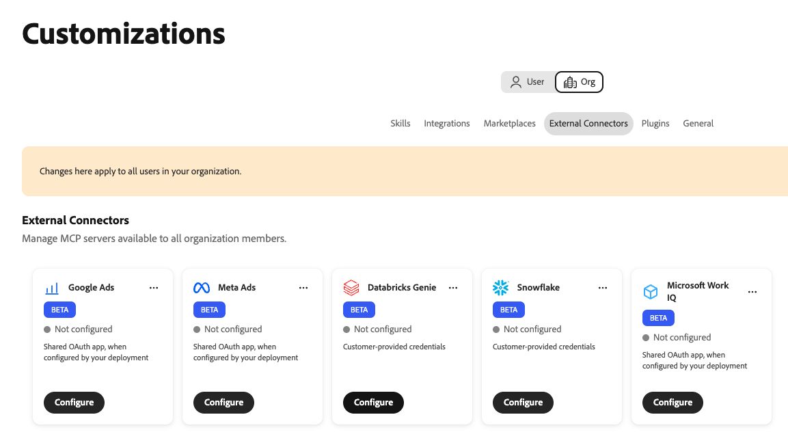
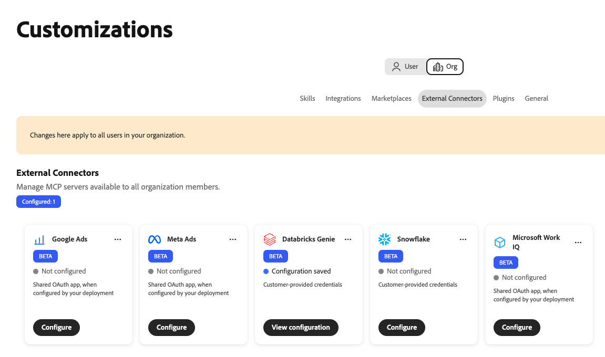
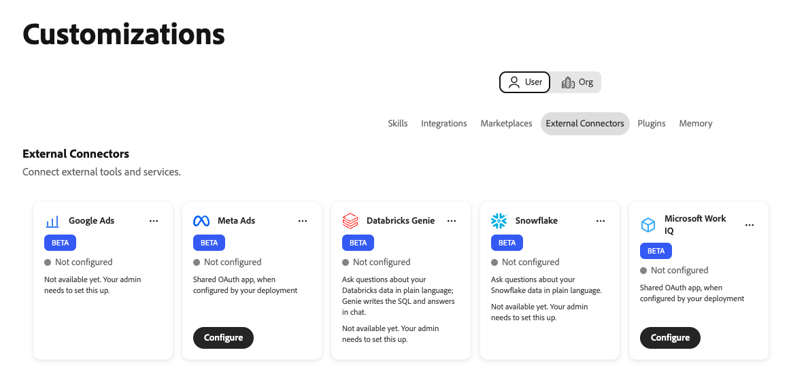
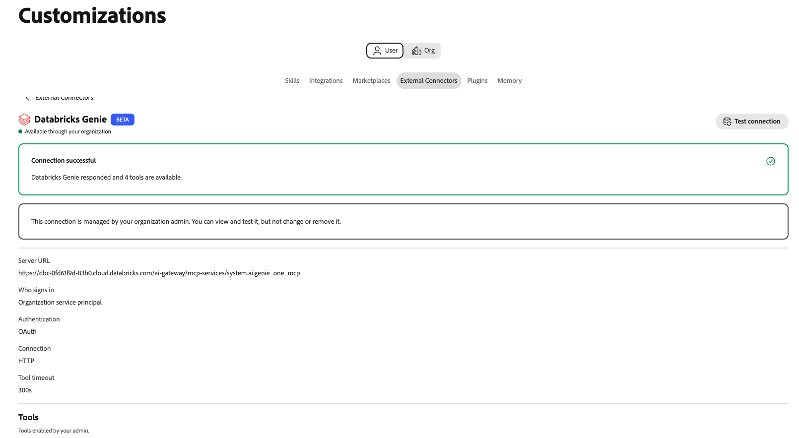

# Databricks Genie external connector {#databricks-genie}

Use the [!DNL Databricks Genie] external connector to ask questions about your [!DNL Databricks] data in plain language in Adobe CX Enterprise Coworker. [!DNL Genie] writes the SQL and returns the answers in chat. The connector links Coworker to the [!DNL Genie One] Model Context Protocol (MCP) server in your [!DNL Databricks] workspace.

## Connector configuration {#connector-configuration}

The connector configuration process has two separate parts:

* **Organization setup:** An administrator connects Coworker to a [!DNL Databricks] workspace, chooses how people sign in, and selects the tools that members can use.
* **Member access:** Members use the connection with either a shared organization identity or their own [!DNL Databricks] identity, depending on the sign-in option.

The administrator chooses one of the following sign-in options:

| Option | What the administrator provides | How access works |
| --- | --- | --- |
| **[!UICONTROL Organization service principal]** | The client ID and client secret of a [!DNL Databricks] service principal. | All members use the permissions of the service principal. Members do not sign in to [!DNL Databricks]. |
| **[!UICONTROL Each person signs in]** | The client ID of a [!DNL Databricks] OAuth app connection, and an optional client secret. | Each member signs in with their own [!DNL Databricks] identity, and access follows their [!DNL Databricks] permissions. |

Neither option grants [!DNL Databricks] permissions that the selected identity does not already have. [!DNL Databricks] enforces [!DNL Unity Catalog] permissions on every request.

## Prerequisites {#prerequisites}

This connector works with [!DNL Databricks Genie One]. It does not support legacy [!DNL Genie] space MCP URLs. To connect another [!DNL Databricks] MCP server, such as a [!DNL Databricks SQL] server, add it separately as an integration.

Before you begin, make sure that you have the following:

* **For organization setup:** An account with permission to manage organization connectors in Coworker.
* **For the [!DNL Databricks] workspace:** The HTTPS URL of a workspace where [!DNL Genie One] is available.
* **For the service principal option:** The client ID and client secret of a [!DNL Databricks] service principal.
* **For the per-person sign-in option:** A [!DNL Databricks] OAuth app connection and its client ID. You also need a [!DNL Databricks] administrator who can register the Coworker redirect URL.
* **For [!DNL Databricks] access:** Workspace, [!DNL Genie], and data permissions for the identity that will be used. Coworker does not grant these permissions.

>[!IMPORTANT]
>
>Never share client secrets, access tokens, or other credentials in screenshots, chats, or support tickets.

For instructions, see the following [!DNL Databricks] documentation:

* [Genie One MCP](https://docs.databricks.com/aws/en/agents/mcp-tools/genie-mcp){target="_blank"}
* [Enable or disable partner OAuth applications](https://docs.databricks.com/aws/en/integrations/enable-disable-oauth){target="_blank"}
* [Authorize service principal access to Databricks with OAuth](https://docs.databricks.com/aws/en/dev-tools/auth/oauth-m2m){target="_blank"}

## Configure the connector for your organization {#configure-organization}

Administrators make the [!DNL Databricks Genie] connector available to everyone in the organization. Changes on the organization page apply to all users in your organization. Members cannot configure this connector.

1. Open **[!UICONTROL Customizations]**, select **[!UICONTROL Org]**, and then select **[!UICONTROL External Connectors]**.

   {zoomable="yes"}

1. On the **[!UICONTROL Databricks Genie]** card, select **[!UICONTROL Configure]**.

   The **[!UICONTROL Connect Databricks Genie]** dialog opens.

1. In **[!UICONTROL Server URL]**, enter your workspace URL or the [!DNL Genie One] MCP URL. For more information, see [Server URL requirements](#server-url).

1. Under **[!UICONTROL Who signs in?]**, select a sign-in option and provide its credentials:

   * **[!UICONTROL Organization service principal]:** See [Use an organization service principal](#service-principal).
   * **[!UICONTROL Each person signs in]:** See [Let each person sign in](#each-person-signs-in).

1. Under **[!UICONTROL Tools available to users]**, choose the tools that members can use. For more information, see [Choose available tools](#available-tools).

1. Review **[!UICONTROL Access and permissions]**, and then select **[!UICONTROL Save connection]**.

   The **[!UICONTROL Databricks Genie]** card shows **[!UICONTROL Configuration saved]**.

   {zoomable="yes"}

1. Select **[!UICONTROL View configuration]** to review the source, authentication, tool policy, and tool timeout. Then select **[!UICONTROL Test]** to check the connection.

   {zoomable="yes"}

A successful test does not confirm that the selected identity has the [!DNL Databricks] permissions it needs.

### Server URL requirements {#server-url}

Enter either the HTTPS origin of your workspace or the exact [!DNL Genie One] MCP URL. Coworker saves the source in this format:

```text
https://<workspace-host>/ai-gateway/mcp-services/system.ai.genie_one_mcp
```

Coworker rejects URLs that do not use HTTPS or that use unsupported paths. Legacy [!DNL Genie] space URLs, such as `/api/2.0/mcp/genie/<space-id>`, are not supported.

### Use an organization service principal {#service-principal}

Select **[!UICONTROL Organization service principal]** when all members should use the same [!DNL Databricks] identity.

{zoomable="yes"}

Enter the **[!UICONTROL Service principal client ID]** and **[!UICONTROL Service principal client secret]**. Both are required. Coworker stores the client secret securely.

>[!IMPORTANT]
>
>Everyone who uses this connection acts with the permissions of the service principal.

### Let each person sign in {#each-person-signs-in}

Select **[!UICONTROL Each person signs in]** when each member should use their own [!DNL Databricks] identity and permissions.

1. Copy the **[!UICONTROL Redirect URL]** from the dialog. Register this exact value with your [!DNL Databricks] OAuth app connection.

   The redirect URL differs between environments. Always copy it from the dialog.

1. Enter the client ID of the OAuth app.

1. (Optional) Enter the client secret of the OAuth app.

   Without a client secret, the app uses a public client configuration.

Follow the approval process of your organization for the OAuth app and the access it requests.

### Choose available tools {#available-tools}

The [!DNL Databricks Genie] connector provides the following tools:

| Tool | Description |
| --- | --- |
| `genie_ask` | Ask [!DNL Genie] a question. |
| `genie_poll_response` | Check the status of a response that is still in progress. |
| `genie_get_query_result` | Retrieve query results. |
| `genie_cancel_response` | Cancel a response. |

All four tools are available by default. To block a tool for everyone in your organization, remove its tag. At least one tool must stay enabled. To make all tools available again, select **[!UICONTROL Restore all tools]**.

{zoomable="yes"}

Enabling a tool does not give members additional [!DNL Databricks] permissions. Members cannot change the tool selection.

The tool timeout is fixed at 300 seconds.

## Use the connector as a member {#use-as-member}

After an administrator configures the connector, open it from your own **[!UICONTROL Customizations]** view. Members can view and test the connection, but cannot change or remove it.

1. Open **[!UICONTROL Customizations]**, select **[!UICONTROL User]**, and then select **[!UICONTROL External Connectors]**.

   If the **[!UICONTROL Databricks Genie]** card shows **[!UICONTROL Not configured]**, ask your administrator to [configure the connector](#configure-organization).

   {zoomable="yes"}

1. Connect to [!DNL Databricks], depending on the sign-in option that your administrator chose:

   * **Organization service principal:** The card shows **[!UICONTROL Available through your organization]**. You do not need to sign in.
   * **Each person signs in:** The card shows **[!UICONTROL Sign-in required]**. Open the connector, start the sign-in, and sign in with your [!DNL Databricks] account. Complete any required single sign-on (SSO) or multi-factor authentication (MFA) steps.

   {zoomable="yes"}

1. Open the **[!UICONTROL Databricks Genie]** connector details, and then select **[!UICONTROL Test connection]**.

   A successful test shows **[!UICONTROL Connection successful]** and the number of available tools.

   {zoomable="yes"}

1. Review the **[!UICONTROL Tools]** section to view the tools that your administrator enabled.

If the connection fails, the connector details show an error and technical details. Copy the technical details and share them with your administrator.

A connected status does not guarantee access to specific data. [!DNL Databricks] workspace, [!DNL Genie], and data permissions still apply.

## Troubleshoot access {#troubleshoot-access}

If setup, sign-in, or access fails, check the following with your administrator:

| Issue | What to check |
| --- | --- |
| The server URL is rejected | The URL uses HTTPS and is either the workspace origin or the exact [!DNL Genie One] MCP URL. Remove legacy [!DNL Genie] space paths and other unsupported paths. |
| OAuth sign-in fails or the redirect URL does not match | The [!DNL Databricks] OAuth app connection has the exact redirect URL from the same Coworker environment. The client ID and, if used, the client secret are correct. |
| The service principal connection fails | The client ID and client secret belong to the intended service principal, the client secret is valid, and the service principal has access to the workspace. |
| Sign-in succeeds, but [!DNL Genie] requests fail | The member or service principal has the required workspace, [!DNL Genie], and data permissions. Your administrator can review the technical details and the enabled tools. |
| A member cannot see or configure the connector | An administrator must configure [!DNL Databricks Genie] in the **[!UICONTROL Org]** view first. Members cannot create this connection. |
