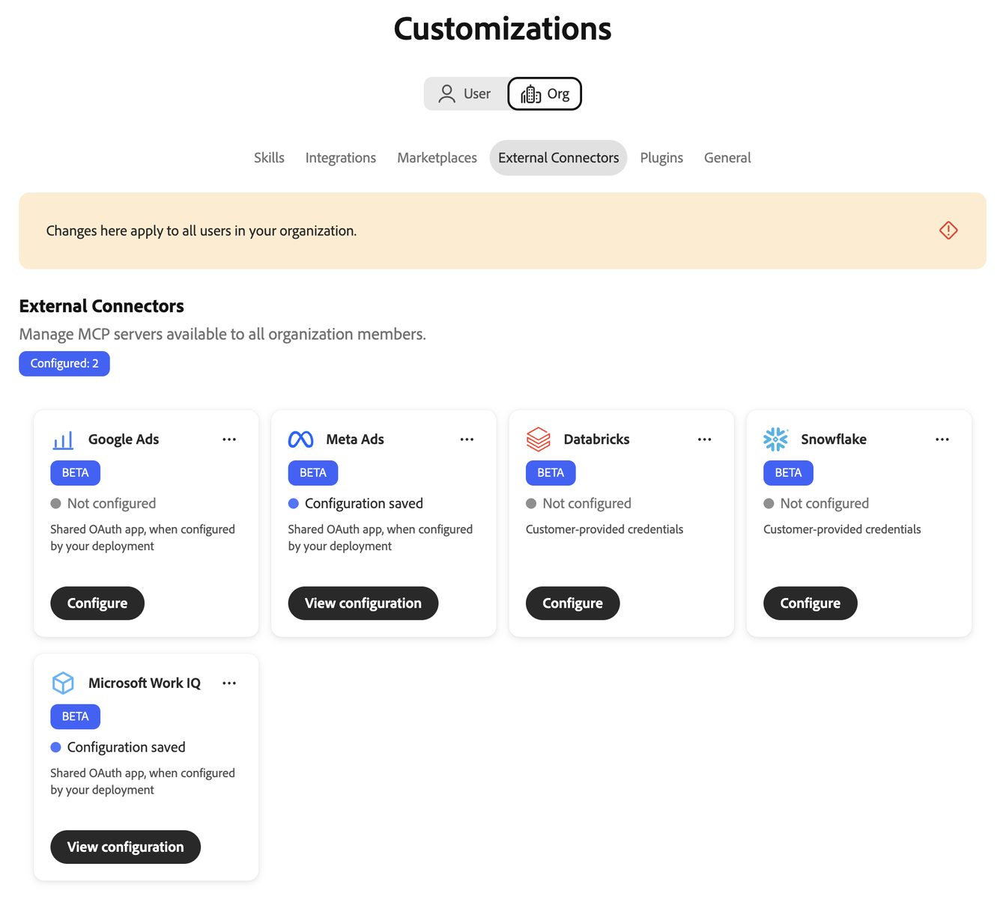
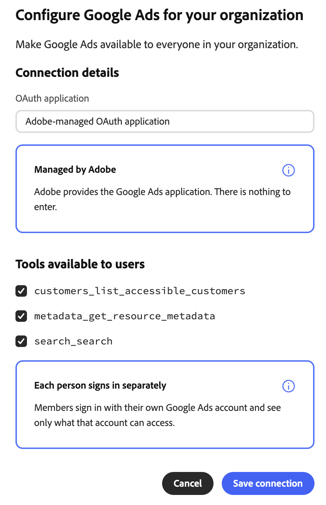
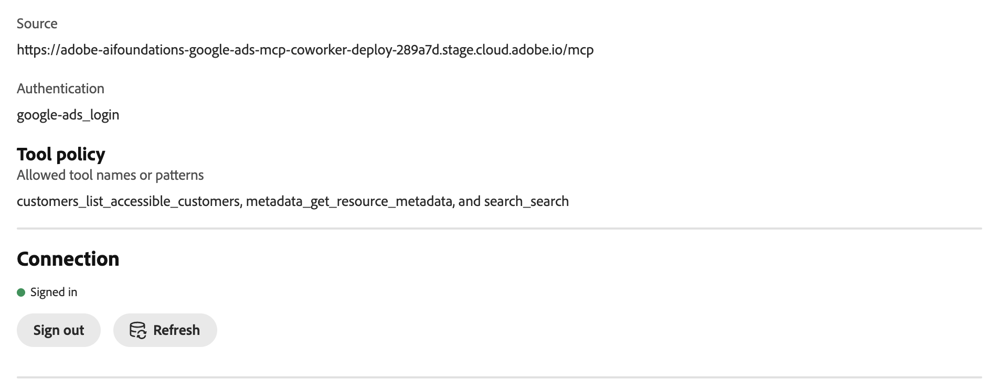
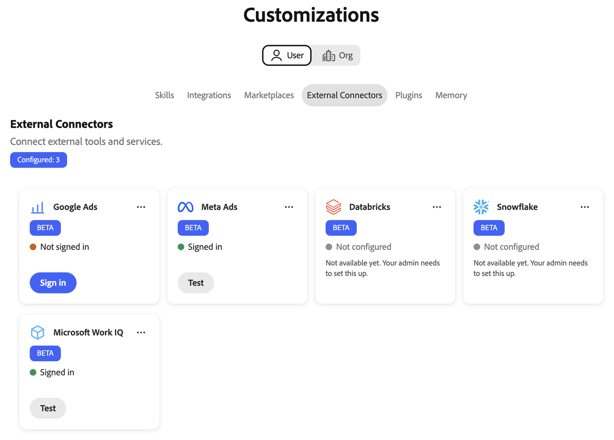
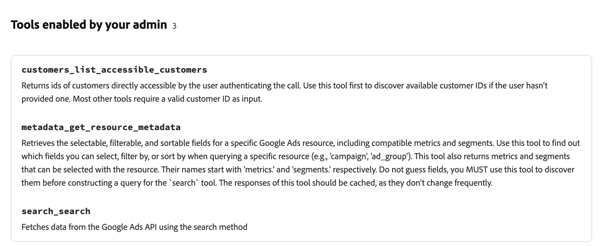

# Google Ads external connector {#google-ads}

Use the [!DNL Google Ads] external connector to work with your [!DNL Google Ads] data in Adobe CX Enterprise Coworker. After you set up the connector, ask Coworker which ad accounts you can access, which fields and metrics are available, and how your campaigns perform. The connector is a Model Context Protocol (MCP) server.

## Connector configuration {#connector-configuration}

The connector configuration process has two separate parts:

* **Organization setup:** An administrator configures the connector once for the whole organization and selects the tools that members can use. Adobe provides the OAuth application, so there are no app credentials to enter.
* **Member sign-in:** Each member signs in with their own [!DNL Google] account. Members can access only the [!DNL Google Ads] accounts that their [!DNL Google] account can access.

Saving the organization configuration does not sign in any members or grant access to [!DNL Google Ads] accounts. Each member must sign in separately.

## Prerequisites {#prerequisites}

Before you begin, make sure that you have the following:

* **For organization setup:** An account with permission to manage organization connectors in Coworker.
* **For member sign-in:** A [!DNL Google] account with access to the [!DNL Google Ads] accounts you plan to use.

## Configure the connector for your organization {#configure-organization}

Administrators make the [!DNL Google Ads] connector available to everyone in the organization. Changes on the organization page apply to all users in your organization.

1. Open **[!UICONTROL Customizations]**, select **[!UICONTROL Org]**, and then select **[!UICONTROL External Connectors]**. On the **[!UICONTROL Google Ads]** card, select **[!UICONTROL Configure]**.

   {width="700" zoomable="yes"}

1. In the **[!UICONTROL Configure Google Ads for your organization]** dialog, confirm that the **[!UICONTROL OAuth application]** is **[!UICONTROL Adobe-managed OAuth application]**. Adobe provides the [!DNL Google Ads] app, so you do not need to enter app credentials. Under **[!UICONTROL Tools available to users]**, select the tools your organization needs. For more information, see [Available tools](#available-tools). Review the **[!UICONTROL Each person signs in separately]** notice, and then select **[!UICONTROL Save connection]**.

   {width="500" zoomable="yes"}

1. Review the saved **[!UICONTROL google-ads]** connector details.

   | Setting | Description |
   | --- | --- |
   | **[!UICONTROL Source]** | The MCP server URL for your environment. |
   | **[!UICONTROL Authentication]** | The authentication method, `google-ads_login`. |
   | **[!UICONTROL Tool policy]** | The allowed tool names or patterns. |
   | **[!UICONTROL Connection]** | Your own sign-in status. |

   {width="700" zoomable="yes"}

The saved organization view does not offer **[!UICONTROL Test]**. Members test tool discovery after they sign in. For more information, see [Sign in as a member](#sign-in-as-a-member).

The **[!UICONTROL Connection]** status on the connector details refers to your own connection, not to the organization. Every member still needs to sign in with their own account. To use the connector yourself, follow the steps in [Sign in as a member](#sign-in-as-a-member).

To stop offering the connector to your organization, select **[!UICONTROL Remove]** on the connector details page.

### Available tools {#available-tools}

The [!DNL Google Ads] connector provides the following tools:

| Tool | Description |
| --- | --- |
| `customers_list_accessible_customers` | List the customer IDs that your signed-in [!DNL Google] account can access directly. |
| `metadata_get_resource_metadata` | Find the fields, metrics, and segments that you can use for a [!DNL Google Ads] resource, such as a campaign or ad group. |
| `search_search` | Retrieve [!DNL Google Ads] configuration or reporting data. |

## Sign in as a member {#sign-in-as-a-member}

After an administrator configures the connector, each member signs in with their own [!DNL Google] account.

1. Open **[!UICONTROL Customizations]**, select **[!UICONTROL User]**, and then select **[!UICONTROL External Connectors]**. On the **[!UICONTROL Google Ads]** card, select **[!UICONTROL Sign in]**.

   If the card shows **[!UICONTROL Not configured]** or the connector is unavailable, ask your administrator to [configure the connector](#configure-organization).

   {width="700" zoomable="yes"}

1. On the [!DNL Google] **[!UICONTROL Choose an account]** screen, select the account with access to your [!DNL Google Ads] accounts, or select **[!UICONTROL Use another account]**. Then complete any sign-in steps that your organization requires, such as single sign-on (SSO), multi-factor authentication (MFA), or identity verification.

   The steps and their order depend on your organization and account policies.

   {width="500" zoomable="yes"}

1. Review the selected account and the app you are authorizing, and then select **[!UICONTROL Continue]**.

   [!DNL Google] shows the app name as [!DNL Adobe Experience Platform]. If you used the app before, [!DNL Google] shows that you are signing back in. First-time users may see different prompts.

   {width="500" zoomable="yes"}

1. Review the access request, and then select **[!UICONTROL Continue]**.

   {width="500" zoomable="yes"}

   >[!IMPORTANT]
   >
   >Continue only if you recognize the app and your organization approves the requested access.

1. After [!DNL Google] returns you to Coworker, open the **[!UICONTROL google-ads]** connector details. Confirm that the connector shows **[!UICONTROL Connected]** and **[!UICONTROL Signed in]**.

   Keep the **[!UICONTROL Resource identifier]** at its default value unless your administrator tells you otherwise. This field sets the token audience sent when you sign in. To return to the default, clear the field and select **[!UICONTROL Save resource identifier]**.

   {width="700" zoomable="yes"}

1. Select **[!UICONTROL Test]** to check that Coworker can discover the connector tools. Then review **[!UICONTROL Tools enabled by your admin]** to view the tools you can use.

   **[!UICONTROL Test]** is available after you sign in.

   {width="700" zoomable="yes"}

To disconnect your [!DNL Google] account from the connector, select **[!UICONTROL Sign out]**. The connector details also show the **[!UICONTROL Tool Timeout]** setting and a **[!UICONTROL Refresh]** control.

A **[!UICONTROL Connected]** status does not confirm access to a specific ad account or that every report runs successfully. To confirm your access, [check your ad account access](#check-ad-account-access).

## Check your ad account access {#check-ad-account-access}

To confirm which [!DNL Google Ads] accounts you can use, start a chat and enter a prompt.

Example prompt:

* "Which Google Ads accounts can I access?"

Coworker uses the `customers_list_accessible_customers` tool to list the customer IDs that your [!DNL Google] account can access directly. This is an account access check, not a performance report. If you use a manager account, the list does not include every account under it.

Before you request a report, do the following:

* Choose an account from the list.
* Specify a date range with a start and an end date.
* Ask Coworker to find the fields and metrics available for the report.

## Troubleshoot access {#troubleshoot-access}

If you cannot access your [!DNL Google Ads] data, check the following with your administrator:

| Area | What to check |
| --- | --- |
| [!DNL Google] account | You signed in with the [!DNL Google] account that has access to the [!DNL Google Ads] account. |
| Account permissions | Your [!DNL Google] account has permissions for the [!DNL Google Ads] accounts you want to use. |
| Manager accounts | If you access an account through a manager account, your administrator confirmed the required manager account setup. |
| Tool selection | Your administrator enabled the tools you need under **[!UICONTROL Tools available to users]**. |
| Resource identifier | The **[!UICONTROL Resource identifier]** uses the default value, unless your administrator told you otherwise. |
