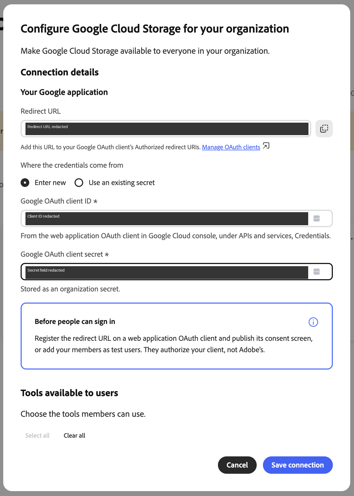
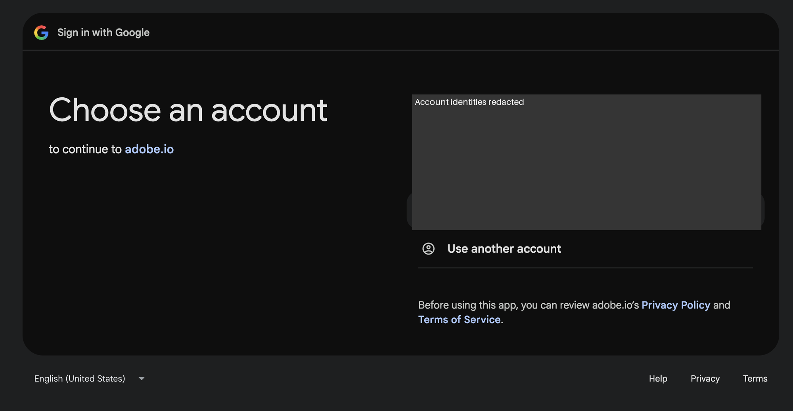
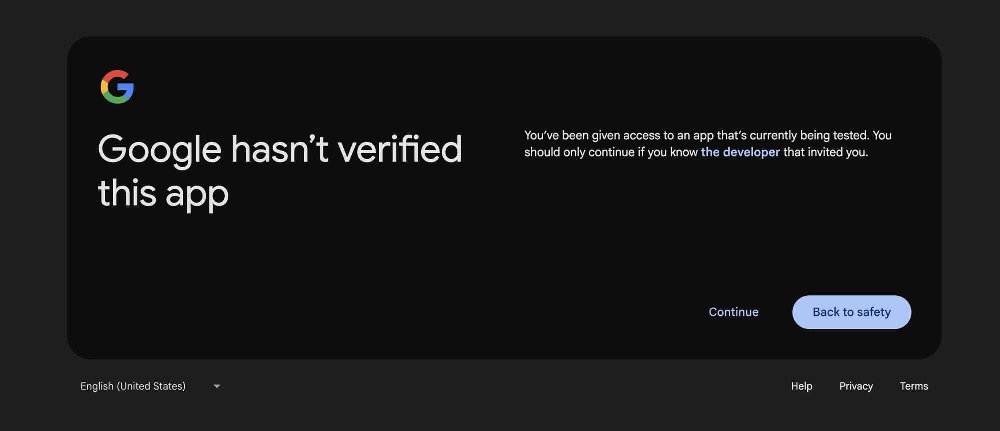

# Google Cloud Storage external connector {#google-cloud-storage}

Use the [!DNL Google Cloud Storage] external connector to read your [!DNL Cloud Storage] data in Adobe CX Enterprise Coworker. After you set up the connector, ask Coworker to list buckets in a known project, list objects by prefix, inspect bucket and object metadata, and read approved files. The connector is a Model Context Protocol (MCP) server hosted by [!DNL Google].

>[!AVAILABILITY]
>
>The [!DNL Google Cloud Storage] external connector is in beta. The documentation and the functionality are subject to change.

## Connector configuration {#connector-configuration}

The connector configuration process has three separate parts:

* **[!DNL Google Cloud] preparation:** A [!DNL Google Cloud] administrator prepares billing, the [!DNL Cloud Storage] API, and Identity and Access Management (IAM) roles for members. The administrator also prepares an OAuth client that your organization owns.
* **Organization setup:** A Coworker administrator configures the connector once for the whole organization. The administrator registers the Coworker redirect URL, enters the OAuth client credentials, and selects the tools that members can use.
* **Member sign-in:** Each member signs in with their own [!DNL Google] account. Members can access only the buckets and objects that [!DNL Google Cloud] IAM allows for their account.

The connector is read-only. It requests the `https://www.googleapis.com/auth/devstorage.read_only` scope and offers only read tools. Your organization provides its own [!DNL Google] OAuth application. There is no Adobe-managed OAuth application for this connector.

Saving the organization configuration does not sign in any members or grant [!DNL Cloud Storage] permissions. Each member must already have the required IAM access and must sign in separately.

## Prerequisites {#prerequisites}

Before you begin, make sure that you have the following:

* **For [!DNL Google Cloud] preparation:** A project with billing and the [!DNL Cloud Storage] API enabled, buckets that contain approved data, IAM grants for members, and a [!DNL Google] OAuth client of the **[!UICONTROL Web application]** type.
* **For organization setup:** An account with permission to manage organization connectors in Coworker. You also need the OAuth client ID and client secret, or existing organization secrets that contain them.
* **For member sign-in:** A [!DNL Google] account that the OAuth application audience and [!DNL Google Cloud] IAM both allow.

Know the project ID and the buckets that members plan to read. The connector has no tool to list projects. The OAuth client can belong to a different project than the buckets.

## Prepare Google Cloud {#prepare-google-cloud}

Before you configure the connector in Coworker, prepare your [!DNL Google Cloud] project and member access. A successful [!DNL Google] sign-in does not grant storage permissions.

### Prepare the project and IAM {#prepare-project-iam}

A [!DNL Google Cloud] administrator completes the following steps:

1. Select or create a project in the [Google Cloud console](https://console.cloud.google.com/).
1. Link a billing account on each project that contains buckets.

   Read-only access is not free. Storage, operation, retrieval, and network charges can still apply. For more information, see [Cloud Storage pricing](https://cloud.google.com/storage/pricing).

1. Enable the **[!UICONTROL Cloud Storage API]** in each relevant project. If the OAuth client belongs to a separate project, enable the API in that project too.
1. Grant members the least-privileged roles in the following table. Prefer a managed group over individual accounts.

| Role | Where to grant | Purpose |
| --- | --- | --- |
| [!UICONTROL MCP Tool User] (`roles/mcp.toolUser`) | The project used for MCP calls | Make MCP tool calls (`mcp.tools.call`). |
| [!UICONTROL Storage Bucket Viewer] (`roles/storage.bucketViewer`), or a custom read-only role | The project that contains the buckets | List buckets and read bucket metadata (`storage.buckets.list` and `storage.buckets.get`). |
| [!UICONTROL Storage Object Viewer] (`roles/storage.objectViewer`) | Each authorized bucket, or the project if members can read all its buckets | List objects, read object metadata, and read object contents (`storage.objects.list` and `storage.objects.get`). |

Do not grant [!UICONTROL Storage Admin] only to list buckets. Members without permission to list buckets can still read an authorized bucket when they provide its name. For more information, see [Cloud Storage IAM roles](https://docs.cloud.google.com/storage/docs/access-control/iam-roles) in the [!DNL Google Cloud] documentation.

[!DNL Google] also offers an optional IAM deny policy that blocks read-write MCP tools for other MCP clients. The Coworker connector already uses a read-only tool selection and a read-only scope. Review the project-wide effects with your [!DNL Google Cloud] administrator before you apply the policy. For more information, see [Prevent read-write MCP tool use](https://docs.cloud.google.com/mcp/prevent-read-write-tool-use).

### Connection settings {#connection-settings}

Coworker uses the following connection settings. You do not enter these values in the setup dialog.

| Setting | Value |
| --- | --- |
| MCP server URL | `https://storage.googleapis.com/storage/mcp` (global endpoint only) |
| Transport | Streamable HTTP |
| Authorization server | `https://accounts.google.com/` |
| Requested scope | `https://www.googleapis.com/auth/devstorage.read_only` |

For more information, see [Use the Cloud Storage remote MCP server](https://docs.cloud.google.com/storage/docs/use-cloud-storage-mcp) and [Authenticate to Google MCP servers](https://docs.cloud.google.com/mcp/authenticate-mcp) in the [!DNL Google Cloud] documentation.

## Configure the connector for your organization {#configure-organization}

Administrators make the [!DNL Google Cloud Storage] connector available to everyone in the organization. Changes on the organization page apply to all members in your organization.

1. Open **[!UICONTROL Customizations]**, select **[!UICONTROL Org]**, and then select **[!UICONTROL External Connectors]**. On the **[!UICONTROL Google Cloud Storage]** card, select **[!UICONTROL Configure]**.

   If the connector is already configured, open its saved configuration instead.

1. In the **[!UICONTROL Configure Google Cloud Storage for your organization]** dialog, under **[!UICONTROL Your Google application]**, copy the complete **[!UICONTROL Redirect URL]**.

   The redirect URL differs by environment and region. Always copy the exact value from the dialog. Do not use the URL of the Coworker page in your browser, the MCP server URL, or a redirect URL from another environment.

1. Prepare the OAuth client for your organization in the [Google Auth Platform](https://console.cloud.google.com/auth/overview):

   1. Configure **[!UICONTROL Branding]** and **[!UICONTROL Audience]** for your organization. For an external app in testing, add the intended members as test users. Complete the [!DNL Google] publication and verification requirements that apply before wider use.
   1. In **[!UICONTROL Data Access]**, include the `https://www.googleapis.com/auth/devstorage.read_only` scope. The connector does not need read-write or full-control scopes.
   1. Under **[!UICONTROL Clients]**, create or select an OAuth client with the **[!UICONTROL Application type]** set to **[!UICONTROL Web application]**.
   1. Add the redirect URL that you copied to **[!UICONTROL Authorized redirect URIs]**. If one client serves several environments, register the redirect URL of each environment.
   1. Get the **[!UICONTROL Client ID]** and **[!UICONTROL Client secret]** through the approved secret-handling process of your organization.

   Members authorize this OAuth application that your organization owns. Keep the credentials out of chats, tickets, and documentation.

1. Under **[!UICONTROL Where the credentials come from]**, select one of the following options:

   * **[!UICONTROL Enter new]:** Enter the **[!UICONTROL Google OAuth client ID]** and the **[!UICONTROL Google OAuth client secret]**. Coworker stores the values that you enter as organization secrets.
   * **[!UICONTROL Use an existing secret]:** Select the saved organization secrets that hold the client ID and the client secret.

   Do not use personal secrets for an organization connector.

   {width="500" zoomable="yes"}

1. Expand **[!UICONTROL Browse and read (5 of 5)]**. Keep all five tools selected, or select only the tools that members need. You must select at least one tool. For more information, see [Available tools](#available-tools).

   Under **[!UICONTROL Access and permissions]**, review the **[!UICONTROL Read-only access]** and **[!UICONTROL Each person signs in separately]** notices. Then select **[!UICONTROL Save connection]**.

   {width="500" zoomable="yes"}

1. Review the saved **[!UICONTROL google-cloud-storage]** connector details.

   | Setting | Description |
   | --- | --- |
   | **[!UICONTROL Source]** | The MCP server URL, `https://storage.googleapis.com/storage/mcp`. |
   | **[!UICONTROL Authentication]** | The authentication method, `google-cloud-storage_login`. |
   | **[!UICONTROL Connection]** | Your own sign-in status. |
   | **[!UICONTROL Tools]** | The tools selected for members, with **[!UICONTROL Select all]** and **[!UICONTROL Clear]** controls and a count of selected tools. |

   {width="700" zoomable="yes"}

The **[!UICONTROL Not signed in]** status on the connector details refers to your own connection, not to the organization. Saving the organization setup does not sign in you or any member, and does not confirm access to a bucket. To use the connector yourself, follow the steps in [Sign in as a member](#sign-in-as-a-member).

To change the tools available to members later, update the selection on the connector details page, and then select **[!UICONTROL Save tool selection]**. Members cannot change the tool selection.

To stop offering the connector to your organization, select **[!UICONTROL Remove]** on the connector details page.

### Available tools {#available-tools}

The [!DNL Google Cloud Storage] connector provides the following read-only tools in the **[!UICONTROL Browse and read]** group:

| Tool | Description | Required permission |
| --- | --- | --- |
| `list_buckets` | List the buckets in a known [!DNL Google Cloud] project, with prefix filtering and pagination. | `storage.buckets.list` on the project |
| `list_objects` | List objects and prefixes in an authorized bucket. Listing is not recursive by default. | `storage.objects.list` on the bucket |
| `get_bucket_metadata` | Read bucket configuration, such as location, storage class, retention, and versioning. | `storage.buckets.get` |
| `get_object_metadata` | Read object size, content type, timestamps, generation, and custom metadata. | `storage.objects.get` |
| `read_object` | Read text or supported binary content, up to 8 MiB per object. | `storage.objects.get` |

Every tool call also requires the `mcp.tools.call` permission, usually through the [!UICONTROL MCP Tool User] role on the relevant project.

The connector does not offer the deprecated `read_text` tool or the `write_text`, `create_bucket`, `delete_object`, and `delete_bucket` tools. There is no option to turn on write tools. Tools that [!DNL Google] adds to the server later do not become available automatically, even when you select all five tools.

## Sign in as a member {#sign-in-as-a-member}

After an administrator configures the connector, each member signs in with their own [!DNL Google] account. You do not need the OAuth client secret to sign in.

1. Open **[!UICONTROL Customizations]**, select **[!UICONTROL User]**, and then select **[!UICONTROL External Connectors]**. On the **[!UICONTROL Google Cloud Storage]** card, select **[!UICONTROL Sign in]**.

   Before you sign in, the card shows **[!UICONTROL Not signed in]**. If the card shows **[!UICONTROL Not configured]**, ask your administrator to [configure the connector](#configure-organization).

1. On the [!DNL Google] **[!UICONTROL Choose an account]** screen, select the account that has the required IAM access, or select **[!UICONTROL Use another account]**. Complete any sign-in steps that your organization requires, such as single sign-on (SSO) or multi-factor authentication (MFA).

   This account can differ from the account that you use for Coworker.

   {width="500" zoomable="yes"}

1. If [!DNL Google] shows **[!UICONTROL Google hasn't verified this app]**, confirm the app and its owner with your administrator.

   If your organization approves the use of this app, select **[!UICONTROL Continue]**. Otherwise, select **[!UICONTROL Back to safety]**, and ask the app owner to resolve the audience, publication, or verification requirements.

   {width="500" zoomable="yes"}

   Review the app name and the requested access on the consent screen, and then select **[!UICONTROL Continue]**. The connector requests **[!UICONTROL View your data in Google Cloud Storage]**, which matches the read-only scope.

   In the screenshots, the app is named adobe.io. The app of your organization shows its own name. This name does not mean that Adobe provides the OAuth app.

   >[!IMPORTANT]
   >
   >Continue only if you recognize the app and your organization approves the requested access.

   {width="500" zoomable="yes"}

1. Return to Coworker and confirm that sign-in completed. Review **[!UICONTROL Tools enabled by your admin]** in the connector details. You can use only the tools that your administrator enabled.

If your connection ends or your session expires, sign in again. When an administrator signs in, other members are not signed in.

## Check your bucket access {#check-bucket-access}

A successful sign-in or tool list does not confirm that you can access a specific bucket. [!DNL Google] does not require authentication to list the server tools. To confirm your access, start a new chat and enter a read-only prompt. Replace the placeholders with approved resources.

Example prompts:

* "List the buckets in project `YOUR_PROJECT_ID`."
* "List up to 25 objects under `reports/` in bucket `YOUR_BUCKET`. Check the size and content type of `reports/example.txt`, then read its first 4096 bytes and summarize them."

Confirm that the result includes the bucket or object that you expect. To list objects in nested prefixes, ask for a recursive listing explicitly. Check object metadata before you read an object.

## Limits and data handling {#limits-data-handling}

Keep the following limits and data handling considerations in mind when you use the connector:

* **Project ID:** Provide a project ID in your request. The connector cannot list projects.
* **Prefixes:** Object prefixes are literal names, not real folders. Listings are not recursive by default and return results in pages.
* **Page size:** A list page can contain up to 1,000 items. Use a small page size, such as 25 to 100, and a narrow prefix.
* **Object size:** The maximum object size for a read is 8 MiB. Reading only part of a larger object does not bypass this limit. Support for binary files depends on the model and client.
* **Costs and quotas:** Storage, request, retrieval, and network charges can apply. [!DNL Google] also applies quotas to the MCP server. For more information, see [Cloud Storage MCP quotas](https://docs.cloud.google.com/storage/quotas#gcs-mcp).
* **Data handling:** Object contents, names, and custom metadata enter your conversation with Coworker. Use approved data only.
* **Audit logs:** [!DNL Cloud Storage] reads appear in [!DNL Cloud Audit Logs] only when the applicable Data Access logs are enabled.

The connector cannot upload, overwrite, create, or delete files or buckets. It also cannot save summaries to [!DNL Cloud Storage].

## Troubleshoot access {#troubleshoot-access}

If sign-in or access fails, check the following with your administrator:

| Issue | What to check |
| --- | --- |
| The card shows **[!UICONTROL Not configured]** | Save the organization connection for the active organization. |
| `redirect_uri_mismatch` | Register the exact **[!UICONTROL Redirect URL]** from the Coworker dialog on the **[!UICONTROL Web application]** OAuth client. |
| `invalid_client` | Check the client type, the client ID and client secret, and the selected organization secrets. |
| `access_denied` or an unverified app warning | Check the app audience, test user eligibility, and verification status with the app owner. Do not approve an unknown app. |
| HTTP 401, or your session ended | Sign in again. |
| `mcp.tools.call` is denied | Check the [!UICONTROL MCP Tool User] role and any IAM deny policies that apply. |
| Bucket listing is denied, but a known bucket is readable | Check the `storage.buckets.list` permission on the project. Object permissions alone do not allow you to list buckets in a project. |
| Bucket metadata is denied | Check the `storage.buckets.get` permission. |
| Object listing or reading is denied | Check the [!UICONTROL Storage Object Viewer] role on the bucket, and the [!DNL Google] account that you signed in with. |
| `SERVICE_DISABLED` | Enable the [!DNL Cloud Storage] API in the project named in the error. |
| HTTP 403 that requires billing | Check billing on the project that contains the buckets, including the project in your `list_buckets` request. |
| `OutOfRange` on a read | The object exceeds the 8 MiB limit. Use an approved alternative outside this connector. |
| A tool is missing | Check the tool selection that your administrator saved. Deprecated and write tools are not available. |
| A request to upload, overwrite, create, or delete fails | The connector is read-only and does not support these actions. |
