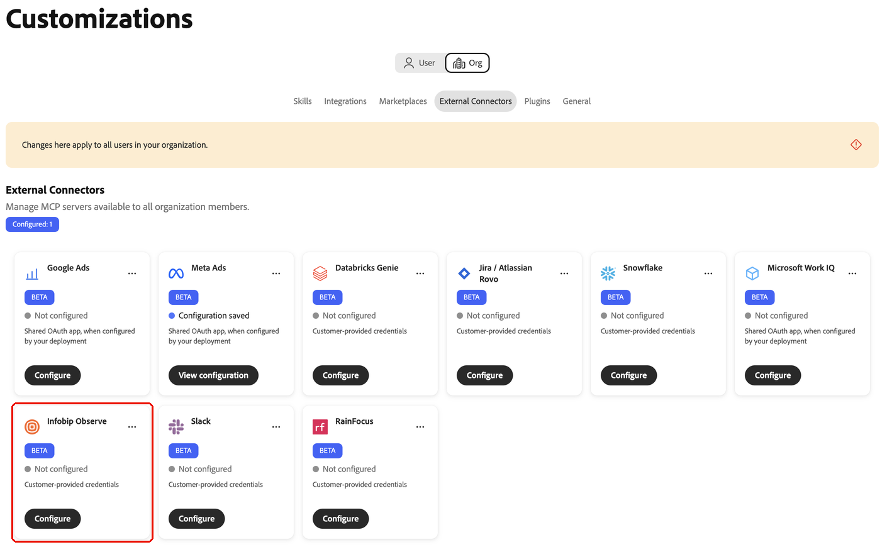
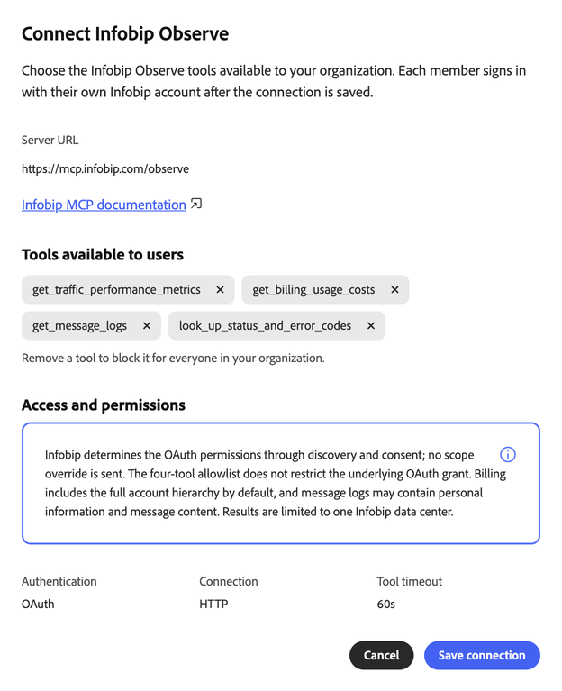
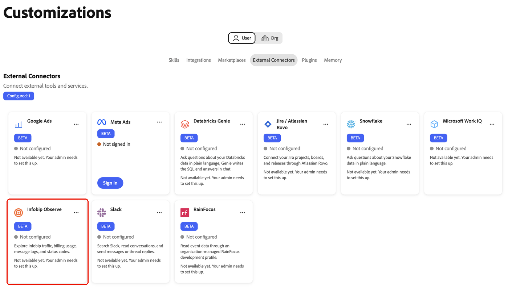

# Infobip Observe external connector {#infobip-observe}

Use the [!DNL Infobip Observe] external connector to review your [!DNL Infobip] traffic and costs in Adobe CX Enterprise Coworker. After you set up the connector, ask Coworker about traffic metrics, billing usage, message logs, and status and error codes. The connector is the [!DNL Observe] Model Context Protocol (MCP) server hosted by [!DNL Infobip].

>[!AVAILABILITY]
>
>The [!DNL Infobip Observe] external connector is in beta. The documentation and the functionality are subject to change.

## Connector configuration {#connector-configuration}

The connector configuration process has two separate parts:

* **Organization setup:** An administrator configures the connector once for the whole organization and approves the tools that members can use.
* **Member sign-in:** Each member signs in with their own [!DNL Infobip] account. Members can access only the data that their [!DNL Infobip] account has permission to use.

The connector has no shared organization sign-in. Every member who uses the connector signs in separately. Saving the organization configuration does not sign in any members or grant additional [!DNL Infobip] permissions.

## Prerequisites {#prerequisites}

The connector works with the [!DNL Infobip] [!DNL Observe] MCP server only. It does not connect to the [!DNL Infobip] messaging, provisioning, or account management MCP servers.

Before you begin, make sure that you have the following:

* **Coworker access:** An account with permission to manage organization connectors, in an organization where the [!DNL Infobip Observe] connector is available.
* **[!DNL Infobip] account:** An approved [!DNL Infobip] account with access to [!DNL Observe] in the intended data center. [!DNL Infobip] offers [!DNL Observe] MCP as an early access feature. Confirm your entitlement and account suitability with [!DNL Infobip].
* **Member identities:** Members with their own [!DNL Infobip] accounts and permission to access the intended data.
* **An approved scope for testing:** An approved test scope and non-sensitive data before you query billing, traffic, or message logs.

To test the connector, you can sign up for a free [!DNL Infobip] trial account. A trial account does not guarantee data isolation or zero cost. For more information, see [Using Infobip MCP servers](https://www.infobip.com/docs/mcp/using-mcp){target="_blank"} and [Observe MCP](https://www.infobip.com/docs/mcp/observe-mcp){target="_blank"} in the [!DNL Infobip] documentation.

>[!IMPORTANT]
>
>Never share passwords, API keys, tokens, authorization codes, or consent and callback URLs in screenshots, chats, or support tickets.

## Connection and sign-in model {#connection-model}

Coworker applies the following settings automatically. You do not create an OAuth app or enter app credentials.

| Setting | Value |
| --- | --- |
| Server URL | `https://mcp.infobip.com/observe` |
| Transport | Streamable HTTP |
| Authorization server discovery | `https://mcp.infobip.com/observe/.well-known/oauth-authorization-server` |
| Sign-in | Each member signs in with OAuth, using dynamic client registration |
| Saved OAuth settings | None. Coworker saves no scopes, client ID, client secret, or OAuth endpoints. |
| Tool selection | Four approved tools. Administrators can narrow the selection. |

[!DNL Infobip] discovery and the consent of each member determine the access that Coworker receives. [!DNL Infobip] documents the `billing:usage:view`, `metrics:manage`, `messages-api:manage`, and `error-codes:read` scopes for [!DNL Observe] MCP. Review the requested access on the consent screen before you approve.

[!DNL Infobip] also supports API key authentication for [!DNL Observe] MCP in other MCP clients. Coworker does not use API keys for this connector. Members sign in with OAuth only.

## Configure the connector for your organization {#configure-organization}

Administrators make the [!DNL Infobip Observe] connector available to everyone in the organization. Changes on the organization page apply to all users in your organization. Members cannot configure the organization connection.

1. Open **[!UICONTROL Customizations]**, select **[!UICONTROL Org]**, and then select **[!UICONTROL External Connectors]**.

1. Find **[!UICONTROL Infobip Observe]**, and then select **[!UICONTROL Configure]**.

   {width="700" zoomable="yes"}

1. In the **[!UICONTROL Connect Infobip Observe]** dialog, review the fixed **[!UICONTROL Server URL]**, `https://mcp.infobip.com/observe`.

   You do not need to enter an OAuth client ID, client secret, or scopes.

1. Under **[!UICONTROL Tools available to users]**, review the four tools that are initially selected. Remove any tool that members of your organization should not use. At least one tool must remain.

   For more information, see [Available tools](#available-tools).

   {width="500" zoomable="yes"}

1. Select **[!UICONTROL Save connection]**. Then reopen the configuration to verify that your tool selection persists.

Saving does not sign in you or any member to [!DNL Infobip]. To check the connection yourself, sign in as described in [Sign in as a member](#sign-in-as-a-member).

To make all four tools available again after you remove any, select **[!UICONTROL Restore all tools]**. This option restores only the four approved tools. Coworker does not enable tools that [!DNL Infobip] adds later. You cannot save the configuration with no tools selected.

### Available tools {#available-tools}

The [!DNL Infobip Observe] connector provides the following tools. [!DNL Infobip] can change the limits of each tool, so check the [!DNL Infobip] documentation before you rely on them.

| Tool | Purpose | Limits |
| --- | --- | --- |
| `get_traffic_performance_metrics` | Aggregated traffic, delivery, and engagement metrics. | Up to 366 days of data. Hourly windows cover up to 14 days, and daily windows up to 93 days. Returns data for the signed-in account by default. Include subaccounts explicitly. |
| `get_billing_usage_costs` | Usage and costs that align with invoices. | The current and previous two calendar months. Includes the full account hierarchy by default. Data for a month is provisional until the fifth day of the following month. |
| `get_message_logs` | Logs for individual messages. | The last 48 hours. Logs can include recipient identifiers, personal information, and message content. |
| `look_up_status_and_error_codes` | Descriptions of known status and error code names. | Up to 50 names per request. [!DNL Infobip] can omit unknown names from the results. |

Results are limited to one [!DNL Infobip] data center. The tool selection controls which tools members can use in Coworker. It does not narrow the [!DNL Infobip] access that members grant at sign-in, the account hierarchy, or the permissions that [!DNL Infobip] enforces.

>[!IMPORTANT]
>
>Message logs can contain personal data, such as recipient identifiers and message content. Billing information is sensitive and covers the full account hierarchy by default. Enable these tools only when your organization approves their use. Use explicit, approved account filters and limited queries.

## Sign in as a member {#sign-in-as-a-member}

After an administrator configures the connector, each member signs in with their own [!DNL Infobip] account. Your sign-in belongs only to you. Other members do not use your credentials.

1. Open **[!UICONTROL Customizations]**, select **[!UICONTROL User]**, and then select **[!UICONTROL External Connectors]**. Find **[!UICONTROL Infobip Observe]**.

   If the card shows **[!UICONTROL Not configured]** and **[!UICONTROL Not available yet. Your admin needs to set this up.]**, ask your administrator to [configure the connector](#configure-organization).

   {width="700" zoomable="yes"}

1. Select **[!UICONTROL Sign in]** and use the intended [!DNL Infobip] account. Complete the single sign-on (SSO), multi-factor authentication (MFA), and consent prompts yourself. Before you approve, review the requested access, the account, and the data center.

1. Return to Coworker and open the connector details. Review the tools that your administrator enabled.

   Members can view the tools but cannot change the organization configuration.

1. Select **[!UICONTROL Test connection]**.

   A successful test confirms that Coworker can connect and list the tools. It does not confirm that every tool runs successfully.

1. If you are authorized and your administrator enabled the `look_up_status_and_error_codes` tool, run the lookup in [Check your connection](#check-connection).

1. To disconnect your [!DNL Infobip] account from the connector, select **[!UICONTROL Sign out]**.

   Signing out does not necessarily revoke the access that you granted in [!DNL Infobip].

## Check your connection {#check-connection}

To confirm that the connector works with your account, run a read-only lookup. Make sure that your administrator enabled the `look_up_status_and_error_codes` tool. Then start a chat and enter a prompt.

Example prompt:

* "Using Infobip Observe, look up the status code NO_ERROR and describe what it means. Do not query traffic metrics, billing, or message logs."

Confirm that the result includes a description of `NO_ERROR` without an error message. A successful lookup does not confirm that the traffic, billing, or message log tools work for your account. Do not query billing or message logs only to test the connection.

## Troubleshoot access {#troubleshoot-access}

If you cannot access your [!DNL Infobip] data, check the following with your administrator:

| Issue | What to check |
| --- | --- |
| The **[!UICONTROL Infobip Observe]** connector is missing | Confirm that the connector is available to your organization and that you have permission to manage organization connectors. Contact your Adobe representative if needed. |
| Consent or sign-in fails | Check the [!DNL Infobip] account you used, your [!DNL Observe] entitlement, and the data center. Do not share the consent URL, callback URL, or authorization codes when you ask for help. |
| Sign-in succeeds, but a tool fails | Check the effective [!DNL Infobip] permissions, the account and data center you signed in with, and the error that [!DNL Infobip] returns. A successful sign-in does not confirm that a tool runs successfully. |
| A tool is unavailable | Check the tools that your administrator enabled. Coworker does not enable new [!DNL Infobip] tools automatically. |
| You cannot save the configuration | Keep at least one tool selected. To stop offering the connector, remove it instead. |
| Billing results include unexpected accounts | Billing results include the full account hierarchy by default. Stop, and then review the approved account filters and permissions. |
| Message logs show sensitive data | Stop the query and limit later queries to approved, non-sensitive data. Do not paste raw logs into chats or support tickets. |
| The status code lookup succeeds, but another request fails | Investigate the failed request separately. A successful lookup does not confirm that every tool or account works. |
