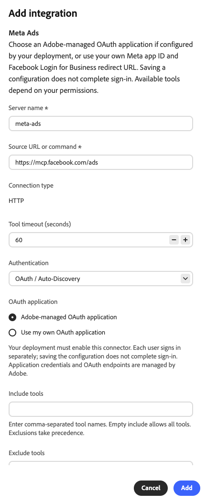
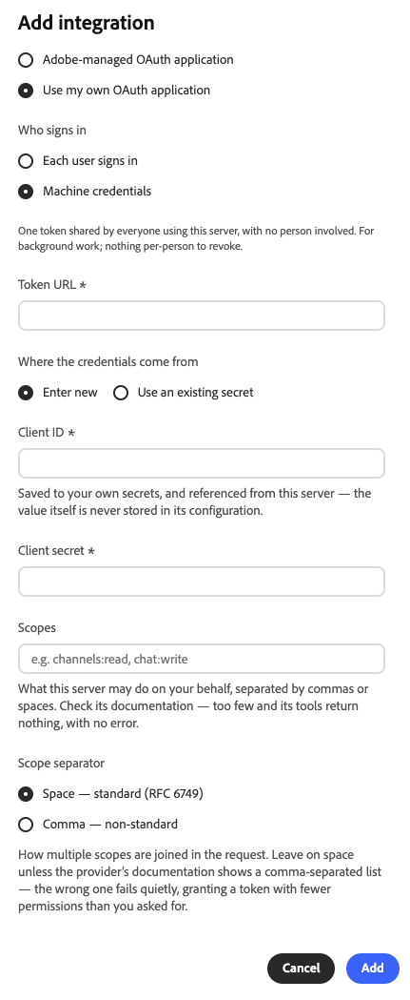

# Meta Ads external connector {#meta-ads}

Use the [!DNL Meta Ads] external connector to work with your [!DNL Meta] advertising data in Adobe CX Enterprise Coworker. After you set up the connector, ask Coworker to report on ad performance, manage campaigns and audiences, work with product catalogs, and more. The connector is a Model Context Protocol (MCP) server hosted by [!DNL Meta].

## Connector configuration {#connector-configuration}

The connector configuration process has two separate parts:

* **Organization setup:** An administrator configures the connector once for the whole organization. The administrator chooses the OAuth application and selects the tools that members can use.
* **Member sign-in:** Each member signs in with their own [!DNL Facebook] account. Members can access only the [!DNL Meta] assets that their [!DNL Facebook] identity and the authorized app allow.

Saving the organization configuration does not sign in any members or grant access to ad accounts. Each member must sign in separately.

## Prerequisites {#prerequisites}

Before you begin, make sure that you have the following:

* **For organization setup:** An account with permission to manage organization connectors in Coworker.
* **For member sign-in:** A [!DNL Facebook] account with access to the ad accounts, businesses, Pages, or other [!DNL Meta] assets you plan to use.
* **For your own OAuth app (optional):** A [!DNL Meta] app that your organization manages, with its app ID and a [!DNL Facebook Login for Business] redirect URL.
* **For machine credentials (optional):** The token URL, client ID, and client secret of your OAuth app.

## Configure the connector for your organization {#configure-organization}

Administrators make the [!DNL Meta Ads] connector available to everyone in the organization. Changes on the organization page apply to all users in your organization.

1. Open **[!UICONTROL Customizations]**, select **[!UICONTROL Org]**, and then select **[!UICONTROL External Connectors]**.

   {zoomable="yes"}

1. On the **[!UICONTROL Meta Ads]** card, select **[!UICONTROL Configure]**.

   The **[!UICONTROL Add integration]** dialog opens with the [!DNL Meta Ads] settings filled in.

1. Review the connection settings. For more information, see [Connection settings](#connection-settings).

1. Under **[!UICONTROL OAuth application]**, select the OAuth application to use:

   * **[!UICONTROL Adobe-managed OAuth application]:** Adobe manages the application credentials and OAuth endpoints. Your deployment must enable this connector. For more information, see [Use the Adobe-managed OAuth application](#adobe-managed-oauth).
   * **[!UICONTROL Use my own OAuth application]:** Your organization provides its own [!DNL Meta] app. For more information, see [Use your own Meta app](#use-your-own-meta-app).

1. In **[!UICONTROL Include tools]** and **[!UICONTROL Exclude tools]**, set the tools that members can use. For more information, see [Choose available tools](#available-tools).

1. Select **[!UICONTROL Add]**.

   Saving the configuration does not sign in any members.

1. Review the saved **[!UICONTROL meta-ads]** connector details.

   | Setting | Description |
   | --- | --- |
   | **[!UICONTROL Source]** | The [!DNL Meta Ads] MCP server, `https://mcp.facebook.com/ads`. |
   | **[!UICONTROL Authentication]** | The authentication method, `meta-ads_login`. |
   | **[!UICONTROL Connection]** | The OAuth application in use and your own sign-in status. |
   | **[!UICONTROL Tool selection]** | The number of tools selected for members. |

   {zoomable="yes"}

1. (Optional) Select **[!UICONTROL Test]** to check that Coworker can discover the connector tools.

The **[!UICONTROL Not signed in]** status on the connector details refers to your own connection, not to the organization. To use the connector yourself, select **[!UICONTROL Sign in]** and follow the steps in [Sign in as a member](#sign-in-as-a-member).

To stop offering the connector to your organization, select **[!UICONTROL Remove]** on the connector details page.

### Connection settings {#connection-settings}

The dialog fills in the following settings for [!DNL Meta Ads]:

| Setting | Description |
| --- | --- |
| **[!UICONTROL Server name]** | Required. The name of the connector in Coworker, `meta-ads`. |
| **[!UICONTROL Source URL or command]** | Required. The [!DNL Meta Ads] MCP server, `https://mcp.facebook.com/ads`. |
| **[!UICONTROL Connection type]** | Read-only. The connection type, HTTP. |
| **[!UICONTROL Tool timeout (seconds)]** | How long Coworker waits for a tool to respond. The default is 60 seconds. |
| **[!UICONTROL Authentication]** | The authentication method. The default is **[!UICONTROL OAuth / Auto-Discovery]**. |

### Use the Adobe-managed OAuth application {#adobe-managed-oauth}

Select **[!UICONTROL Adobe-managed OAuth application]** to use the [!DNL Meta] app that Adobe provides. Adobe manages the application credentials and OAuth endpoints, so you do not need to enter them. Your deployment must enable this connector.

{zoomable="yes"}

Each member signs in separately with their own [!DNL Facebook] account.

### Use your own Meta app {#use-your-own-meta-app}

Select **[!UICONTROL Use my own OAuth application]** when members must authorize an app that your organization manages instead of the Adobe-managed app. Your app needs a [!DNL Meta] app ID and a [!DNL Facebook Login for Business] redirect URL.

{zoomable="yes"}

1. Prepare your [!DNL Meta] app. Set up [!DNL Facebook Login for Business] with the Coworker redirect URL, and make the app available to the members who will sign in.

   Ask your [!DNL Meta] app administrator to confirm the required permissions and any app review requirements for your intended use.

1. Under **[!UICONTROL Who signs in]**, select one of the following options:

   * **[!UICONTROL Each user signs in]:** Each member signs in with their own [!DNL Facebook] account. Coworker keeps one token per person, and you can revoke each token separately.
   * **[!UICONTROL Machine credentials]:** Everyone who uses the connector shares one token, with no person involved. Use this option for background work. There is no per-person token to revoke. For more information, see [Use machine credentials](#machine-credentials).

1. If you selected **[!UICONTROL Each user signs in]**, provide the OAuth details of your app in one of the following ways:

   * **[!UICONTROL Discover auth]:** Coworker reads the OAuth metadata of the server, so that it asks only for the details the server needs.
   * **[!UICONTROL Enter the details myself]:** Enter the OAuth details manually.

1. (Optional) To send additional HTTP headers to the server, select **[!UICONTROL Add header]** under **[!UICONTROL Headers]**.

### Use machine credentials {#machine-credentials}

When you select **[!UICONTROL Machine credentials]**, the dialog shows the settings for a shared token.

{zoomable="yes"}

| Setting | Description |
| --- | --- |
| **[!UICONTROL Token URL]** | Required. The URL where Coworker requests the shared access token. |
| **[!UICONTROL Where the credentials come from]** | Choose where the credentials come from. Select **[!UICONTROL Enter new]** to enter a client ID and client secret, or **[!UICONTROL Use an existing secret]** to select organization secrets that already contain them. |
| **[!UICONTROL Client ID]** | Required when you select **[!UICONTROL Enter new]**. Coworker saves the value to your secrets and references it from the connector. The value itself is never stored in the connector configuration. |
| **[!UICONTROL Client secret]** | Required when you select **[!UICONTROL Enter new]**. The client secret of your OAuth app. |
| **[!UICONTROL Scopes]** | Optional. The permissions the connector requests, separated by commas or spaces. Check the documentation of the provider for the scopes you need. With too few scopes, tools return no results, without an error. |
| **[!UICONTROL Scope separator]** | How Coworker joins multiple scopes in the token request. Keep **[!UICONTROL Space — standard (RFC 6749)]** unless the documentation of the provider shows a comma-separated list. In that case, select **[!UICONTROL Comma — non-standard]**. |

>[!IMPORTANT]
>
>With machine credentials, everyone who uses the connector acts with the permissions of the shared token. If you select the wrong scope separator, the request does not fail. Instead, the token has fewer permissions than you requested.

### Choose available tools {#available-tools}

Use **[!UICONTROL Include tools]** and **[!UICONTROL Exclude tools]** to control which tools members can use. Enter tool names separated by commas.

| Setting | Description |
| --- | --- |
| **[!UICONTROL Include tools]** | The tools that members can use. Leave the field empty to allow all tools. |
| **[!UICONTROL Exclude tools]** | The tools that members can never use. Exclusions take precedence over the tools you include. |

The [!DNL Meta Ads] connector provides tools for reporting and insights, ads, campaigns, and audiences, catalogs and products, signals and datasets, A/B tests and lift studies, activity logs, and help and troubleshooting. For example, `ads_insights_performance_trend` reports performance trends, and `ads_get_ad_accounts` lists the ad accounts you can access. The tools available to each member also depend on their permissions in [!DNL Meta].

>[!IMPORTANT]
>
>Not every tool is read-only. Some tools can change campaigns, budgets, audiences, catalogs, or other advertising assets. If you leave **[!UICONTROL Include tools]** empty, members can use all tools. Include only the tools that your organization intends members to use.

## Sign in as a member {#sign-in-as-a-member}

After an administrator configures the connector, each member signs in with their own [!DNL Facebook] account. You do not need an app secret or access token to sign in. If your administrator set up [machine credentials](#machine-credentials), the connector uses a shared token, and you do not sign in.

1. Open **[!UICONTROL Customizations]**, select **[!UICONTROL User]**, and then select **[!UICONTROL External Connectors]**.

   {zoomable="yes"}

1. On the **[!UICONTROL Meta Ads]** card, select **[!UICONTROL Sign in]**.

   If the card shows **[!UICONTROL Not configured]** or the connector is unavailable, ask your administrator to [configure the connector](#configure-organization).

1. Sign in to [!DNL Facebook] and complete any required prompts, such as single sign-on (SSO), multi-factor authentication (MFA), consent, or identity verification.

   The order of these prompts depends on your account and organization policies. First-time users may also see prompts to grant permissions and select assets.

1. Review the [!DNL Facebook] account and the app you are authorizing, and then do one of the following:

   * To keep your previous settings, select **[!UICONTROL Continue]**.
   * To review or change the authorization, select **[!UICONTROL Edit settings]**.
   * To use a different [!DNL Facebook] account, select **[!UICONTROL Log into another account]**.

   With the Adobe-managed app, you authorize [!DNL Adobe Experience Cloud]. With your own organization app, the app name and prompts differ.

   >[!IMPORTANT]
   >
   >The app receives ongoing access to the information you share, and [!DNL Meta] records when the app accesses that information. Continue only if your organization approves the requested access.

1. After [!DNL Facebook] returns you to Coworker, open the **[!UICONTROL meta-ads]** connector details. Confirm that the connector shows **[!UICONTROL Connected]** and **[!UICONTROL Signed in]**.

   {zoomable="yes"}

1. Review **[!UICONTROL Tools enabled by your admin]** to view the tools you can use.

The connector details also show the **[!UICONTROL Tool Timeout]** setting and the following controls:

* **[!UICONTROL Reload tools]:** Refresh the list of tools.
* **[!UICONTROL Test]:** Check that Coworker can discover the connector tools.
* **[!UICONTROL Sign out]:** Disconnect your [!DNL Facebook] account from the connector.

A **[!UICONTROL Connected]** status does not confirm access to a specific ad account or that every tool runs successfully. To confirm your access, [check your ad account access](#check-ad-account-access).

## Check your ad account access {#check-ad-account-access}

To confirm which ad accounts you can use, start a chat and enter a read-only prompt.

Example prompt:

* "Which Meta ad accounts can I access? List them without changing anything."

If your administrator enabled the `ads_get_ad_accounts` tool, Coworker lists the ad accounts you can access. For each account, Coworker shows the owning business, MCP eligibility, and reporting availability. Choose an accessible account before you request reports or take actions.

## Troubleshoot access {#troubleshoot-access}

If you cannot access your [!DNL Meta] assets, check the following:

| Area | What to check |
| --- | --- |
| [!DNL Facebook] account | You signed in with the [!DNL Facebook] account that has access to the ad account. |
| Asset permissions | Your [!DNL Facebook] account has permissions for the ad accounts, businesses, or Pages you want to use. |
| App authorization | You authorized the app and shared the required assets. To review the authorization, sign out and sign in again, and then select **[!UICONTROL Edit settings]**. |
| Tool policy | The tools you need are in **[!UICONTROL Include tools]**, or that field is empty, and they are not in **[!UICONTROL Exclude tools]**. |
| Your own OAuth app | The [!DNL Facebook Login for Business] redirect URL and the app ID are correct, and members have access to the app. Confirm the required permissions with your [!DNL Meta] app administrator. |
| Machine credentials | The token URL, client ID, and client secret are correct. If tools return no results, check the **[!UICONTROL Scopes]** and **[!UICONTROL Scope separator]** settings. |
