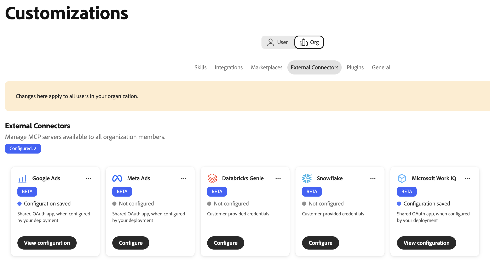
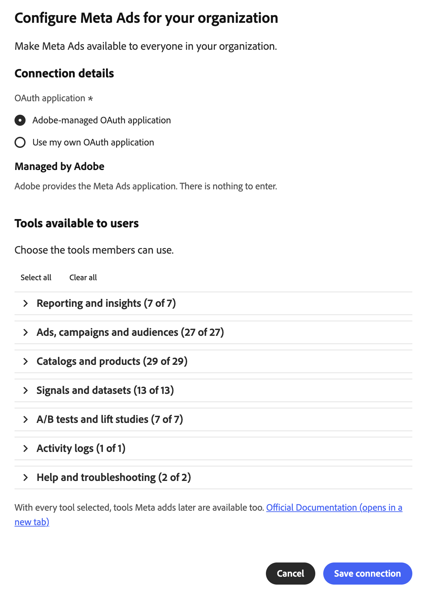
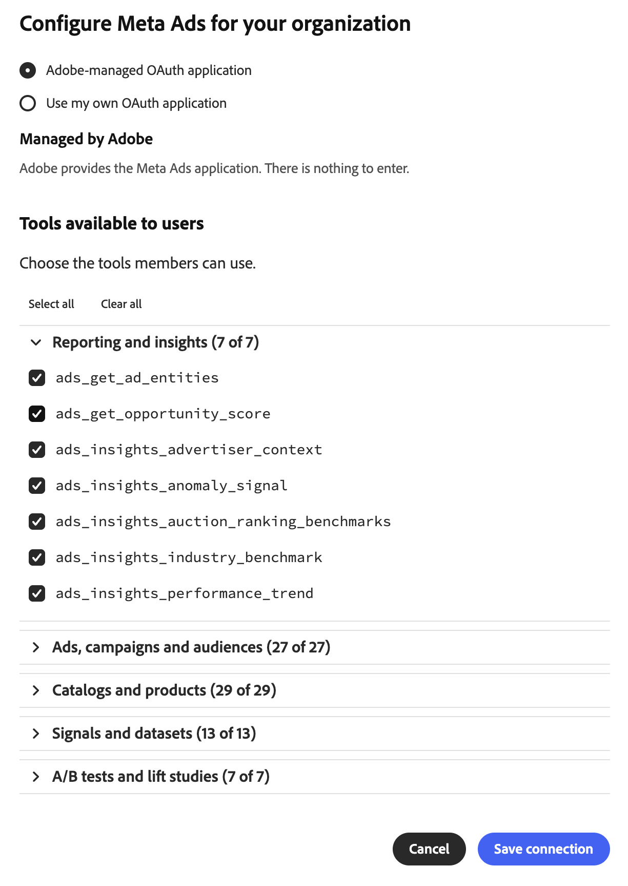
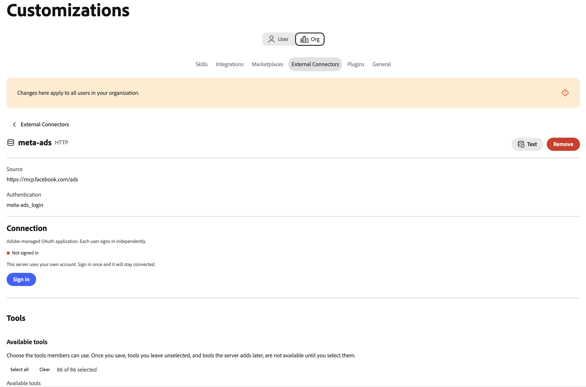
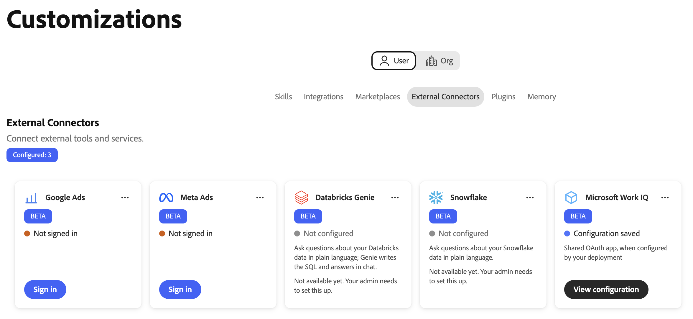
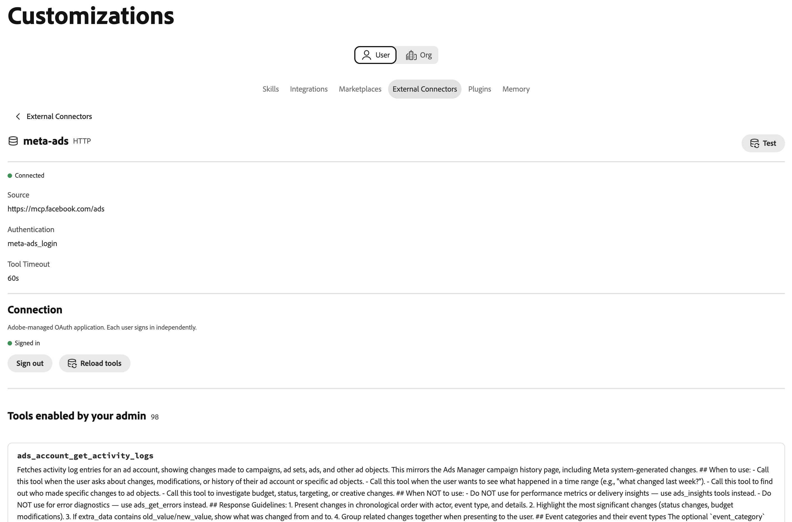

# Meta Ads external connector {#meta-ads}

Use the [!DNL Meta Ads] external connector to work with your [!DNL Meta] advertising data in Adobe CX Enterprise Coworker. After you set up the connector, ask Coworker to report on ad performance, manage campaigns and audiences, work with product catalogs, and more. The connector is a Model Context Protocol (MCP) server hosted by [!DNL Meta].

## Connector configuration {#connector-configuration}

The connector configuration process has two separate parts:

* **Organization setup:** An administrator configures the connector once for the whole organization. The administrator chooses the OAuth application and selects the tools that members can use.
* **Member sign-in:** Each member signs in with their own [!DNL Facebook] account. Members can access only the [!DNL Meta] assets that their [!DNL Facebook] identity and the authorized app allow.

Saving the organization configuration does not sign in any members or grant access to ad accounts. Each member must sign in separately.

## Prerequisites {#prerequisites}

Before you begin, make sure that you have the following:

* **For organization setup:** An account with permission to manage organization connectors in Coworker.
* **For member sign-in:** A [!DNL Facebook] account with access to the ad accounts, businesses, Pages, or other [!DNL Meta] assets you plan to use.
* **For your own OAuth app (optional):** A [!DNL Meta] app that your organization manages, along with its app ID and app secret.

## Configure the connector for your organization {#configure-organization}

Administrators make the [!DNL Meta Ads] connector available to everyone in the organization. Changes on the organization page apply to all users in your organization.

1. Open **[!UICONTROL Customizations]**, select **[!UICONTROL Org]**, and then select **[!UICONTROL External Connectors]**. On the **[!UICONTROL Meta Ads]** card, select **[!UICONTROL Configure]**.

   {width="700" zoomable="yes"}

1. In the **[!UICONTROL Configure Meta Ads for your organization]** dialog, review the **[!UICONTROL Connection details]**, and then select an **[!UICONTROL OAuth application]**:

   * **[!UICONTROL Adobe-managed OAuth application]:** Adobe provides the [!DNL Meta Ads] app, so you do not need to enter app credentials. Each member still signs in with their own [!DNL Facebook] account after you save.

     {width="500" zoomable="yes"}

   * **[!UICONTROL Use my own OAuth application]:** Your organization provides its own [!DNL Meta] app. Members authorize your app, not the Adobe app. Under **[!UICONTROL Your Meta application]**, complete the following steps:

     1. Copy the **[!UICONTROL Redirect URL]**, and add it to the login settings of your [!DNL Meta] app. Use the exact value shown in the dialog, because the redirect URL differs between environments.
     1. Under **[!UICONTROL Where the credentials come from]**, select **[!UICONTROL Enter new]**, and then enter the **[!UICONTROL Meta app ID]** and **[!UICONTROL Meta app secret]**. Find the app ID in the basic settings of your [!DNL Meta] app. Coworker stores the app secret as an organization secret. To reuse saved credentials for the same app instead, select **[!UICONTROL Use an existing secret]**.
     1. Make the app available to the members who will sign in. Ask your [!DNL Meta] app administrator to confirm the required permissions and any app review requirements for your intended use.

     The **[!UICONTROL Discovered from the MCP server]** indicator confirms that Coworker found the connector. It does not confirm that your app credentials are valid or that members have signed in. To refresh discovery, select **[!UICONTROL Discover again]**.

     {width="500" zoomable="yes"}

1. Under **[!UICONTROL Tools available to users]**, expand each tool group and select the tools your organization needs. To change all tools at once, use **[!UICONTROL Select all]** or **[!UICONTROL Clear all]**. For more information, see [Tool groups](#tool-groups). Then select **[!UICONTROL Save connection]**.

   {width="500" zoomable="yes"}

1. Review the saved **[!UICONTROL meta-ads]** connector details. Optionally, select **[!UICONTROL Test]** to check that Coworker can discover the connector tools.

   | Setting | Description |
   | --- | --- |
   | **[!UICONTROL Source]** | The [!DNL Meta Ads] MCP server, `https://mcp.facebook.com/ads`. |
   | **[!UICONTROL Authentication]** | The authentication method, `meta-ads_login`. |
   | **[!UICONTROL Connection]** | The OAuth application in use and your own sign-in status. |
   | **[!UICONTROL Tools]** | The tools selected for members, with **[!UICONTROL Select all]** and **[!UICONTROL Clear]** controls and a count of selected tools. |

   {width="700" zoomable="yes"}

The **[!UICONTROL Not signed in]** status on the connector details refers to your own connection, not to the organization. To use the connector yourself, select **[!UICONTROL Sign in]** and follow the steps in [Sign in as a member](#sign-in-as-a-member).

To stop offering the connector to your organization, select **[!UICONTROL Remove]** on the connector details page.

### Tool groups {#tool-groups}

The [!DNL Meta Ads] connector organizes its tools into the following groups:

* [!UICONTROL Reporting and insights]
* [!UICONTROL Ads, campaigns and audiences]
* [!UICONTROL Catalogs and products]
* [!UICONTROL Signals and datasets]
* [!UICONTROL A/B tests and lift studies]
* [!UICONTROL Activity logs]
* [!UICONTROL Help and troubleshooting]

For example, the [!UICONTROL Reporting and insights] group includes tools such as `ads_insights_performance_trend` and `ads_insights_industry_benchmark`. The tools in each group can change as [!DNL Meta] updates the connector.

>[!IMPORTANT]
>
>Not every tool is read-only. Some tools can change campaigns, budgets, audiences, catalogs, or other advertising assets. Select only the tools that your organization intends members to use.

After you save, tools that you leave unselected are not available to members until you select them. To confirm which tools members can use, review the **[!UICONTROL Available tools]** section on the connector details page.

## Sign in as a member {#sign-in-as-a-member}

After an administrator configures the connector, each member signs in with their own [!DNL Facebook] account. You do not need an app secret or access token to sign in.

1. Open **[!UICONTROL Customizations]**, select **[!UICONTROL User]**, and then select **[!UICONTROL External Connectors]**.

   {width="700" zoomable="yes"}

1. On the **[!UICONTROL Meta Ads]** card, select **[!UICONTROL Sign in]**.

   If the card shows **[!UICONTROL Not configured]** or the connector is unavailable, ask your administrator to [configure the connector](#configure-organization).

1. Sign in to [!DNL Facebook] and complete any required prompts, such as single sign-on (SSO), multi-factor authentication (MFA), consent, or identity verification.

   The order of these prompts depends on your account and organization policies. First-time users may also see prompts to grant permissions and select assets.

1. Review the [!DNL Facebook] account and the app you are authorizing, and then do one of the following:

   * To keep your previous settings, select **[!UICONTROL Continue]**.
   * To review or change the authorization, select **[!UICONTROL Edit settings]**.
   * To use a different [!DNL Facebook] account, select **[!UICONTROL Log into another account]**.

   With the Adobe-managed app, you authorize [!DNL Adobe Experience Cloud]. With your own organization app, the app name and prompts differ.

   {width="400" zoomable="yes"}

   >[!IMPORTANT]
   >
   >The app receives ongoing access to the information you share, and [!DNL Meta] records when the app accesses that information. Continue only if your organization approves the requested access.

1. After [!DNL Facebook] returns you to Coworker, open the **[!UICONTROL meta-ads]** connector details. Confirm that the connector shows **[!UICONTROL Connected]** and **[!UICONTROL Signed in]**.

   {width="700" zoomable="yes"}

1. Review **[!UICONTROL Tools enabled by your admin]** to view the tools you can use.

The connector details also show the **[!UICONTROL Tool Timeout]** setting and the following controls:

* **[!UICONTROL Reload tools]:** Refresh the list of tools.
* **[!UICONTROL Test]:** Check that Coworker can discover the connector tools.
* **[!UICONTROL Sign out]:** Disconnect your [!DNL Facebook] account from the connector.

A **[!UICONTROL Connected]** status does not confirm access to a specific ad account or that every tool runs successfully. To confirm your access, [check your ad account access](#check-ad-account-access).

## Check your ad account access {#check-ad-account-access}

To confirm which ad accounts you can use, start a chat and enter a read-only prompt.

Example prompt:

* "Which Meta ad accounts can I access? List them without changing anything."

If your administrator enabled the `ads_get_ad_accounts` tool, Coworker lists the ad accounts you can access. For each account, Coworker shows the owning business, MCP eligibility, and reporting availability. Choose an accessible account before you request reports or take actions.

## Troubleshoot access {#troubleshoot-access}

If you cannot access your [!DNL Meta] assets, check the following:

| Area | What to check |
| --- | --- |
| [!DNL Facebook] account | You signed in with the [!DNL Facebook] account that has access to the ad account. |
| Asset permissions | Your [!DNL Facebook] account has permissions for the ad accounts, businesses, or Pages you want to use. |
| App authorization | You authorized the app and shared the required assets. To review the authorization, sign out and sign in again, and then select **[!UICONTROL Edit settings]**. |
| Enabled tools | Your administrator enabled the tools you need under **[!UICONTROL Tools available to users]**. |
| Your own OAuth app | The redirect URL matches exactly, the app ID and app secret are correct, and members have access to the app. Confirm the required permissions with your [!DNL Meta] app administrator. |
