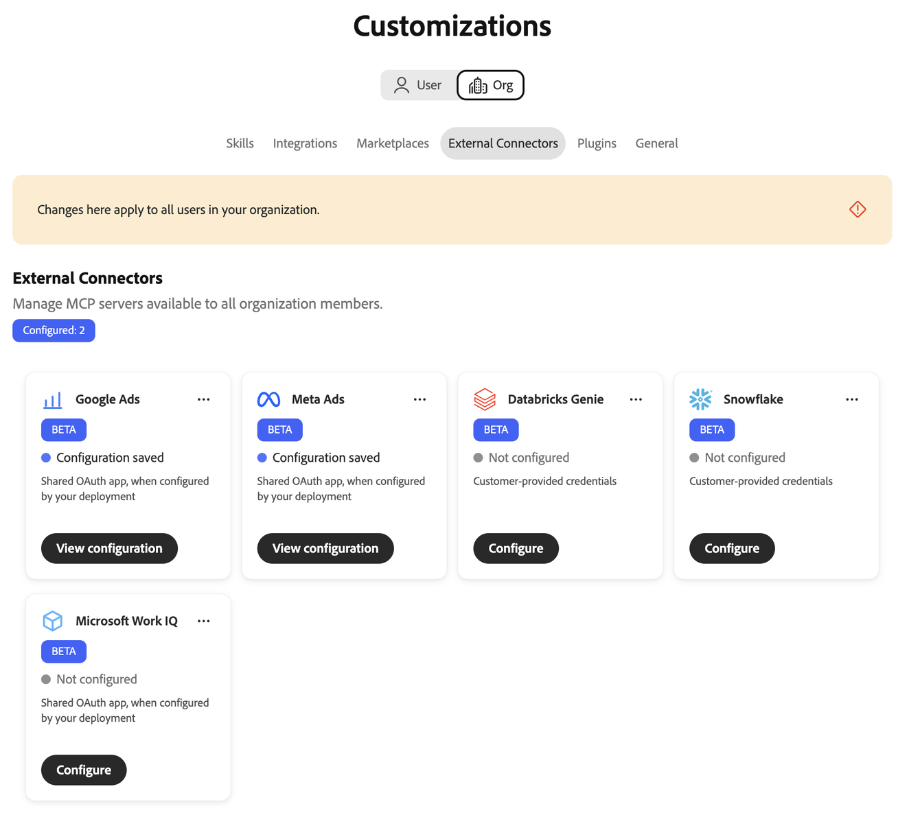
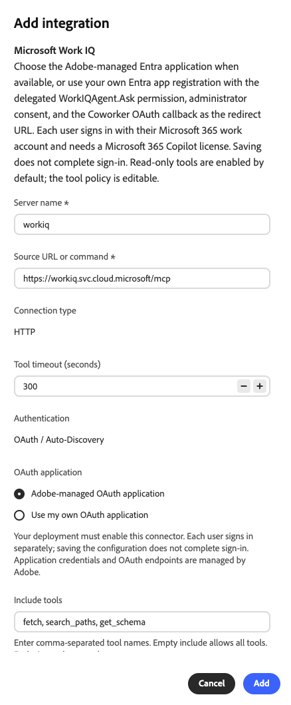
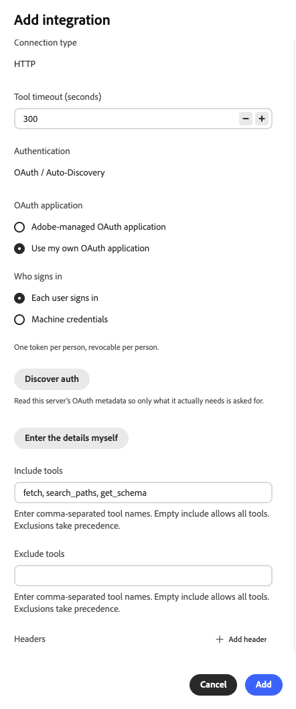
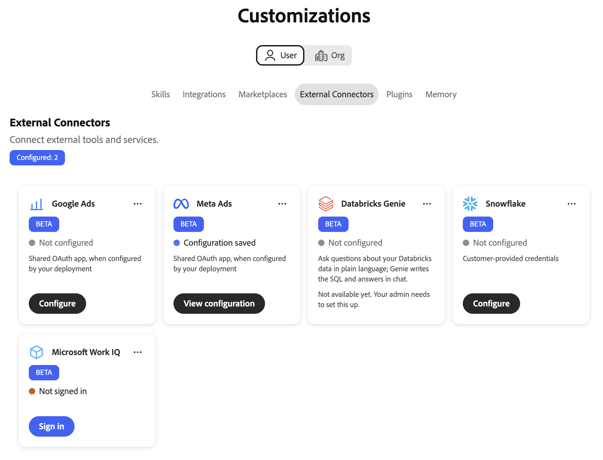

# Microsoft Work IQ external connector {#microsoft-work-iq}

Use the [!DNL Microsoft Work IQ] external connector to work with your [!DNL Microsoft 365] data in Adobe CX Enterprise Coworker. After you set up the connector, ask Coworker to search your email, files, meetings, and [!DNL Microsoft Teams] messages, review calendar events, and more. The connector is a Model Context Protocol (MCP) server hosted by [!DNL Microsoft].

## Connector configuration {#connector-configuration}

The connector configuration process has two separate parts:

* **Organization setup:** An administrator configures the connector once for the whole organization. The administrator chooses the OAuth application and selects the tools that members can use.
* **Member sign-in:** Each member signs in with their own [!DNL Microsoft] work account. Members can access only the data that their account can access.

Saving the organization configuration does not sign in any members or grant additional [!DNL Microsoft 365] permissions. Each member must sign in separately.

## Prerequisites {#prerequisites}

Before you begin, make sure that you have the following:

* **For organization setup:** An account with permission to manage organization connectors in Coworker.
* **For your [!DNL Microsoft] tenant:** [!DNL Work IQ] enabled for the tenant.
* **For member sign-in:** A [!DNL Microsoft 365] work account with a [!DNL Microsoft 365 Copilot] license and access to the data you plan to use.
* **For your own OAuth app (optional):** A [!DNL Microsoft Entra] administrator who can register an app and grant admin consent.

## Configure the connector for your organization {#configure-organization}

Administrators make the [!DNL Microsoft Work IQ] connector available to everyone in the organization. Changes on the organization page apply to all users in your organization.

1. Open **[!UICONTROL Customizations]**, select **[!UICONTROL Org]**, and then select **[!UICONTROL External Connectors]**.

   {zoomable="yes"}

1. On the **[!UICONTROL Microsoft Work IQ]** card, select **[!UICONTROL Configure]**.

   The **[!UICONTROL Add integration]** dialog opens with the [!DNL Microsoft Work IQ] settings filled in.

1. Review the connection settings. For more information, see [Connection settings](#connection-settings).

1. Under **[!UICONTROL OAuth application]**, select the OAuth application that members authorize when they sign in:

   * **[!UICONTROL Adobe-managed OAuth application]:** Adobe manages the application credentials and OAuth endpoints. Your deployment must enable this connector. For more information, see [Use the Adobe-managed OAuth application](#adobe-managed-oauth).
   * **[!UICONTROL Use my own OAuth application]:** Members authorize an app that your organization registers in [!DNL Microsoft Entra]. For more information, see [Use your own OAuth application](#own-oauth).

1. In **[!UICONTROL Include tools]** and **[!UICONTROL Exclude tools]**, set the tools that members can use. For more information, see [Choose available tools](#available-tools).

1. Select **[!UICONTROL Add]**.

   Saving the configuration does not sign in any members.

1. Review the saved **[!UICONTROL workiq]** connector details. Optionally, select **[!UICONTROL Test]** to check that Coworker can discover the connector tools.

   {zoomable="yes"}

The **[!UICONTROL Not signed in]** status on the connector details refers to your own connection, not to the organization. To use the connector yourself, select **[!UICONTROL Sign in]** and follow the steps in [Sign in as a member](#sign-in-as-a-member).

To stop offering the connector to your organization, select **[!UICONTROL Remove]** on the connector details page.

### Connection settings {#connection-settings}

The dialog fills in the following settings for [!DNL Microsoft Work IQ]:

| Setting | Description |
| --- | --- |
| **[!UICONTROL Server name]** | Required. The name of the connector in Coworker, `workiq`. |
| **[!UICONTROL Source URL or command]** | Required. The [!DNL Work IQ] MCP server, `https://workiq.svc.cloud.microsoft/mcp`. |
| **[!UICONTROL Connection type]** | Read-only. The connection type, HTTP. |
| **[!UICONTROL Tool timeout (seconds)]** | How long Coworker waits for a tool to respond. The default is 300 seconds. |
| **[!UICONTROL Authentication]** | Read-only. The authentication method, OAuth with automatic discovery. |

### Use the Adobe-managed OAuth application {#adobe-managed-oauth}

Select **[!UICONTROL Adobe-managed OAuth application]** to use the [!DNL Microsoft Entra] application that Adobe provides. Adobe manages the application credentials and OAuth endpoints, so you do not need to enter them. Your deployment must enable this connector.

{zoomable="yes"}

Each member signs in separately with their own [!DNL Microsoft 365] work account.

### Use your own OAuth application {#own-oauth}

Select **[!UICONTROL Use my own OAuth application]** when members must authorize an app that your organization manages in [!DNL Microsoft Entra].

{zoomable="yes"}

1. Prepare your [!DNL Microsoft Entra] app. For more information, see [Prepare your Microsoft Entra app](#prepare-entra-app).

1. Under **[!UICONTROL Who signs in]**, select one of the following options:

   * **[!UICONTROL Each user signs in]:** Each member signs in with their own account. Coworker keeps one token per person, and you can revoke each token separately.
   * **[!UICONTROL Machine credentials]:** The connection uses machine credentials instead of each member signing in.

1. Provide the OAuth details of your app in one of the following ways:

   * **[!UICONTROL Discover auth]:** Coworker reads the OAuth metadata of the server, so that it asks only for the details the server needs.
   * **[!UICONTROL Enter the details myself]:** Enter the OAuth details manually.

1. (Optional) To send additional HTTP headers to the server, select **[!UICONTROL Add header]** under **[!UICONTROL Headers]**.

### Prepare your Microsoft Entra app {#prepare-entra-app}

If you use your own OAuth application, prepare an app registration in [!DNL Microsoft Entra] before you save the configuration.

1. Register an app in [!DNL Microsoft Entra], or use an existing one.

1. Register the Coworker OAuth callback URL as the redirect URL of the app.

1. Create a client secret, or confirm that the existing client secret is still valid.

   You need the secret value, not the secret ID.

1. Add the delegated `WorkIQAgent.Ask` permission, and grant admin consent.

1. Confirm that [!DNL Work IQ] is enabled for your tenant.

### Choose available tools {#available-tools}

Use **[!UICONTROL Include tools]** and **[!UICONTROL Exclude tools]** to control which tools members can use. Enter tool names separated by commas.

| Setting | Description |
| --- | --- |
| **[!UICONTROL Include tools]** | The tools that members can use. By default, this field contains the read-only tools `fetch`, `search_paths`, and `get_schema`. Leave the field empty to allow all tools. |
| **[!UICONTROL Exclude tools]** | The tools that members can never use. Exclusions take precedence over the tools you include. |

The [!DNL Microsoft Work IQ] connector provides the following tools:

| Tool | Description |
| --- | --- |
| `search_paths` | Find which [!DNL Microsoft 365] capabilities are available and how to address them. |
| `get_schema` | See which fields a supported request accepts or returns. |
| `list_agents` | See the [!DNL Microsoft 365 Copilot] agents available to your account, without running them. |
| `fetch` | Read [!DNL Microsoft 365] items your account can access, such as messages, events, files, and people. Does not change data. |
| `call_function` | Compute results from data your account can access, such as a calendar view or recent changes. Does not change data. |
| `retrieve` | Search your email, files, meetings, [!DNL Microsoft Teams] messages, people, and connected sources, with links to each source. |
| `fetch_blob` | Download a file, such as a document, image, or profile photo, up to 4 MB. Does not change data. |
| `ask` | Ask [!DNL Microsoft 365 Copilot], or one of its agents, about your email, meetings, files, and other [!DNL Microsoft 365] data. |
| `delete_entity` | Delete a [!DNL Microsoft 365] item, such as a message or an event. Changes data. |
| `do_action` | Run a [!DNL Microsoft 365] action, such as sending mail or moving an item. Changes data. |
| `create_entity` | Create a [!DNL Microsoft 365] item, such as an event or a message draft. Changes data. |
| `update_entity` | Change an existing [!DNL Microsoft 365] item, such as an event or a contact. Changes data. |

>[!IMPORTANT]
>
>The `delete_entity`, `do_action`, `create_entity`, and `update_entity` tools change data in [!DNL Microsoft 365]. If you leave **[!UICONTROL Include tools]** empty, members can use these tools. Include only the tools that your organization intends members to use.

You can edit the tool policy after you save the configuration.

## Sign in as a member {#sign-in-as-a-member}

After an administrator configures the connector, each member signs in with their own [!DNL Microsoft] work account. You do not need the app client secret to sign in.

1. Open **[!UICONTROL Customizations]**, select **[!UICONTROL User]**, and then select **[!UICONTROL External Connectors]**.

   {zoomable="yes"}

1. On the **[!UICONTROL Microsoft Work IQ]** card, select **[!UICONTROL Sign in]**.

   If the card shows **[!UICONTROL Not configured]** or the connector is unavailable, ask your administrator to [configure the connector](#configure-organization).

1. On the [!DNL Microsoft] **[!UICONTROL Pick an account]** screen, select the work account for your organization, or select **[!UICONTROL Use another account]**.

   Your browser may remember several accounts, including accounts from other tenants. The account that is already signed in is not always the right one. Choose the account with the [!DNL Microsoft 365] access you need.

1. Complete the sign-in steps for your account, such as a password, single sign-on (SSO), passwordless sign-in, multi-factor authentication (MFA), or other verification.

   Enter your [!DNL Microsoft] credentials only in the sign-in flow that your organization approves. Never enter them in the OAuth app fields of the connector.

1. If [!DNL Microsoft] asks for consent, review the request.

   >[!IMPORTANT]
   >
   >Continue only if you recognize the app and your organization approves the requested access.

1. After [!DNL Microsoft] returns you to Coworker, open the **[!UICONTROL workiq]** connector details. Confirm that the connector shows **[!UICONTROL Connected]** and **[!UICONTROL Signed in]**.

   {zoomable="yes"}

1. Review **[!UICONTROL Tools enabled by your admin]** to view the tools you can use.

From the connector details, you can also do the following:

* **[!UICONTROL Test]:** Check that Coworker can discover the connector tools.
* **[!UICONTROL Sign out]:** Disconnect your [!DNL Microsoft] account from the connector.

The connector details also show the **[!UICONTROL Tool Timeout]** setting and a **[!UICONTROL Refresh]** control.

A **[!UICONTROL Connected]** status does not confirm that you can access every [!DNL Microsoft 365] resource or that every tool runs successfully. To confirm your access, [check your Microsoft 365 access](#check-access).

## Check your Microsoft 365 access {#check-access}

To confirm that the connector can read your data, start a chat and enter a read-only prompt.

Example prompt:

* "Find my meetings for tomorrow and include links to the sources. Do not create, update, send, or delete anything."

For this prompt to work, your administrator must enable a tool that can read calendar data, and your account must have access to the data.

## Troubleshoot access {#troubleshoot-access}

If sign-in or access fails, check the following with your administrator:

| Area | What to check |
| --- | --- |
| [!DNL Microsoft] account | You signed in with the right work account for the intended tenant. |
| [!DNL Microsoft 365 Copilot] license | Your account has a [!DNL Microsoft 365 Copilot] license. |
| [!DNL Work IQ] availability | [!DNL Work IQ] is enabled for your [!DNL Microsoft] tenant. |
| Adobe-managed OAuth application | Your deployment enabled the connector. |
| Your own OAuth application | The [!DNL Microsoft Entra] app has the Coworker OAuth callback URL registered as its redirect URL, admin consent for the delegated `WorkIQAgent.Ask` permission, and a valid client secret. |
| Tool policy | If only one tool fails, the tool is in **[!UICONTROL Include tools]** and not in **[!UICONTROL Exclude tools]**. |
| [!DNL Microsoft 365] permissions | Your account has permission to access the requested data. |
