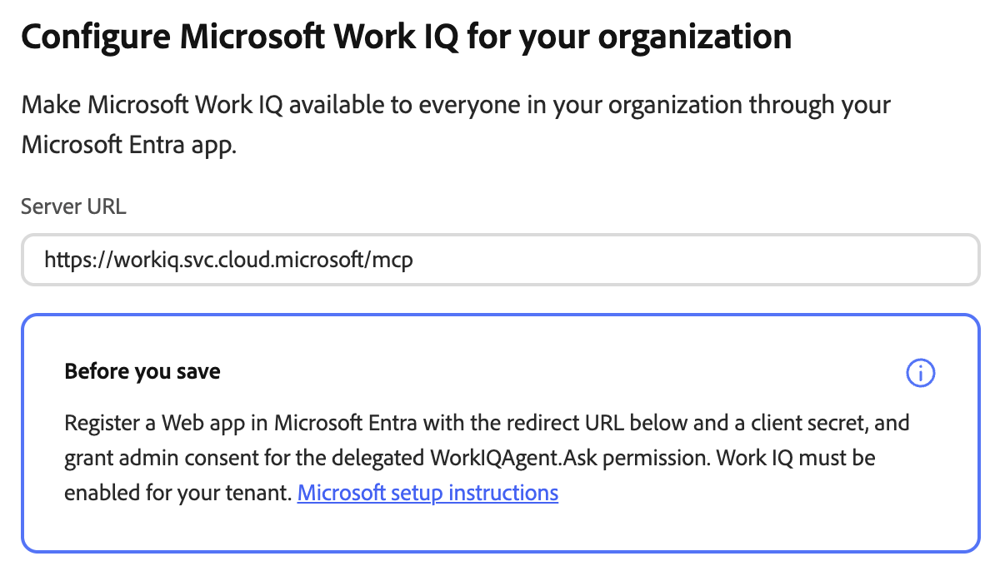
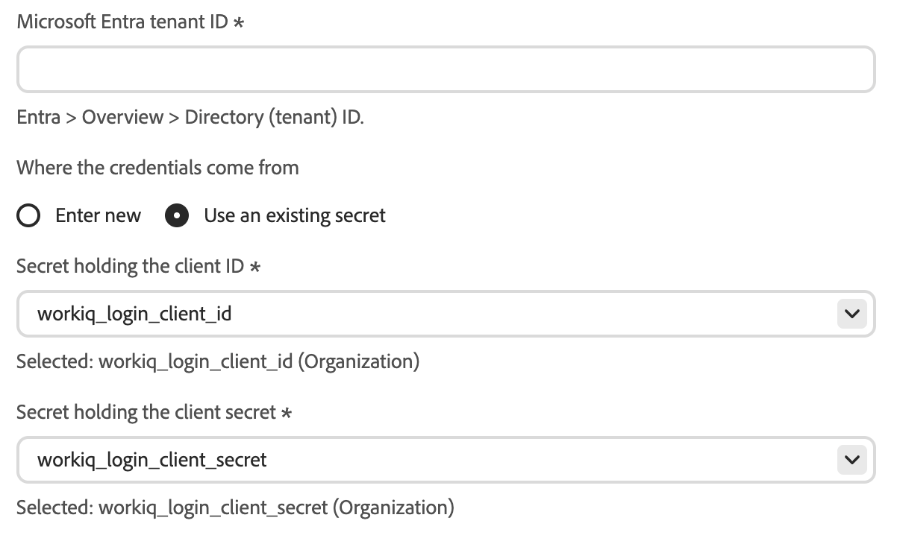
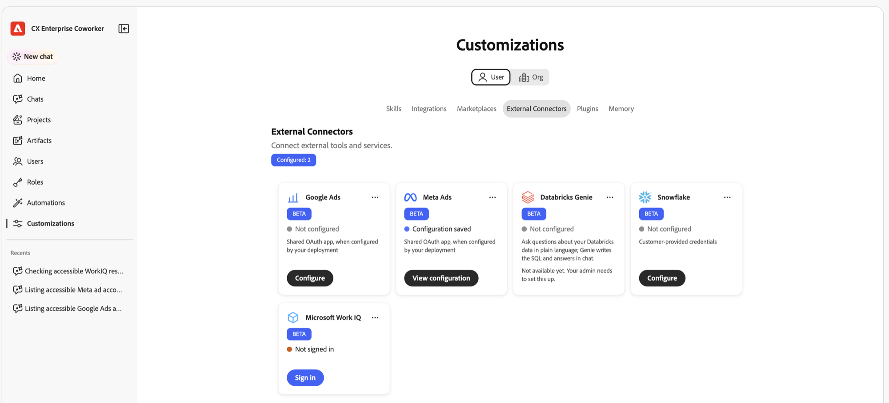
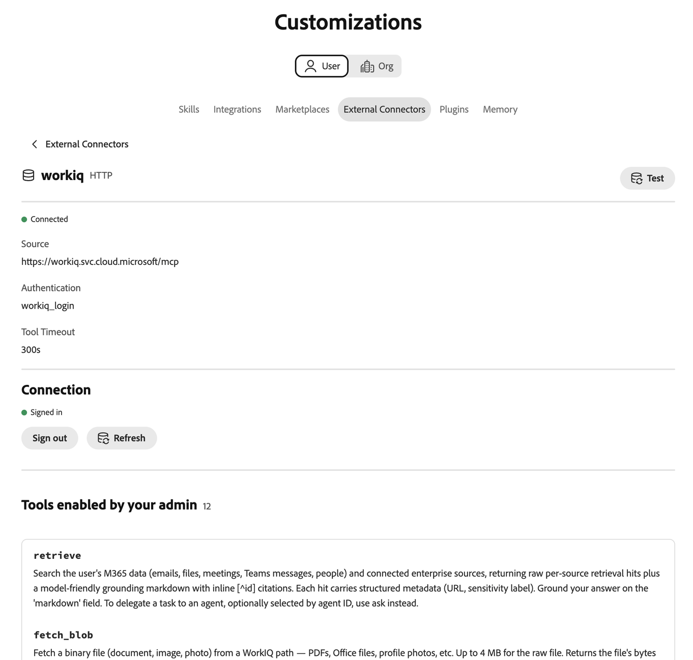

# Microsoft Work IQ external connector {#microsoft-work-iq}

Use the [!DNL Microsoft Work IQ] external connector to work with your [!DNL Microsoft 365] data in Adobe CX Enterprise Coworker. After you set up the connector, ask Coworker to search your email, files, meetings, and [!DNL Microsoft Teams] messages, review calendar events, and more. The connector is a Model Context Protocol (MCP) server hosted by [!DNL Microsoft].

## Connector configuration {#connector-configuration}

The connector configuration process has two separate parts:

* **Organization setup:** An administrator configures the connector once for the whole organization. The administrator connects a [!DNL Microsoft Entra] app and selects the tools that members can use.
* **Member sign-in:** Each member signs in with their own [!DNL Microsoft] work account. Members can access only the data that their account can access.

Saving the organization configuration does not sign in any members or grant additional [!DNL Microsoft 365] permissions. Each member must sign in separately.

## Prerequisites {#prerequisites}

Before you begin, make sure that you have the following:

* **For organization setup:** An account with permission to manage organization connectors in Coworker.
* **For the [!DNL Microsoft Entra] app:** A [!DNL Microsoft Entra] administrator who can register a web app and grant admin consent.
* **For your [!DNL Microsoft] tenant:** [!DNL Work IQ] enabled for the tenant.
* **For member sign-in:** An eligible [!DNL Microsoft] work account with access to the data you plan to use.

## Configure the connector for your organization {#configure-organization}

Administrators make the [!DNL Microsoft Work IQ] connector available to everyone in the organization. Changes on the organization page apply to all users in your organization.

1. Open **[!UICONTROL Customizations]**, select **[!UICONTROL Org]**, and then select **[!UICONTROL External Connectors]**.

   {zoomable="yes"}

1. On the **[!UICONTROL Microsoft Work IQ]** card, select **[!UICONTROL Configure]**.

   The **[!UICONTROL Configure Microsoft Work IQ for your organization]** dialog opens. The **[!UICONTROL Server URL]** shows the [!DNL Work IQ] MCP server, `https://workiq.svc.cloud.microsoft/mcp`.

   {zoomable="yes"}

1. Prepare your [!DNL Microsoft Entra] app. For more information, see [Prepare your Microsoft Entra app](#prepare-entra-app).

1. In **[!UICONTROL Microsoft Entra tenant ID]**, enter your tenant ID.

   In [!DNL Microsoft Entra], find this value in **[!UICONTROL Overview]** > **[!UICONTROL Directory (tenant) ID]**.

1. Under **[!UICONTROL Where the credentials come from]**, provide the app credentials. For more information, see [Provide app credentials](#provide-app-credentials).

1. Under **[!UICONTROL Tools available to users]**, select the tools your organization needs. For more information, see [Available tools](#available-tools).

1. Review **[!UICONTROL Access and permissions]**, which confirms that each person signs in separately. Then select **[!UICONTROL Save configuration]**.

1. Review the saved **[!UICONTROL workiq]** connector details. Optionally, select **[!UICONTROL Test]** to check that Coworker can discover the connector tools.

   | Setting | Description |
   | --- | --- |
   | **[!UICONTROL Source]** | The [!DNL Work IQ] MCP server, `https://workiq.svc.cloud.microsoft/mcp`. |
   | **[!UICONTROL Authentication]** | The authentication method, `workiq_login`. |
   | **[!UICONTROL Tool Timeout]** | The tool timeout for the connector. |
   | **[!UICONTROL Connection]** | Your own sign-in status. |

   {zoomable="yes"}

The **[!UICONTROL Not signed in]** status on the connector details refers to your own connection, not to the organization. To use the connector yourself, select **[!UICONTROL Sign in]** and follow the steps in [Sign in as a member](#sign-in-as-a-member).

To stop offering the connector to your organization, select **[!UICONTROL Remove]** on the connector details page.

### Prepare your Microsoft Entra app {#prepare-entra-app}

Before you save the configuration, prepare a web app in [!DNL Microsoft Entra]. For the [!DNL Microsoft] requirements, select **[!UICONTROL Microsoft setup instructions]** in the configuration dialog.

1. Register a web app in [!DNL Microsoft Entra], or use an existing one.

1. In the Coworker configuration dialog, copy the **[!UICONTROL Redirect URL]**. Register this exact value as a web redirect URI on the app.

   The redirect URL differs between environments. Always copy it from the dialog.

1. Create a client secret, or confirm that the existing client secret is still valid.

   You need the secret value, not the secret ID.

1. Grant admin consent for the delegated `WorkIQAgent.Ask` permission.

1. Confirm that [!DNL Work IQ] is enabled for your tenant.

### Provide app credentials {#provide-app-credentials}

Under **[!UICONTROL Where the credentials come from]**, select one of the following options:

* **[!UICONTROL Enter new]:** In **[!UICONTROL OAuth app client ID]**, enter the application (client) ID of your [!DNL Microsoft Entra] app. In **[!UICONTROL OAuth app client secret]**, enter the secret value. Coworker stores the secret value as an organization secret.
* **[!UICONTROL Use an existing secret]:** In **[!UICONTROL Secret holding the client ID]** and **[!UICONTROL Secret holding the client secret]**, select the saved organization secrets for your app. If the right secrets are not available, select **[!UICONTROL Enter new]** instead.

{zoomable="yes"}

The tenant ID, client ID, and client secret must all belong to the same app and tenant. If you reuse saved secrets, confirm that the client secret has not expired. These app credentials are separate from the [!DNL Microsoft] passwords that members use to sign in.

### Available tools {#available-tools}

The [!DNL Microsoft Work IQ] connector provides the following tools:

| Tool | Description |
| --- | --- |
| `search_paths` | Find which [!DNL Microsoft 365] capabilities are available and how to address them. |
| `get_schema` | See which fields a supported request accepts or returns. |
| `list_agents` | See the [!DNL Microsoft 365 Copilot] agents available to your account, without running them. |
| `fetch` | Read [!DNL Microsoft 365] items your account can access, such as messages, events, files, and people. Does not change data. |
| `call_function` | Compute results from data your account can access, such as a calendar view or recent changes. Does not change data. |
| `retrieve` | Search your email, files, meetings, [!DNL Microsoft Teams] messages, people, and connected sources, with links to each source. |
| `fetch_blob` | Download a file, such as a document, image, or profile photo, up to 4 MB. Does not change data. |
| `ask` | Ask [!DNL Microsoft 365 Copilot], or one of its agents, about your email, meetings, files, and other [!DNL Microsoft 365] data. |
| `delete_entity` | Delete a [!DNL Microsoft 365] item, such as a message or an event. Changes data. |
| `do_action` | Run a [!DNL Microsoft 365] action, such as sending mail or moving an item. Changes data. |
| `create_entity` | Create a [!DNL Microsoft 365] item, such as an event or a message draft. Changes data. |
| `update_entity` | Change an existing [!DNL Microsoft 365] item, such as an event or a contact. Changes data. |

>[!IMPORTANT]
>
>The `delete_entity`, `do_action`, `create_entity`, and `update_entity` tools change data in [!DNL Microsoft 365]. Review these tools carefully, and select only the tools that your organization intends members to use.

Tools that the server adds later stay off until you select them.

### Change the tool selection {#change-tool-selection}

To change the tools available to members after you save, use the **[!UICONTROL Tools]** section on the connector details page.

1. Select or clear individual tools, or use **[!UICONTROL Select all]** or **[!UICONTROL Clear]**.

1. Select **[!UICONTROL Save tool selection]**.

>[!CAUTION]
>
>Selecting **[!UICONTROL Show every tool]** clears the current selection. Members can then use every tool that the policy does not exclude, until you save a new selection. Do not select **[!UICONTROL Show every tool]** only to view the list of tools.

## Sign in as a member {#sign-in-as-a-member}

After an administrator configures the connector, each member signs in with their own [!DNL Microsoft] work account. You do not need the app client secret to sign in.

1. Open **[!UICONTROL Customizations]**, select **[!UICONTROL User]**, and then select **[!UICONTROL External Connectors]**.

   {zoomable="yes"}

1. On the **[!UICONTROL Microsoft Work IQ]** card, select **[!UICONTROL Sign in]**.

   If the card shows **[!UICONTROL Not configured]** or the connector is unavailable, ask your administrator to [configure the connector](#configure-organization).

1. On the [!DNL Microsoft] **[!UICONTROL Pick an account]** screen, select the work account for your organization, or select **[!UICONTROL Use another account]**.

   Your browser may remember several accounts, including accounts from other tenants. The account that is already signed in is not always the right one. Choose the account with the [!DNL Microsoft 365] access you need.

1. Complete the sign-in steps for your account, such as a password, single sign-on (SSO), passwordless sign-in, multi-factor authentication (MFA), or other verification.

   Enter your [!DNL Microsoft] credentials only in the sign-in flow that your organization approves. Never enter them in the OAuth app fields of the connector.

1. If [!DNL Microsoft] asks for consent, review the request.

   >[!IMPORTANT]
   >
   >Continue only if you recognize the app and your organization approves the requested access.

1. After [!DNL Microsoft] returns you to Coworker, open the **[!UICONTROL workiq]** connector details. Confirm that the connector shows **[!UICONTROL Connected]** and **[!UICONTROL Signed in]**.

   {zoomable="yes"}

1. Review **[!UICONTROL Tools enabled by your admin]** to view the tools you can use.

From the connector details, you can also do the following:

* **[!UICONTROL Test]:** Check that Coworker can discover the connector tools.
* **[!UICONTROL Sign out]:** Disconnect your [!DNL Microsoft] account from the connector.

The connector details also show the **[!UICONTROL Tool Timeout]** setting and a **[!UICONTROL Refresh]** control.

A **[!UICONTROL Connected]** status does not confirm that you can access every [!DNL Microsoft 365] resource or that every tool runs successfully. To confirm your access, [check your Microsoft 365 access](#check-access).

## Check your Microsoft 365 access {#check-access}

To confirm that the connector can read your data, start a chat and enter a read-only prompt.

Example prompt:

* "Find my meetings for tomorrow and include links to the sources. Do not create, update, send, or delete anything."

For this prompt to work, your administrator must enable a tool that can read calendar data, and your account must have access to the data.

## Troubleshoot access {#troubleshoot-access}

If sign-in or access fails, check the following with your administrator:

| Area | What to check |
| --- | --- |
| [!DNL Microsoft] account | You signed in with the right work account for the intended tenant. |
| [!DNL Work IQ] availability | [!DNL Work IQ] is enabled for your [!DNL Microsoft] tenant. |
| Redirect URI | The [!DNL Microsoft Entra] app has the exact redirect URL from the dialog registered as a web redirect URI. |
| Admin consent | An administrator granted admin consent for the delegated `WorkIQAgent.Ask` permission. |
| Client secret | The client secret has not expired, and the connector uses the secret value, not the secret ID. |
| Saved secrets | Both selected organization secrets belong to the intended [!DNL Microsoft Entra] app. |
| Tool selection | If only one tool fails, your administrator enabled that tool. |
| [!DNL Microsoft 365] permissions | Your account has permission to access the requested data. |
