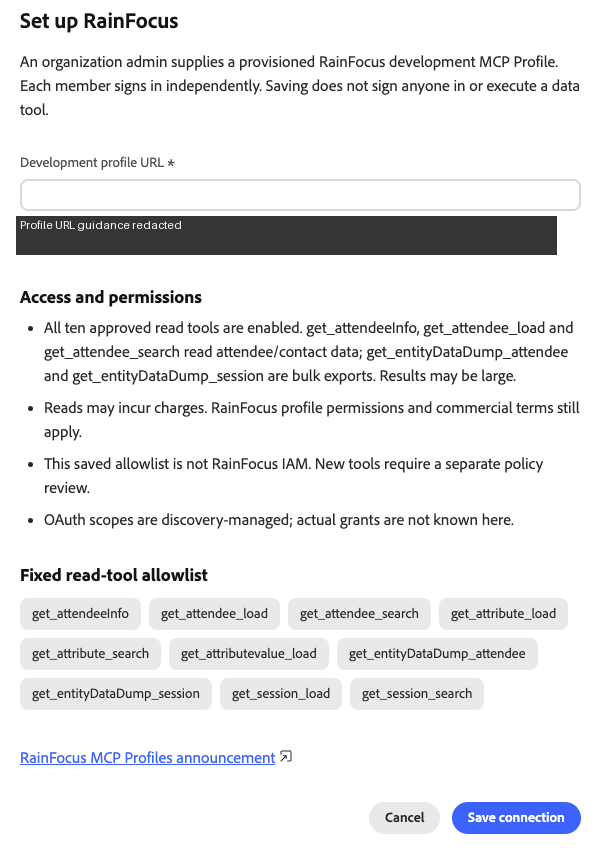

# RainFocus external connector {#rainfocus}

Use the [!DNL RainFocus] external connector to work with your [!DNL RainFocus] event data in Adobe CX Enterprise Coworker. After you set up the connector, ask Coworker about the sessions, attendees, and custom attributes that your [!DNL RainFocus] account can access. The connector uses a [!DNL RainFocus] MCP Profile, a Model Context Protocol (MCP) server hosted by [!DNL RainFocus].

>[!AVAILABILITY]
>
>The [!DNL RainFocus] external connector is in beta. The documentation and the functionality are subject to change.

## Connector configuration {#connector-configuration}

The connector configuration process has three separate parts:

* **[!DNL RainFocus] preparation:** A [!DNL RainFocus] administrator provisions an MCP Profile, enables its tools, and provides the profile URL. Each member needs a [!DNL RainFocus] account with the right role.
* **Organization setup:** A Coworker administrator saves the MCP profile URL once for the whole organization. The connector enables a fixed list of read tools.
* **Member sign-in:** Each member signs in with their own [!DNL RainFocus] account. Members can access only the data that their [!DNL RainFocus] role and the profile allow.

Saving the organization configuration does not sign in any members, grant [!DNL RainFocus] permissions, or run a [!DNL RainFocus] data tool. Each member must sign in separately.

## Prerequisites {#prerequisites}

Before you begin, make sure that you have the following:

* **Coworker access:** A Coworker administrator account with organization settings turned on, in an organization where the [!DNL RainFocus] connector is available.
* **An MCP Profile:** A provisioned [!DNL RainFocus] MCP Profile and its complete HTTPS profile URL, provided by your [!DNL RainFocus] administrator. For more information, see [Get the MCP profile URL](#get-profile-url).
* **Member accounts:** For each member, a [!DNL RainFocus] account with a security role that gives access to the data they need.

You do not enter a client ID, client secret, or access token in Coworker. Each member signs in to [!DNL RainFocus] with their own account.

## Prepare [!DNL RainFocus] access {#prepare-rainfocus}

Before you configure the connector in Coworker, prepare the MCP Profile and member access in [!DNL RainFocus]. [!DNL RainFocus] owns the profile, its enabled tools, member roles, and any charges. Coworker stores the profile URL and tool list for your organization, and the sign-in of each member.

### Get the MCP profile URL {#get-profile-url}

[!DNL RainFocus] usually configures MCP Profiles for its customers based on their requirements. If your [!DNL RainFocus] administrator sets up the profile, the process is as follows:

1. In [!DNL RainFocus], open **[!UICONTROL Integration Suite]** > **[!UICONTROL Active Profiles]** > **[!UICONTROL MCP Profiles]**, and then create a profile.
1. Enable only the tools that your use case needs, and leave the other tools turned off.
1. Copy the generated MCP server URL. The URL is specific to the profile.

Give the complete URL to the Coworker administrator who configures the connector. Do not guess a profile name or build the URL yourself. For more information, see the [RainFocus MCP Profiles announcement](https://www.rainfocus.com/company/news-press/rainfocus-launches-ai-agent-connectivity-for-event-data-with-mcp-profiles/).

### Confirm member access {#confirm-member-access}

Each member signs in with their own [!DNL RainFocus] account. The security role of the account and the tools enabled in the profile control which data a member can access. Ask your [!DNL RainFocus] administrator to confirm that each member has the least-privileged role for their tasks.

## Configure the connector for your organization {#configure-organization}

Administrators make the [!DNL RainFocus] connector available to everyone in the organization. Changes on the organization page apply to all users in your organization. The **[!UICONTROL Org]** scope appears only for administrators with organization settings turned on.

1. Open **[!UICONTROL Customizations]**, select **[!UICONTROL Org]**, and then select **[!UICONTROL External Connectors]**.
1. Find the **[!UICONTROL RainFocus]** card, which has a Beta label and shows **[!UICONTROL Not configured]**. Select **[!UICONTROL Configure]**.

1. In the **[!UICONTROL Set up RainFocus]** dialog, enter the **[!UICONTROL Development profile URL]**. Use the complete MCP profile URL that your [!DNL RainFocus] administrator provided.

   The URL must start with `https://`. It cannot contain spaces, backslashes, a query string (`?`), a fragment (`#`), a user name or password, a nondefault port, or `.` or `..` path segments. If the URL does not match a rule, Coworker shows a message that describes the rule. Coworker checks only the format of the URL. It does not check that the profile exists or that you can use it.

1. Review the **[!UICONTROL Access and permissions]** and **[!UICONTROL Fixed read-tool allowlist]** sections. The connector enables all 10 read tools, and you cannot add, remove, or edit them in this dialog. Some tools return attendee personal data or bulk exports. For more information, see [Available tools](#available-tools).

   {width="500" zoomable="yes"}

1. Select **[!UICONTROL Save connection]**. While Coworker saves the connection, you cannot edit or cancel the form.

If saving fails, the dialog shows **[!UICONTROL Could not save connection]** and keeps the URL that you entered. Some settings might be saved even when the save fails. Reopen the configuration and check it before you try again. To avoid conflicting changes, make sure that only one administrator configures the connector at a time.

### Verify the saved configuration {#verify-configuration}

After you save the connection, check the configuration:

1. After saving, the dialog opens the saved connector details. Return to the **[!UICONTROL External Connectors]** list, and confirm that the **[!UICONTROL RainFocus]** card shows **[!UICONTROL Configuration saved]** and **[!UICONTROL View configuration]**.
1. Reload the page, and then select **[!UICONTROL View configuration]**.
1. Confirm the following details:

   * **[!UICONTROL Source]** shows the profile URL that you entered.
   * **[!UICONTROL Authentication]** is present.
   * **[!UICONTROL Tool policy]** > **[!UICONTROL Allowed tool names or patterns]** lists the same 10 tools as the [Available tools](#available-tools) section.

1. To check your own connection, select **[!UICONTROL Test]**. If Coworker asks you to sign in, use your own [!DNL RainFocus] account, as described in [Sign in as a member](#sign-in-as-a-member).

   **[!UICONTROL Test]** lists the tools of the server and updates the **[!UICONTROL Tools]** count. If the server returns no tools, the details show **[!UICONTROL 0 tools available]**. If the test fails, the details show **[!UICONTROL Connection failed]**.

   {width="700" zoomable="yes"}

The **[!UICONTROL Connection]**, **[!UICONTROL Test]**, and sign-in controls on the connector details apply only to your own connection. When you sign in as an administrator, no members are signed in. A successful test lists tools only. The test does not run a [!DNL RainFocus] data tool or confirm that a member can access specific data.

The connector details have no option to edit the profile URL. **[!UICONTROL Remove]** opens a confirmation, and then removes the connection for the whole organization. Treat removal as a deliberate administrator decision, not as a troubleshooting step.

### Available tools {#available-tools}

The [!DNL RainFocus] connector enables a fixed list of 10 read tools:

| Tool | Data area |
| --- | --- |
| `get_attendeeInfo` | Attendees |
| `get_attendee_load` | Attendees |
| `get_attendee_search` | Attendees |
| `get_attribute_load` | Custom attributes |
| `get_attribute_search` | Custom attributes |
| `get_attributevalue_load` | Custom attributes |
| `get_entityDataDump_attendee` | Attendees, bulk export |
| `get_entityDataDump_session` | Sessions, bulk export |
| `get_session_load` | Sessions |
| `get_session_search` | Sessions |

Tools that are not on this list, including tools that [!DNL RainFocus] adds later, are not enabled automatically. The list does not replace [!DNL RainFocus] security roles or the tool settings of the profile, which still control access to data.

>[!IMPORTANT]
>
>Several tools can return personal data and contact information about attendees. Two tools export data in bulk, and their results can be large. Reads can also incur charges under your [!DNL RainFocus] terms. Review these tools with your data governance owners before members sign in.

## Sign in as a member {#sign-in-as-a-member}

After an administrator configures the connector, each member signs in with their own [!DNL RainFocus] account. You do not need a client ID, client secret, or access token to sign in.

1. Open **[!UICONTROL Customizations]**, and then select **[!UICONTROL External Connectors]**. Members use the **[!UICONTROL User]** scope by default. Find the **[!UICONTROL RainFocus]** card.
1. If the card shows **[!UICONTROL Not available yet. Your admin needs to set this up.]**, ask your administrator to [configure the connector](#configure-organization). Members cannot enter their own profile URL.
1. Check the status on the card. The card shows **[!UICONTROL Sign-in required]**, **[!UICONTROL Connected]**, **[!UICONTROL Set up by your admin]**, or a **[!UICONTROL Connection failed]** status.

   **[!UICONTROL Set up by your admin]** means that Coworker cannot confirm your sign-in status. It does not mean that you are signed in or signed out.

1. Select **[!UICONTROL Sign in]**. You can also open the card details and select **[!UICONTROL Sign in]** in the **[!UICONTROL Connection]** section. In the [!DNL RainFocus] window, complete the sign-in, single sign-on (SSO), multi-factor authentication (MFA), and consent prompts. Review the access that you approve.

   If **[!UICONTROL Discover authorization]** appears, Coworker reads the sign-in details of the server, not its tools. If discovery fails, or the panel asks for a **[!UICONTROL Client ID]** or **[!UICONTROL Client secret]**, stop and contact your administrator. Do not enter or guess credentials.

   {width="700" zoomable="yes"}

1. Return to Coworker and confirm that the status shows **[!UICONTROL Connected]**. A closed sign-in window alone does not confirm success. If you close the window early, nothing changes, and you can try again.
1. Open the card details to review the setup from your administrator. You can view the **[!UICONTROL Server URL]**, **[!UICONTROL Who signs in]**, **[!UICONTROL Authentication]**, and **[!UICONTROL Tools enabled by your admin]**.
1. Select **[!UICONTROL Test]** on the card, or **[!UICONTROL Test connection]** in the details, to check the connection with your account.

   A successful test shows that [!DNL RainFocus] responded using your account, with the number of available tools. The test lists tools only. It does not run a data tool or confirm access to specific events or records. To renew your sign-in and list the tools again, select **[!UICONTROL Refresh]**. If Coworker cannot renew your sign-in, the button shows **[!UICONTROL Reload tools]** instead, which only lists the tools again.

1. If the test fails, Coworker shows **[!UICONTROL Couldn't connect to RainFocus]**, with **[!UICONTROL Try again]** and **[!UICONTROL Technical details]**. If you are signed out, sign in again. If the problem continues, contact your administrator.

Members can sign in, sign out, test, refresh, and view the enabled tools. Members cannot change or remove the organization connection, edit the profile URL, or change the tools. Every member who opens the details can view the profile URL. When an administrator signs in, other members are not signed in.

To disconnect your [!DNL RainFocus] account from the connector, select **[!UICONTROL Sign out]**. You can sign in again at any time.

## Check your event data access {#check-event-access}

To confirm that you can use [!DNL RainFocus] data, run a read-only check with a narrow request. Use an event that you are approved to work with, and avoid tools that return attendee data or bulk exports for this check. Start a chat and enter a prompt.

Example prompt:

* "Using RainFocus, find up to five sessions I can access. Show only the session title and ID if those fields are returned. Do not export data, return attendee information, or change anything."

Confirm that the result includes sessions that you expect. An empty result does not always mean that the connector is not working. Check the [!DNL RainFocus] account you signed in with, your security role, and the tools enabled in the profile. If a result is unexpectedly large or includes sensitive data, stop and narrow your request.

## Troubleshoot access {#troubleshoot-access}

If you cannot access your [!DNL RainFocus] data, check the following with your administrator:

| Issue | What to check |
| --- | --- |
| The **[!UICONTROL RainFocus]** card is missing | Confirm with your Adobe representative that the connector is available to your organization. |
| The **[!UICONTROL Org]** scope is missing | Confirm that you are an administrator and that organization settings are turned on for your organization. |
| Coworker rejects the profile URL | Follow the rule in the message. Use the complete profile URL from your [!DNL RainFocus] administrator, and do not guess a profile name. |
| **[!UICONTROL Could not save connection]** appears | Some settings might be saved. Reopen the configuration and check it before you try again. Make sure that only one administrator configures the connector at a time. |
| The card shows **[!UICONTROL Not available yet. Your admin needs to set this up.]** | The organization setup is missing. Ask your administrator to [configure the connector](#configure-organization). |
| Sign-in asks for a **[!UICONTROL Client ID]** or **[!UICONTROL Client secret]**, or discovery fails | Stop and contact your administrator. Do not enter or guess credentials, or register an app. |
| Sign-in fails after you approve access in [!DNL RainFocus] | Check the [!DNL RainFocus] account and security role that you used. Ask your Adobe representative and [!DNL RainFocus] to check the sign-in setup for your environment. Do not share the sign-in URL. |
| **[!UICONTROL Test]** succeeds, but data requests fail | **[!UICONTROL Test]** only lists tools. Check your [!DNL RainFocus] security role, the tools enabled in the profile, and the filters that the tool requires. |
| **[!UICONTROL Couldn't connect to RainFocus]** appears when you are signed in | Select **[!UICONTROL Try again]**. If the problem continues, contact your administrator. |
| A result is unexpectedly large or includes sensitive data | Stop and narrow your request. Do not paste raw event data into tickets or chat. |

When you contact support, include only the error text, the time of the error, and your environment. Do not share technical details, profile URLs, sign-in captures, passwords, tokens, or authorization codes.
