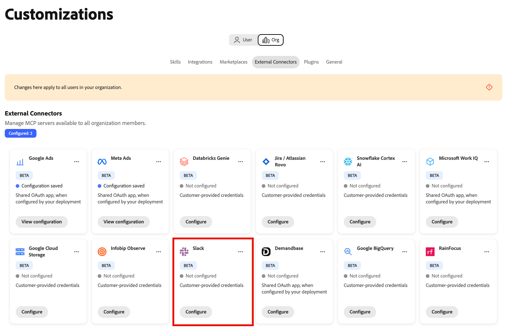
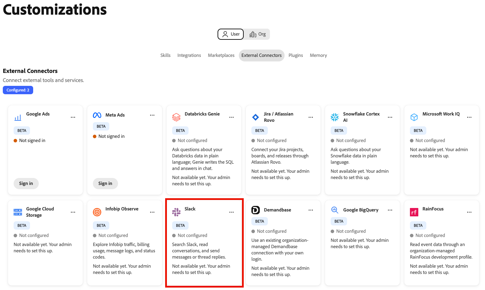
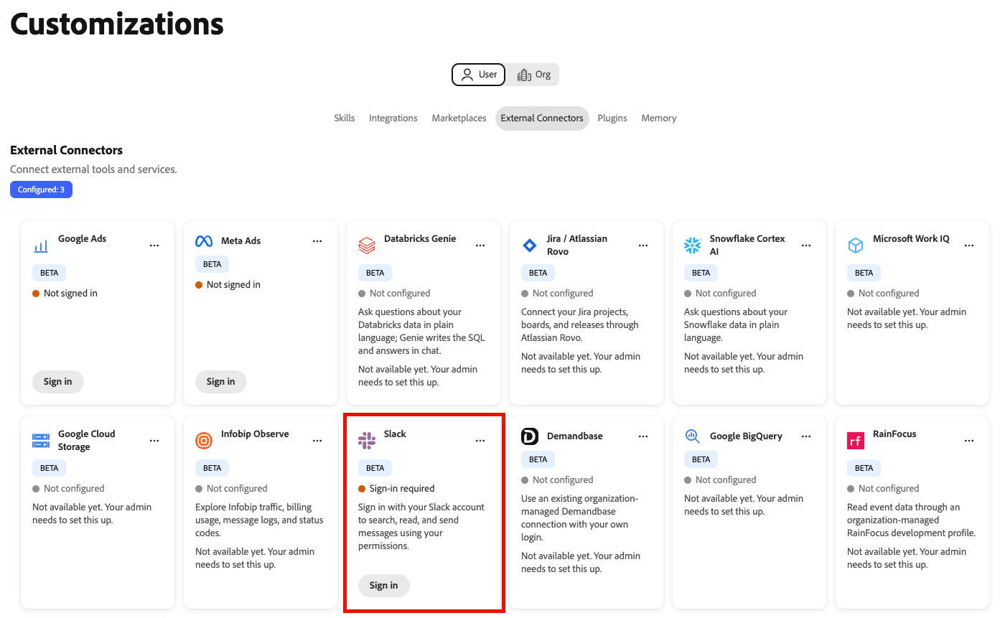

# Slack external connector {#slack}

Use the [!DNL Slack] external connector to work with your [!DNL Slack] conversations in Adobe CX Enterprise Coworker. After you set up the connector, ask Coworker to search messages and files, read channels and threads, and find people. You can also send messages and replies, if your administrator enables these tools. The connector uses the official remote Model Context Protocol (MCP) server hosted by [!DNL Slack].

>[!AVAILABILITY]
>
>The [!DNL Slack] external connector is in beta. The documentation and the functionality are subject to change.

## Connector configuration {#connector-configuration}

The connector configuration process has three separate parts:

* **[!DNL Slack] app preparation:** The owner of a [!DNL Slack] app prepares an eligible app, registers the Coworker redirect URL, and sets the user scopes. Adobe does not provide a managed [!DNL Slack] app.
* **Organization setup:** A Coworker administrator configures the connector once for the whole organization. The administrator enters the app credentials and chooses the user OAuth scopes and the tools that members can use.
* **Member sign-in:** Each member signs in with their own [!DNL Slack] account. Members can access only the content that their [!DNL Slack] account can access.

The connector does not use a shared bot or a shared [!DNL Slack] identity. Coworker sends messages and replies as the member who is signed in. Saving the organization configuration does not sign in any members or grant additional [!DNL Slack] access. Each member must sign in separately.

## Prerequisites {#prerequisites}

Before you begin, make sure that you have the following:

* **Coworker access:** An account with permission to manage organization connectors, in an organization where the [!DNL Slack] connector is available.
* **A [!DNL Slack] app:** An internal app or a [!DNL Slack Marketplace] app that is approved for your workspace. You also need an app owner who can confirm the approved user scopes and edit the app settings.
* **App credentials:** The client ID and client secret of the app, shared through your approved process for handling credentials.
* **A tool and scope decision:** The read, messaging, and draft tools that your organization plans to enable, and the user OAuth scopes that it plans to request.
* **A test workspace or channel:** A place to check the connection with members who agree to test it. Do not send test messages in customer or production channels.

>[!IMPORTANT]
>
>Never share client secrets, access tokens, or other credentials in screenshots, chats, or support tickets. Enter credentials only in the secure fields of the setup dialog.

## Prepare your Slack app {#prepare-slack-app}

Before you configure the connector in Coworker, the app owner prepares the [!DNL Slack] app. A workspace or organization app administrator may also need to approve it. For the [!DNL Slack] requirements, see [Slack MCP server](https://docs.slack.dev/ai/slack-mcp-server/) in the [!DNL Slack] developer documentation.

### Choose an eligible app {#choose-eligible-app}

[!DNL Slack] supports its MCP server only for internal custom apps and apps published in the [!DNL Slack Marketplace]. Unlisted apps that are distributed outside your organization cannot use the [!DNL Slack] MCP server. Turning on public distribution alone does not make an app eligible.

1. Choose the workspace or organization that will own the app, and the app owner.
1. In [Slack app management](https://api.slack.com/apps), create a new app in that workspace. To reuse an existing eligible app, get approval from its owner first.
1. In the app settings, select **[!UICONTROL Basic Information]** > **[!UICONTROL App Credentials]**. Note the **[!UICONTROL Client ID]** and **[!UICONTROL Client Secret]**.

   Enter only these two values in Coworker. Do not use the app ID, the signing secret, a bot token, or an app-level token.

### Register the redirect URL {#register-redirect-url}

Register the Coworker redirect URL in your [!DNL Slack] app:

1. In Coworker, open the **[!UICONTROL Connect Slack]** dialog, as described in [Configure the connector for your organization](#configure-organization). Copy the complete value of the **[!UICONTROL Redirect URL]**.

   You can open the dialog to copy the URL before you complete or save the configuration.

1. In the [!DNL Slack] app settings, select **[!UICONTROL OAuth & Permissions]**. Under **[!UICONTROL Redirect URLs]**, add the complete redirect URL, and then save.

Always copy the redirect URL from the Coworker dialog in the environment that you are setting up. Register the exact scheme, host name, port, if one is present, and path. Do not build the URL yourself, or reuse a redirect URL from another environment. If you use more than one environment, register each redirect URL separately.

### Set the user scopes {#set-user-scopes}

The connector uses user OAuth scopes, which authorize the account of each member. It does not use bot scopes.

1. In the [!DNL Slack] app settings, select **[!UICONTROL OAuth & Permissions]** > **[!UICONTROL Scopes]** > **[!UICONTROL User Token Scopes]**.
1. Add the user scopes that your organization approves. Compare them with the [default scopes](#review-scopes) in Coworker, and add only the scopes that you plan to request.

   The default scopes are the default capability set of Coworker, not a minimum that [!DNL Slack] requires. Use the granular `search:read.*` scopes, not the older `search:read` scope. In an app manifest, user scopes belong in `oauth_config.scopes.user`, not `oauth_config.scopes.bot`.

The `chat:write` user scope lets Coworker send messages as the member who is signed in. If your organization does not plan to send messages, leave it out.

Your workspace or [!DNL Slack] Enterprise organization may require app approval and scope review. App approval does not replace the consent of each member. A policy that allows only [!DNL Slack Marketplace] apps can block an internal app. For more information, see [Manage app approval for your workspace](https://slack.com/help/articles/222386767-Manage-app-approval-for-your-workspace).

If your app uses allowed IP address restrictions, [!DNL Slack] also applies them to MCP requests. Contact your Adobe representative to confirm the addresses to allow. Do not guess IP address ranges. Some capabilities, such as semantic search, can depend on your [!DNL Slack] plan.

### Review irreversible app settings {#review-irreversible-settings}

Coworker connects as a confidential OAuth client with the client ID and client secret. Some [!DNL Slack] app settings cannot be reversed, so review the following before you change them:

* **Proof Key for Code Exchange (PKCE):** Do not turn on the [!DNL Slack] PKCE setting for this connector without confirmation. [!DNL Slack] documents that this setting changes the app to a public client, and only [!DNL Slack] support can reverse it. For more information, see [Using PKCE](https://docs.slack.dev/authentication/using-pkce/).
* **Token rotation:** [!DNL Slack] token rotation cannot be turned off after you turn it on. Contact your Adobe representative before you turn it on for this app. For more information, see [Using token rotation](https://docs.slack.dev/authentication/using-token-rotation/).

### Bot features not required {#bot-features-not-required}

The connector does not need bot features. You do not need bot token scopes, an [!DNL Events API] request URL, an interactivity request URL, incoming webhooks, slash commands, [!DNL Socket Mode], or app-level tokens. If an existing app uses these features for another purpose, keep them.

The [!DNL Slack] MCP server does not support dynamic client registration or server-sent events (SSE). Coworker uses your registered app and the Streamable HTTP transport.

## Configure the connector for your organization {#configure-organization}

Administrators make the [!DNL Slack] connector available to everyone in the organization. Changes on the organization page apply to all users in your organization. Complete [Prepare your Slack app](#prepare-slack-app) before members sign in.

1. Open **[!UICONTROL Customizations]**, select **[!UICONTROL Org]**, and then select **[!UICONTROL External Connectors]**. On the **[!UICONTROL Slack]** card, select **[!UICONTROL Configure]**.

   The **[!UICONTROL Connect Slack]** dialog opens. The connector uses the fixed [!DNL Slack] MCP server URL, `https://mcp.slack.com/mcp`. Use the organization scope for this configuration, not a personal connection.

   {width="700" zoomable="yes"}

1. Under **[!UICONTROL Slack application]**, make sure that the **[!UICONTROL Redirect URL]** is registered in your app. For more information, see [Register the redirect URL](#register-redirect-url).

1. Enter the **[!UICONTROL Client ID]** and **[!UICONTROL Client secret]** of your app. Both fields are required.

   Do not enter the app ID, the signing secret, or a bot token. Coworker stores the credentials as secrets, not as plain-text connector settings.

   {width="500" zoomable="yes"}

1. Review the **[!UICONTROL User OAuth scopes]**. For more information, see [Review the user OAuth scopes](#review-scopes).

1. Under **[!UICONTROL Tools available to users]**, remove any tools that members should not use. To undo your changes, select **[!UICONTROL Restore all tools]**. At least one tool must remain. For more information, see [Available tools](#available-tools).

1. Review **[!UICONTROL Access and permissions]**, and then select **[!UICONTROL Save connection]**. The **[!UICONTROL Slack]** card shows **[!UICONTROL Configuration saved]**.

   The dialog also shows the **[!UICONTROL Authentication]** method, the **[!UICONTROL Connection]** type, and the **[!UICONTROL Tool timeout]**. Coworker does not save the configuration when a credential field or the scope list is empty.

   {width="500" zoomable="yes"}

1. Reload the page, and then select **[!UICONTROL View configuration]**. Confirm that the organization connection and your tool selection are saved before members sign in.

Saving does not sign in you or any member to [!DNL Slack]. To check the connection, sign in as yourself, as described in [Sign in as a member](#sign-in-as-a-member).

### Review the user OAuth scopes {#review-scopes}

The **[!UICONTROL User OAuth scopes]** field is required. Separate scopes with spaces or commas, and match the user scopes that are approved for your app. By default, the field contains the following 22 scopes:

```text
search:read.public search:read.private search:read.im search:read.mpim search:read.files search:read.users channels:history groups:history im:history mpim:history channels:read groups:read im:read mpim:read users:read users:read.email files:read canvases:read lists:read emoji:read reactions:read chat:write
```

Your workspace may not approve every default scope. Review the requested scopes with the app owner.

>[!IMPORTANT]
>
>The default scopes include private content, such as private channels, group messages, and direct messages. They also include `chat:write`, which lets Coworker send messages and replies as the member who is signed in. Decide explicitly whether your organization enables the message-sending tools. Removing a tool does not remove its OAuth scopes. If you do not want members to send messages, remove the `slack_send_message` tool and the `chat:write` scope.

Tool selection and OAuth scopes are independent. When you narrow access, review both the tool list and the scope field. An enabled tool does not give a member more [!DNL Slack] access than their account has.

### Available tools {#available-tools}

The [!DNL Slack] connector provides the following 16 tools. By default, all of them are available to members.

| Capability | Tool | Description |
| --- | --- | --- |
| Search | `slack_search_public` | Search public messages and files. |
| Search | `slack_search_public_and_private` | Search messages and files, including private conversations you can access. |
| Search | `slack_search_channels` | Find channels and their identifiers. |
| Search | `slack_search_users` | Find people in your workspace. |
| Read conversations | `slack_read_channel` | Read a conversation message history. |
| Read conversations | `slack_read_thread` | Read a message thread and its replies. |
| Read conversations | `slack_list_channel_members` | List the members of a conversation. |
| Read conversations | `slack_list_user_channels` | List channels and direct conversations you belong to. |
| Read content and profiles | `slack_read_canvas` | Read a canvas without changing it. |
| Read content and profiles | `slack_read_user_profile` | Read a user profile and email address. |
| Read content and profiles | `slack_read_file` | Read files you have access to. |
| Read content and profiles | `slack_read_list` | Read a list and its records without changing them. |
| Emoji and reactions | `slack_search_emojis` | Find custom emoji in your workspace. |
| Emoji and reactions | `slack_get_reactions` | Read reactions on a message. |
| Messages and drafts | `slack_send_message` | Send a message or reply to a thread as the signed-in user. |
| Messages and drafts | `slack_send_message_draft` | Prepare a message draft for review before sending. |

The connector is not read-only. Members can send messages and replies unless you remove the `slack_send_message` tool. Channel creation, scheduled messages, file uploads, adding reactions, and canvas or list changes are not included.

## Sign in as a member {#sign-in-as-a-member}

After an administrator configures the connector, each member signs in with their own [!DNL Slack] account. You do not need the client secret to sign in.

1. Open **[!UICONTROL Customizations]**, select **[!UICONTROL User]**, and then select **[!UICONTROL External Connectors]**.

1. Find the **[!UICONTROL Slack]** card. If the card shows **[!UICONTROL Not configured]** and **[!UICONTROL Not available yet. Your admin needs to set this up.]**, ask your administrator to [configure the connector](#configure-organization).

   Do not ask for, or copy, the client secret of the organization.

   {width="700" zoomable="yes"}

1. After your administrator configures the connector, the **[!UICONTROL Slack]** card shows **[!UICONTROL Sign-in required]**. Select **[!UICONTROL Sign in]** on the card.

   {width="700" zoomable="yes"}

   Before you sign in, the **[!UICONTROL Connection]** section shows **[!UICONTROL Not signed in]**, with a **[!UICONTROL Sign in]** button.

   {width="700" zoomable="yes"}

1. Complete the [!DNL Slack] authorization with the [!DNL Slack] account and workspace that you plan to use. Review the requested permissions and any workspace approval requirements.

   >[!IMPORTANT]
   >
   >Continue only if you recognize the app and your organization approves the requested access.

1. Return to Coworker and review the connection status. Select **[!UICONTROL Test connection]**, and then [check your Slack access](#check-access) before you rely on the connection.

1. Review messaging actions carefully. Coworker sends messages and replies as your [!DNL Slack] account.

As a member, you can test the connection or sign out, but you cannot change the organization settings. You can access only the content that [!DNL Slack] and the granted scopes allow. This content includes private conversations only when your own [!DNL Slack] account can access them.

To disconnect your [!DNL Slack] account from the connector, select **[!UICONTROL Sign out]**.

## Check your Slack access {#check-access}

To confirm that the connector can read your [!DNL Slack] content, start a chat and enter a read-only prompt. Make sure that your administrator enabled the `slack_list_user_channels` tool.

Example prompt:

* "Using Slack, list up to five channels that I belong to. Show only the channel names. Do not send messages, create drafts, or change anything."

If your organization enables messaging tools, test sending only in a channel that is set aside for testing, and with approval. Ask a second member to sign in separately, and confirm that each member sees only their own [!DNL Slack] content.

## Troubleshoot access {#troubleshoot-access}

If setup, sign-in, or access fails, check the following with your administrator:

| Issue | What to check |
| --- | --- |
| The setup cannot be saved | Enter both the client ID and the client secret, keep at least one user OAuth scope, and keep at least one tool. Do not enter an app ID, a signing secret, or a bot token. |
| The **[!UICONTROL Redirect URL]** is missing, or [!DNL Slack] reports a redirect mismatch | Compare the complete redirect URL from the Coworker dialog, including the scheme, host, port, and path, with the **[!UICONTROL Redirect URLs]** saved in the [!DNL Slack] app. If the URL is missing or the values differ, contact your Adobe representative. |
| [!DNL Slack] sign-in or requests fail | Check the app approval, the granted user scopes, the [!DNL Slack] account and workspace you signed in with, and any IP address restrictions on the app. If requests keep failing, sign out, and then sign in again. |
| A read or send action is unavailable | Check the tool selection of your organization, the requested and granted scopes, and the [!DNL Slack] permissions of the member. These settings are independent. |
| A member cannot change the app settings | This behavior is expected for a connection that the organization manages. Ask the administrator. Members never enter the client secret of the organization. |
