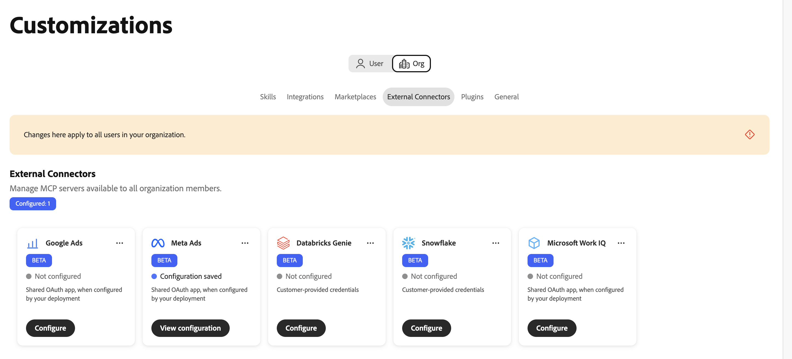
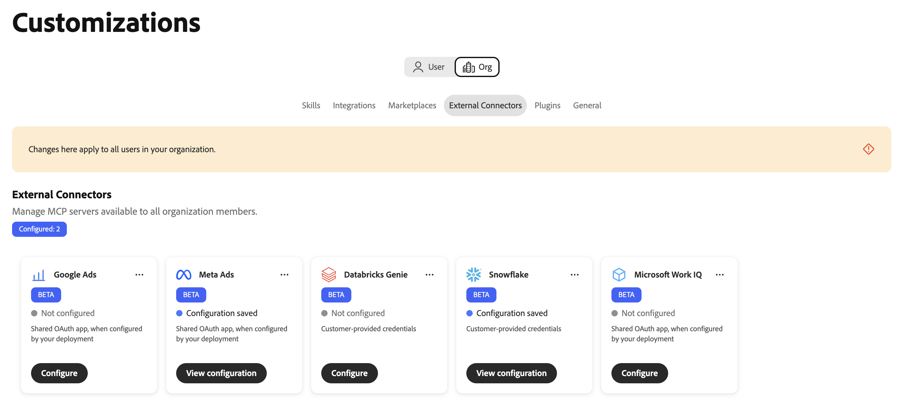
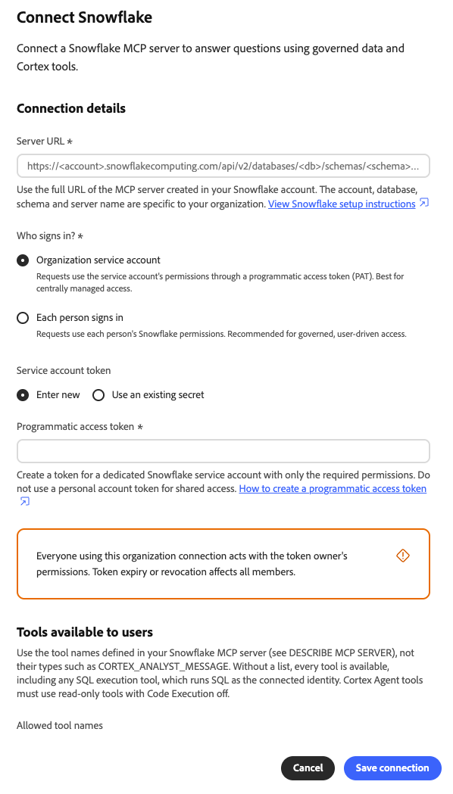
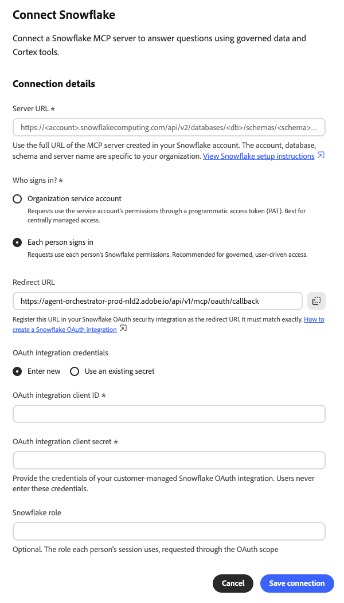
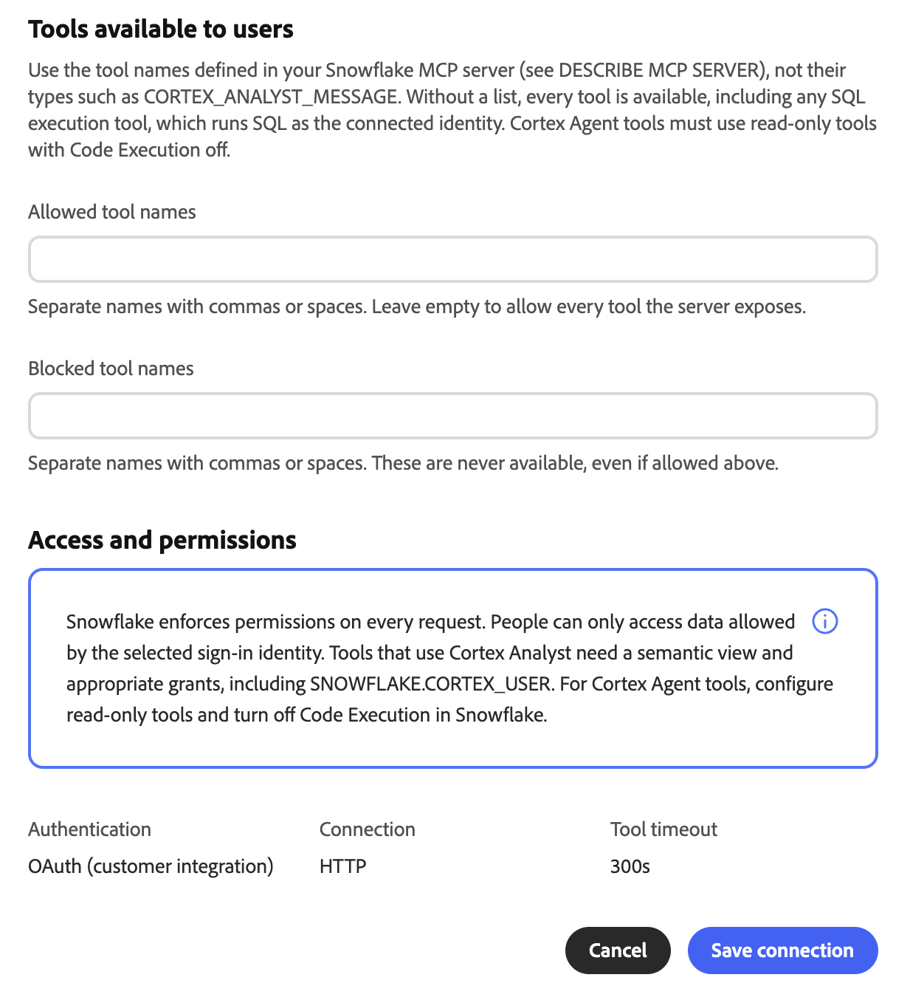
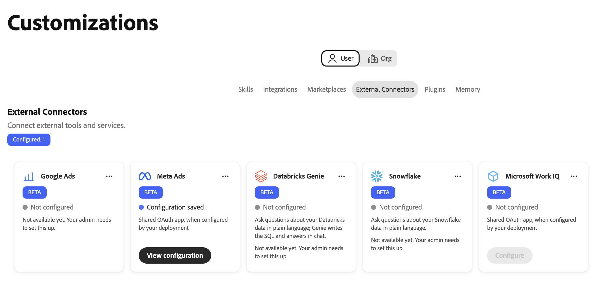
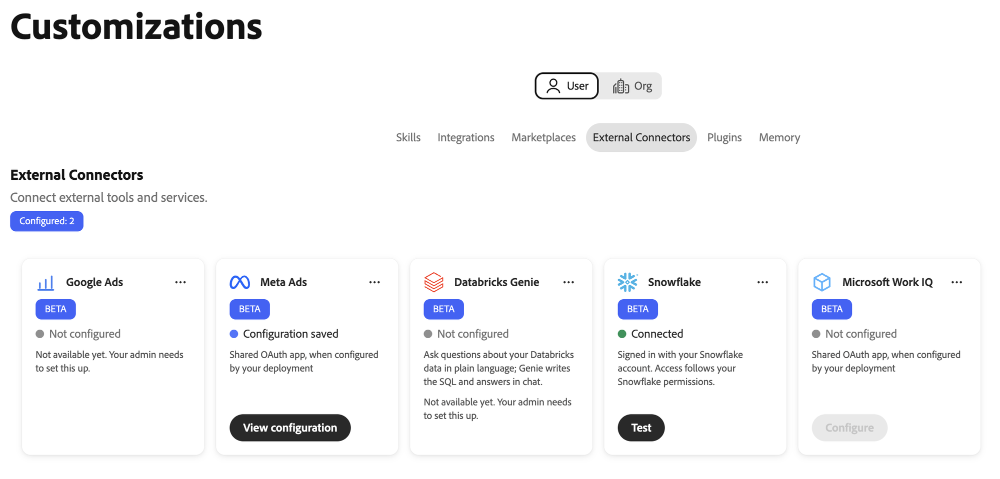
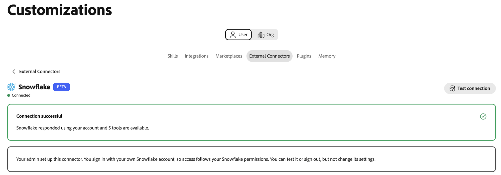
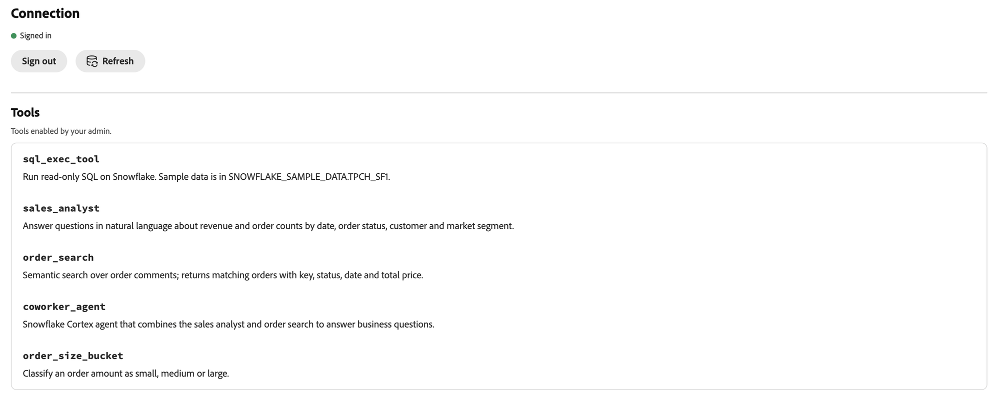

# Snowflake external connector {#snowflake}

Use the [!DNL Snowflake] external connector to ask questions about your [!DNL Snowflake] data in plain language in Adobe CX Enterprise Coworker. The connector links Coworker to a [!DNL Snowflake]-managed Model Context Protocol (MCP) server in your [!DNL Snowflake] account. Coworker can then use the tools that the server exposes, such as [!DNL Cortex Analyst], [!DNL Cortex Search], and SQL tools.

## Connector configuration {#connector-configuration}

The connector configuration process has two separate parts:

* **Organization setup:** An administrator connects Coworker to an existing [!DNL Snowflake] MCP server, chooses how people sign in, and selects the tools that members can use.
* **Member access:** Members use the connection with either a shared organization identity or their own [!DNL Snowflake] identity, depending on the sign-in option.

The administrator chooses one of the following sign-in options:

| Option | What the administrator provides | How access works |
| --- | --- | --- |
| **[!UICONTROL Organization service account]** | A [!DNL Snowflake] programmatic access token (PAT) for a service account. | All members use the permissions of the service account. Token expiration or revocation affects all members. |
| **[!UICONTROL Each person signs in]** | The client ID and client secret of a [!DNL Snowflake] OAuth integration, and an optional [!DNL Snowflake] role. | Each member signs in with their own [!DNL Snowflake] identity, and access follows their [!DNL Snowflake] permissions. |

Neither option grants [!DNL Snowflake] privileges that the selected identity does not already have. [!DNL Snowflake] enforces permissions on every request.

## Prerequisites {#prerequisites}

Coworker connects to an existing [!DNL Snowflake] MCP server. It does not create the server or its tools. Before you begin, make sure that you have the following:

* **For organization setup:** An account with permission to manage organization connectors in Coworker.
* **For the [!DNL Snowflake] MCP server:** The full HTTPS URL of the server, including its database, schema, and server name.
* **For the service account option:** A PAT for a dedicated service account. The service account role should have only the privileges needed for the MCP server and its tools.
* **For the per-person sign-in option:** A [!DNL Snowflake] OAuth integration with its client ID and client secret. You also need a [!DNL Snowflake] administrator who can register the Coworker redirect URL and configure the integration.

>[!IMPORTANT]
>
>Never share PATs, OAuth client secrets, or other credentials in screenshots, chats, or support tickets. Use organization secrets and a least-privileged [!DNL Snowflake] identity.

### Configure your Snowflake MCP server {#configure-snowflake-mcp-server}

A [!DNL Snowflake] administrator must complete the following tasks in [!DNL Snowflake] before you configure the connector:

1. Create the MCP server and define the tools it exposes.
1. Grant the required roles access to the MCP server, its tools, and the underlying objects.

   Access to the MCP server does not automatically grant access to every tool or object.

1. Set up authentication for the sign-in option you plan to use:

   * For the service account option, create a PAT for the service account.
   * For the per-person sign-in option, create an OAuth integration that issues refresh tokens.

For instructions, see the following [!DNL Snowflake] documentation:

* [Snowflake-managed MCP server](https://docs.snowflake.com/en/user-guide/snowflake-cortex/cortex-agents-mcp){target="_blank"}
* [CREATE MCP SERVER](https://docs.snowflake.com/en/sql-reference/sql/create-mcp-server){target="_blank"}
* [Overview of access control](https://docs.snowflake.com/en/user-guide/security-access-control-overview){target="_blank"}
* [Configure Snowflake OAuth for custom clients](https://docs.snowflake.com/en/user-guide/oauth-custom){target="_blank"}
* [Create security integration (Snowflake OAuth)](https://docs.snowflake.com/en/sql-reference/sql/create-security-integration-oauth-snowflake){target="_blank"}
* [Using programmatic access tokens for authentication](https://docs.snowflake.com/en/user-guide/programmatic-access-tokens){target="_blank"}

## Configure the connector for your organization {#configure-organization}

Administrators make the [!DNL Snowflake] connector available to everyone in the organization. Changes on the organization page apply to all users in your organization.

1. Open **[!UICONTROL Customizations]**, select **[!UICONTROL Org]**, and then select **[!UICONTROL External Connectors]**.

   {zoomable="yes"}

1. On the **[!UICONTROL Snowflake]** card, select **[!UICONTROL Configure]**.

   The **[!UICONTROL Connect Snowflake]** dialog opens.

1. In **[!UICONTROL Server URL]**, enter the full URL of your [!DNL Snowflake] MCP server. For more information, see [Server URL requirements](#server-url).

1. Under **[!UICONTROL Who signs in?]**, select a sign-in option and provide its credentials:

   * **[!UICONTROL Organization service account]:** See [Use an organization service account](#service-account).
   * **[!UICONTROL Each person signs in]:** See [Let each person sign in](#each-person-signs-in).

1. Under **[!UICONTROL Tools available to users]**, choose the tools that members can use. For more information, see [Choose available tools](#available-tools).

1. Review **[!UICONTROL Access and permissions]**, and then select **[!UICONTROL Save connection]**.

   The **[!UICONTROL Snowflake]** card shows **[!UICONTROL Configuration saved]**.

   {zoomable="yes"}

1. Select **[!UICONTROL View configuration]** to review the server URL, authentication type, and tool policy. Then select **[!UICONTROL Test connection]** to check access and discover the server tools.

A successful test does not confirm that every tool or [!DNL Snowflake] object is available to every member.

### Server URL requirements {#server-url}

The server URL must use HTTPS and follow this pattern:

```text
https://<account-host>/api/v2/databases/<database>/schemas/<schema>/mcp-servers/<server-name>
```

Coworker checks the URL before saving. Make sure that the URL meets the following requirements:

* The account hostname does not contain an underscore, including an encoded underscore (`%5F`).
* The URL does not include credentials.
* The database, schema, and server name match the MCP server in your [!DNL Snowflake] account.

### Use an organization service account {#service-account}

Select **[!UICONTROL Organization service account]** when all members should use the same [!DNL Snowflake] identity. Use a dedicated service account, not a personal account.

{zoomable="yes"}

Under **[!UICONTROL Service account token]**, select one of the following options:

* **[!UICONTROL Enter new]:** In **[!UICONTROL Programmatic access token]**, enter the PAT. Coworker stores the token as an organization secret.
* **[!UICONTROL Use an existing secret]:** Select the organization secret that contains the token. The secret must contain the complete value for the `Authorization` header, not only the raw token.

>[!IMPORTANT]
>
>Everyone who uses this connection acts with the permissions of the token owner. If the token expires or is revoked, the connection stops working for all members.

### Let each person sign in {#each-person-signs-in}

Select **[!UICONTROL Each person signs in]** when each member should use their own [!DNL Snowflake] identity and permissions.

{zoomable="yes"}

1. Copy the **[!UICONTROL Redirect URL]** from the dialog. Register this exact value as the redirect URI in your [!DNL Snowflake] OAuth integration.

   The redirect URL differs between environments. Always copy it from the dialog.

1. Under **[!UICONTROL OAuth integration credentials]**, select one of the following options:

   * **[!UICONTROL Enter new]:** Enter the **[!UICONTROL OAuth integration client ID]** and **[!UICONTROL OAuth integration client secret]**.
   * **[!UICONTROL Use an existing secret]:** Select the organization secrets that contain the client ID and client secret.

   Members never enter these credentials.

1. (Optional) In **[!UICONTROL Snowflake role]**, enter the role that each session uses.

   The role must be granted to your members and have access to the MCP server. Leave the field blank to use the default role of each member.

Coworker converts the role name to uppercase. Roles created with a quoted lowercase name cannot be used. If the OAuth integration blocks the role, or a member does not have the role, sign-in or access can fail.

The OAuth integration must be configured to issue refresh tokens.

### Choose available tools {#available-tools}

Each [!DNL Snowflake] MCP server defines its own tools, so the dialog does not show a fixed list. Enter tool names as defined in your MCP server, not tool types such as `CORTEX_ANALYST_MESSAGE`. To view the tool names, run `DESCRIBE MCP SERVER` in [!DNL Snowflake].

* **[!UICONTROL Allowed tool names]:** Enter the tools that members can use. Separate names with commas or spaces. Leave the field empty to allow every tool that the server exposes.
* **[!UICONTROL Blocked tool names]:** Enter the tools that members can never use. Blocked tools stay unavailable even if you also allow them.

{zoomable="yes"}

>[!IMPORTANT]
>
>If you leave **[!UICONTROL Allowed tool names]** empty, members can use every tool, including any SQL execution tool. SQL execution tools run SQL as the connected identity. Review the tool definitions on your server, and allow only the tools that your organization needs.

For [!DNL Cortex Analyst] tools, set up a semantic view and the required grants, including the `SNOWFLAKE.CORTEX_USER` database role. For [!DNL Cortex Agent] tools, configure read-only tools and turn off code execution in [!DNL Snowflake].

Members cannot change the tool selection.

## Use the connector as a member {#use-as-member}

After an administrator configures the connector, open it from your own **[!UICONTROL Customizations]** view. Members can test the connection or sign out, but cannot change its settings.

1. Open **[!UICONTROL Customizations]**, select **[!UICONTROL User]**, and then select **[!UICONTROL External Connectors]**.

   If the **[!UICONTROL Snowflake]** card shows **[!UICONTROL Not configured]**, ask your administrator to [configure the connector](#configure-organization).

   {zoomable="yes"}

1. Connect to [!DNL Snowflake], depending on the sign-in option that your administrator chose:

   * **Organization service account:** You do not need to sign in. Requests use the service account identity. Never enter or share the PAT.
   * **Each person signs in:** Start the sign-in, and then sign in with your [!DNL Snowflake] account. Complete any required single sign-on (SSO) or multi-factor authentication (MFA) steps, and confirm the requested role if one appears.

   After you connect, the **[!UICONTROL Snowflake]** card shows **[!UICONTROL Connected]**.

   {zoomable="yes"}

1. Open the **[!UICONTROL Snowflake]** connector details, and then select **[!UICONTROL Test connection]**.

   A successful test shows **[!UICONTROL Connection successful]** and the number of available tools.

   {zoomable="yes"}

1. Review the **[!UICONTROL Tools]** section to view the tools that your administrator enabled.

   Before you run a successful test, this section may show only the tool names. After the test, each tool appears with its description.

   {zoomable="yes"}

The tools in the example are defined by one [!DNL Snowflake] MCP server. The tools that you see depend on your server and the tool selection of your administrator.

The connector details also show the server URL, sign-in option, authentication type, and tool timeout. To disconnect your [!DNL Snowflake] account, select **[!UICONTROL Sign out]**.

A **[!UICONTROL Connected]** status does not guarantee access to a specific tool or data object. [!DNL Snowflake] grants, policies, and the selected role still apply.

## Troubleshoot access {#troubleshoot-access}

If setup, sign-in, or access fails, check the following with your administrator:

| Issue | What to check |
| --- | --- |
| The server URL is rejected | The URL uses HTTPS and the full `/api/v2/databases/<database>/schemas/<schema>/mcp-servers/<server-name>` path. The account hostname has no underscores, and the URL has no credentials. |
| The PAT cannot be created or used | The network policy, authentication policy, token expiration, and role of the service account. If you use an existing secret, confirm that it contains the complete `Authorization` header value. |
| The OAuth redirect URL does not match | The [!DNL Snowflake] OAuth integration has the exact redirect URL from the same Coworker environment. |
| Sign-in succeeds, but requests fail | The role is granted to the member and allowed by the OAuth integration. The integration issues refresh tokens, and the client ID and secret belong to the intended integration. |
| A tool is missing or denied | The **[!UICONTROL Allowed tool names]** and **[!UICONTROL Blocked tool names]** settings, the tool availability on the MCP server, and the [!DNL Snowflake] grants on the server, tool, and underlying objects. |
| A tool call times out | The **[!UICONTROL Tool timeout]** on the connector details. New connections use 300 seconds. Older connections without a saved timeout may use 60 seconds. |
